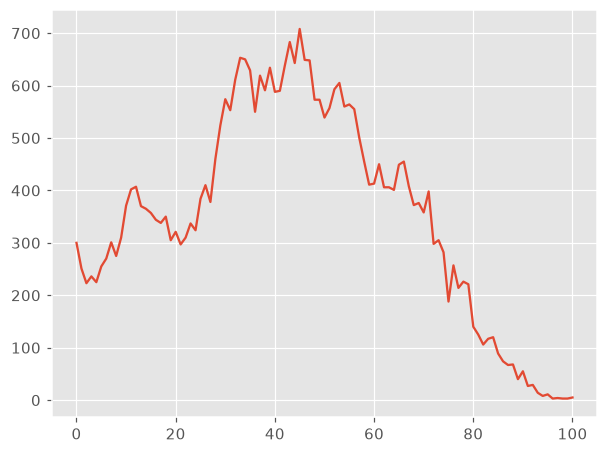
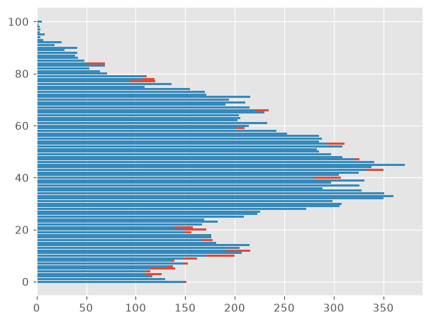
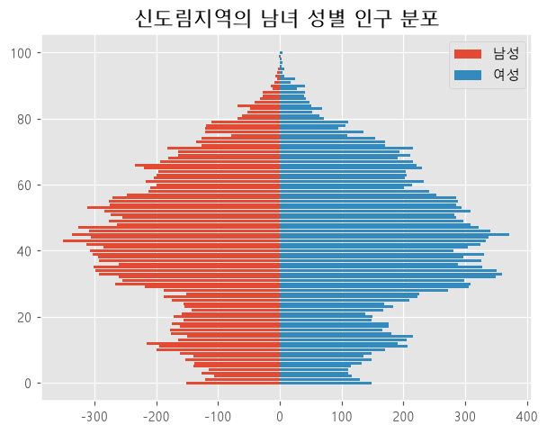
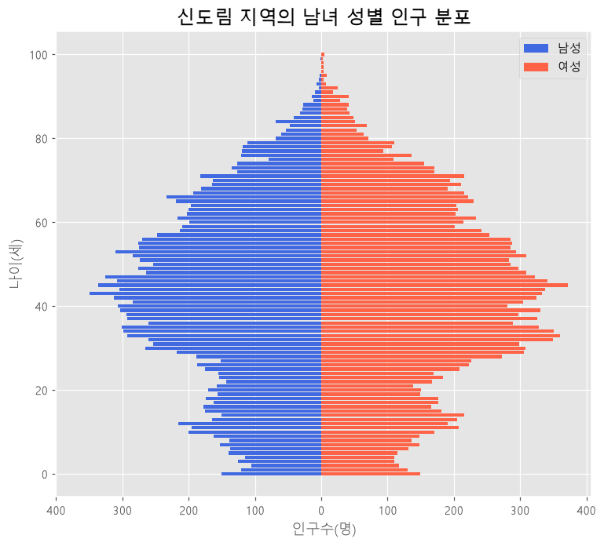

# 공공데이터 분석 ② 인구 — 우리 동네 인구 구조 그리기 (06.공공데이터-통계청.ipynb)

> 오늘 배운 것 한 줄 요약
> **표에서 "한 줄" 을 골라 → 글자를 숫자로 바꿔 → 리스트로 만들어 → 그래프로 그린다.**
> 같은 일을 for 문과 pandas 두 가지로 해 보고, 마지막에는 남녀 인구를 좌우로 펼친 **인구 피라미드**를 그렸다.

- 데이터 : `age.csv` (나이별 인구수), `gender.csv` (남녀 · 나이별 인구수) — 2026년 9월 기준 주민등록 인구
- 크기 : `age.csv` 3,919행 × 104열, `gender.csv` 207열
- 예제 지역 : 서울특별시 구로구 **신도림동** (총 35,688명)
- 데이터 폴더 : 이 글의 코드는 `./Data-Pandas/` 를 쓴다. 강의 코드에는 `./data/` 로 적혀 있으니 내 폴더 이름에 맞춰 바꾼다.
- 이 글의 코드는 직접 실행해서 노트북에 저장된 결과와 같은 값이 나오는지 확인했다. 그림은 그 실행 결과다.

> ⚠️ **내 컴퓨터의 파일 상태 (2026-10-14 확인) — 실행 전에 꼭 읽기**
>
> | 파일 | 상태 | 영향 |
> |---|---|---|
> | `Data-Pandas/age.csv` | **2026년 7월** 자료 (노트북 결과는 9월 자료) | 실행은 되지만 숫자가 조금 다르다 (신도림동 35,692명) |
> | `Data-Pandas/gender.csv` | **파일이 깨져 있다** | `read_csv` 에서 `ParserError` 가 난다 → [7-1](#7-1-gendercsv-가-깨져-있다) |
>
> 9월 `age.csv` 는 `다운로드` 폴더에 있다. `gender.csv` 는 새로 받아야 한다.

---

## 목차

0. [전체 흐름](#0-전체-흐름)
1. [데이터 읽고 살펴보기](#1-데이터-읽고-살펴보기)
2. [방법 ① for 문으로 한 지역의 나이별 인구 꺼내기](#2-방법--for-문으로-한-지역의-나이별-인구-꺼내기)
3. [나이별 인구 선 그래프](#3-나이별-인구-선-그래프)
4. [방법 ② pandas 스타일로 같은 일 하기](#4-방법--pandas-스타일로-같은-일-하기)
5. [성별 데이터 : 남자 · 여자 리스트 만들기](#5-성별-데이터--남자--여자-리스트-만들기)
6. [인구 피라미드 그리기](#6-인구-피라미드-그리기)
7. [코드 리뷰 — 알고 넘어갈 점](#7-코드-리뷰--알고-넘어갈-점)
8. [만날 수 있는 에러](#8-만날-수-있는-에러)
9. [한눈에 요약](#9-한눈에-요약)

---

## 0. 전체 흐름

| 단계 | 한 일 | 핵심 코드 |
|---|---|---|
| 1 | 파일 읽기 | `pd.read_csv(..., encoding='cp949')` |
| 2 | 한 지역의 줄 찾기 (for 문) | `iterrows()`, `in`, `break` |
| 3 | 글자 → 숫자 | `.replace(',', '')`, `int()` |
| 4 | 선 그래프 | `plt.plot(result)` |
| 5 | 같은 일을 pandas 로 | `.str.contains()`, `mask`, `.replace(regex=True)`, `.astype(int)` |
| 6 | 남 · 여 나누기 | `iloc[:, 3:104]`, `iloc[:, -101:]` |
| 7 | 인구 피라미드 | `plt.barh()` 두 번, 남성 값에 `-` 붙이기 |

기상청 데이터(05)에서는 **열 하나**(날짜별 기온)를 세로로 따라 내려갔다.
이번에는 반대로 **줄 하나**(한 지역)를 골라 **가로로** 값을 꺼낸다. 표의 모양이 다르기 때문이다.

---

## 1. 데이터 읽고 살펴보기

### 1-0. 경고 끄기

```python
import warnings

warnings.filterwarnings('ignore')
```

빨간 경고 문구(Warning)를 화면에 보이지 않게 한다. 경고는 에러가 아니라 "나중에 문제가 될 수 있다" 는 안내다.
화면은 깔끔해지지만 **쓸모 있는 안내도 함께 사라지므로**, 결과가 이상할 때는 이 줄을 빼고 다시 실행해 본다.

### 1-1. 읽기

```python
import pandas as pd

df = pd.read_csv('./Data-Pandas/age.csv', encoding='cp949')
df.head()
```

```
                          행정구역 2026년09월_계_총인구수 2026년09월_계_연령구간인구수 2026년09월_계_0세 ... 2026년09월_계_100세 이상
0          서울특별시  (1100000000)       9,279,861          9,279,861        49,203 ...              1,506
1       서울특별시 종로구 (1111000000)         135,842            135,842           463 ...                 43
2  서울특별시 종로구 청운효자동(1111051500)          10,601             10,601            37 ...                  3
3    서울특별시 종로구 사직동(1111053000)           8,823              8,823            24 ...                  5
4    서울특별시 종로구 삼청동(1111054000)           2,012              2,012             4 ...                  0

[5 rows x 104 columns]
```

`encoding='cp949'` 를 빼면 `UnicodeDecodeError` 가 난다. 이유는 05 정리의 1장과 같다(윈도우 엑셀에서 만든 한글 파일).

### 1-2. 표의 모양 — 한 줄이 한 지역이다

**행(3,919줄)** : 한 줄이 한 지역이다. 세 가지 크기의 지역이 섞여 있다.

| 종류 | 예 | 줄 번호 |
|---|---|---|
| 시 · 도 전체 | `서울특별시  (1100000000)` | 0 |
| 시 · 군 · 구 전체 | `서울특별시 종로구 (1111000000)` | 1 |
| 읍 · 면 · 동 | `서울특별시 종로구 청운효자동(1111051500)` | 2 |

괄호 안의 10자리 숫자는 행정구역 코드다.

**열(104개)** : 앞의 3개는 설명, 뒤의 101개가 나이별 인구수다.

| 열 번호 | 열 이름 | 뜻 |
|---|---|---|
| 0 | `행정구역` | 지역 이름 + 코드 |
| 1 | `..._계_총인구수` | 그 지역의 전체 인구 |
| 2 | `..._계_연령구간인구수` | 조회한 나이 범위(0 ~ 100세 이상)의 인구. 전체를 조회했으므로 1번과 같다 |
| **3 ~ 103** | `..._계_0세` ~ `..._계_100세 이상` | **나이별 인구수 (101개)** |

> 💡 **왜 101개인가** : 0세, 1세, ..., 99세가 100개이고 "100세 이상" 이 1개다.
> 그래서 **리스트의 순번이 곧 나이**가 된다. `result[0]` = 0세, `result[45]` = 45세, `result[100]` = 100세 이상.

### 1-3. 이 데이터의 함정 — 숫자가 전부 글자다

```python
df.dtypes.value_counts()   # str    104
```

104개 열이 **전부 `str`(글자)** 다. `9,279,861` 처럼 **천 단위 쉼표**가 들어 있어서 pandas 가 숫자로 읽지 못했다.

| 값 | 컴퓨터가 보는 것 | 계산 |
|---|---|---|
| `'9,279,861'` | 글자 9개 | 더하기 · 그래프 불가 |
| `9279861` | 숫자 | 가능 |

그래서 이번 실습의 핵심 작업은 **쉼표를 지우고 숫자로 바꾸는 것**이다.
빈칸(NaN)은 하나도 없다(`df.isna().sum().sum()` → 0).

---

## 2. 방법 ① for 문으로 한 지역의 나이별 인구 꺼내기

```python
# 신도림에 사는 사람들의 나이별 인구수를 리스트에 저장
result = []                                    # 결과를 담을 빈 리스트

for index, row in df.iterrows():               # 표를 한 줄씩 꺼낸다
    if '신도림' in str(row.iloc[0]):           # 그 줄의 0번 열(행정구역)에 '신도림' 이 들어 있으면
        for value in row.iloc[3:]:             # 3번 열부터 끝까지(0세 ~ 100세 이상) 하나씩
            value = str(value).replace(',', '')    # 쉼표 지우기 : '1,234' → '1234'
            result.append(int(value))              # 숫자로 바꿔 리스트에 추가
        break                                  # 찾았으니 for 문을 끝낸다

print(len(result))   # 101
print(result)        # [300, 251, 223, 236, 225, ..., 3, 4, 3, 3, 5]
```

for 문이 두 겹이다. **바깥 for 는 줄(지역)을 찾고, 안쪽 for 는 그 줄의 칸(나이)을 하나씩 꺼낸다.**

| 줄 | 하는 일 |
|---|---|
| `result = []` | 빈 리스트. **for 문 밖**에 한 번만 쓴다 |
| `for index, row in df.iterrows()` | `index` = 줄 번호, `row` = 그 줄 전체(시리즈) |
| `row.iloc[0]` | 그 줄의 0번 칸 = 행정구역 이름 |
| `'신도림' in 글자` | 글자 안에 '신도림' 이 **들어 있으면** True |
| `str(...)` | 혹시 글자가 아닌 값(NaN 등)이 있어도 `in` 에서 에러가 나지 않게 글자로 바꾼다 |
| `row.iloc[3:]` | 3번 칸부터 끝까지. 앞의 3칸(이름, 총인구수, 연령구간인구수)을 건너뛴다 |
| `.replace(',', '')` | 쉼표를 빈 글자로 바꾼다 = 쉼표를 지운다 |
| `int(value)` | 글자 `'300'` 을 숫자 `300` 으로 |
| `result.append(...)` | 리스트 맨 뒤에 붙인다 |
| `break` | **바깥 for 문**을 멈춘다 |

### `in` — "들어 있나?"

```python
'신도림' in '서울특별시 구로구 신도림동(1153051000)'   # True
'신도림' in '서울특별시 종로구 사직동(1111053000)'     # False
```

`==` 는 "완전히 같은가" 이고 `in` 은 "일부라도 들어 있는가" 다. 행정구역 칸에는 시 · 구 이름과 코드까지 붙어 있으므로 `==` 로는 찾을 수 없고 `in` 을 써야 한다.

### `break` 가 하는 일

- 신도림동은 **279번 줄**에 있다. `break` 가 있으면 280번째 줄에서 멈추고, 없으면 3,919줄을 끝까지 돈다.
- 더 중요한 이유 : **조건에 맞는 줄이 여러 개일 때** `break` 가 없으면 그 줄들의 값이 전부 `result` 에 이어 붙는다.
  예를 들어 `'남양주'` 는 19줄이 맞는다(남양주시 전체 1줄 + 읍 · 면 · 동 18줄). `break` 가 없으면 `result` 가 101개가 아니라 1,919개가 된다.
- `break` 는 `if` 안, 안쪽 for 문 **밖**에 있어야 한다(들여쓰기 주의). 안쪽 for 안에 쓰면 0세 값 하나만 넣고 끝난다.

> 🔍 **코드 리뷰** : 노트북의 주석은 "남양주에 사는 사람들의…" 인데 코드는 `'신도림'` 을 찾는다.
> 지역을 바꿔 실행하면서 주석을 안 고친 것이다. 주석과 코드가 다르면 나중에 헷갈리니 함께 고친다.

### 결과 읽기 (신도림동, 2026년 9월)

| | 값 |
|---|---|
| 전체 인구 | 35,688명 (`sum(result)`, 표의 총인구수와 같다) |
| 가장 많은 나이 | **45세, 708명** (`max(result)`, `result.index(708)`) |
| 0 ~ 14세 | 4,561명 |
| 15 ~ 64세 | 25,212명 |
| 65세 이상 | 5,915명 |

`sum(result)` 가 표의 총인구수와 같은지 확인하면 **열을 정확히 101개 꺼냈는지** 검증할 수 있다.

---

## 3. 나이별 인구 선 그래프

```python
import matplotlib.pyplot as plt

plt.style.use('ggplot')   # 회색 바탕 + 흰 격자 스타일
plt.plot(result)
plt.show()
```



- `plt.plot(리스트)` 처럼 **값을 하나만** 주면 그 값이 y 가 되고, x 는 자동으로 `0, 1, 2, ...` (리스트의 순번)가 된다.
  순번이 곧 나이이므로 **x축 = 나이, y축 = 인구수** 그래프가 된다.
- 읽는 법 : 30 ~ 50대가 가장 많고(봉우리가 45세), 10대 초반에 작은 봉우리가 있다(30 ~ 40대의 자녀 세대). 80세부터는 빠르게 줄어든다.

> 💡 `plt.style.use('ggplot')` 은 **한 번 실행하면 그 뒤의 모든 그래프에 적용된다.**
> 그래서 뒤에 나오는 막대그래프도 회색 바탕으로 그려진다. 커널을 다시 시작하면 원래대로 돌아간다.

---

## 4. 방법 ② pandas 스타일로 같은 일 하기

2장의 두 겹 for 문을 **for 없이** 쓴 것이다.

```python
# pandas 스타일
mask = df.iloc[:, 0].astype(str).str.contains('남양주')
row = df.loc[mask].head(1)

result = row.iloc[:, 3:].replace(',', '', regex=True).astype(int).values.flatten().tolist()
print(len(result))   # 101
```

### 4-1. 줄 찾기 : `mask`

```python
mask = df.iloc[:, 0].astype(str).str.contains('남양주')
```

| 순서 | 부분 | 하는 일 |
|---|---|---|
| ① | `df.iloc[:, 0]` | 모든 줄의 0번 열 = 행정구역 열 전체 |
| ② | `.astype(str)` | 글자로 바꾼다 (이미 글자지만 안전하게) |
| ③ | `.str.contains('남양주')` | 칸마다 '남양주' 가 **들어 있으면 True**, 아니면 False |

결과 `mask` 는 True / False 가 3,919개 늘어선 시리즈다. `.str.contains()` 는 for 문의 `in` 을 **열 전체에 한 번에** 적용한 것이다.

```python
row = df.loc[mask].head(1)
```

- `df.loc[mask]` : mask 가 True 인 줄만 고른다 → 남양주는 **19줄**
- `.head(1)` : 그중 **첫 줄만** → `경기도 남양주시 (4136000000)` (시 전체, 727,066명). for 문의 `break` 와 같은 역할이다.

> 💡 파일에서 **시 · 군 · 구 전체 줄이 그 아래 동들보다 먼저** 나온다. 그래서 `'남양주'` 처럼 시 이름을 넣으면 `head(1)` 이 시 전체 줄을 고른다.
>
> ⚠️ `row` 는 한 줄이지만 **여전히 데이터프레임(1행 × 104열)** 이다. 시리즈가 아니다. 뒤에서 `.flatten()` 이 필요한 이유다.

### 4-2. 꺼내서 숫자 리스트로 : 메서드를 줄줄이 잇기

```python
result = row.iloc[:, 3:].replace(',', '', regex=True).astype(int).values.flatten().tolist()
```

왼쪽부터 차례로 실행된다. 앞 단계의 결과에 다음 단계를 이어 붙이는 방식(**메서드 체이닝**)이다.

| 순서 | 부분 | 하는 일 | 결과의 모양 |
|---|---|---|---|
| ① | `row.iloc[:, 3:]` | 3번 열부터 끝까지 (0세 ~ 100세 이상) | 데이터프레임 1행 × 101열, 값은 `'3,810'` 같은 글자 |
| ② | `.replace(',', '', regex=True)` | 모든 칸에서 쉼표를 지운다 | `'3810'` (아직 글자) |
| ③ | `.astype(int)` | 글자를 정수로 | `3810` (숫자) |
| ④ | `.values` | pandas 의 껍데기를 벗겨 numpy 배열로 | 2차원 배열, 모양 `(1, 101)` → `[[3810, 3736, ...]]` |
| ⑤ | `.flatten()` | 2차원을 1차원으로 편다 | 모양 `(101,)` → `[3810, 3736, ...]` |
| ⑥ | `.tolist()` | numpy 배열을 파이썬 리스트로 | `[3810, 3736, ...]` |

④ ~ ⑥ 이 필요한 이유 : 데이터프레임은 **표(2차원)** 라서 그대로 꺼내면 대괄호가 두 겹인 `[[...]]` 이 된다. 그래프에 넣을 것은 한 겹짜리 `[...]` 다.

### 4-3. `regex=True` 와 `regex=False` ⭐

노트북 메모의 내용이다. 데이터프레임의 `.replace()` 에서 이 옵션에 따라 결과가 완전히 달라진다.

| | 바꾸는 대상 | `'3,810'` 에 `.replace(',', '')` |
|---|---|---|
| `regex=False` (기본값) | 칸의 값이 **통째로** `','` 와 같을 때만 | 그대로 `'3,810'` (칸 전체가 `','` 는 아니므로) |
| `regex=True` | 칸의 글자 **안에서** `','` 를 찾아 | `'3810'` |

직접 실행해 확인한 결과 :

```python
row.iloc[:, 3:].replace(',', '', regex=False)   # ['3,810', '3,736', '3,488', ...]  ← 안 바뀜
row.iloc[:, 3:].replace(',', '', regex=True)    # ['3810',  '3736',  '3488',  ...]
```

`regex=False` 로 두고 `.astype(int)` 를 하면 에러가 난다.

```
ValueError: invalid literal for int() with base 10: '3,810'
```

> ⚠️ **헷갈리는 점 — 이름이 같은 `replace` 가 세 가지다.**
>
> | 쓰는 곳 | 예 | 글자의 일부를 바꾸나 |
> |---|---|---|
> | 파이썬 글자 | `'3,810'.replace(',', '')` | 바꾼다 (2장에서 쓴 것) |
> | pandas 의 `.str` | `시리즈.str.replace(',', '')` | 바꾼다 |
> | 데이터프레임 · 시리즈 | `df.replace(',', '')` | **안 바꾼다.** `regex=True` 를 줘야 바꾼다 |
>
> 데이터프레임의 `.replace()` 는 원래 "값 A 를 값 B 로 통째로 교체" 하는 기능이기 때문이다(예 : `df.replace('?', 0)`).

> 💡 **신도림동에서는 `regex=False` 로도 에러가 안 난다.** 나이별 인구가 전부 1,000명 미만이라 쉼표가 하나도 없기 때문이다.
> 작은 동에서는 되고 시 · 구 단위에서는 터지는 코드가 된다. **작은 지역으로만 시험하면 이런 문제를 놓친다.**

### 4-4. for 문 방식과 pandas 방식 비교

| 하는 일 | for 문 (2장) | pandas (4장) |
|---|---|---|
| 줄 찾기 | `if '신도림' in str(row.iloc[0])` | `.str.contains('신도림')` → `mask` |
| 첫 줄만 | `break` | `.head(1)` |
| 나이 열만 | `row.iloc[3:]` | `row.iloc[:, 3:]` |
| 쉼표 지우기 | `str(value).replace(',', '')` | `.replace(',', '', regex=True)` |
| 숫자로 | `int(value)` | `.astype(int)` |
| 리스트로 | `result.append(...)` | `.values.flatten().tolist()` |

`row.iloc[3:]` 과 `row.iloc[:, 3:]` 의 차이 : for 문의 `row` 는 **시리즈(1차원)** 라서 위치 하나만 쓰고, pandas 방식의 `row` 는 **데이터프레임(2차원)** 이라서 `[행, 열]` 두 개를 쓴다.

두 방식의 결과는 같다(같은 지역으로 실행해 리스트가 일치하는 것을 확인했다).

---

## 5. 성별 데이터 : 남자 · 여자 리스트 만들기

```python
import pandas as pd

df = pd.read_csv('./Data-Pandas/gender.csv', encoding='cp949')

# 지역 입력
name = input('지역명을 입력하세요: ')
mask = df.iloc[:, 0].astype(str).str.contains(name)
row = df.loc[mask].head(1)

male = (row.iloc[:, 3:104]
          .replace(',', '', regex=True)
          .astype(int)
          .values
          .flatten()
          .tolist())

female = (row.iloc[:, -101:]
          .replace(',', '', regex=True)
          .astype(int)
          .values
          .flatten()
          .tolist())

print("남자:", len(male))     # 남자: 101
print("여자:", len(female))   # 여자: 101

print("남자:", male)     # [151, 121, 106, 126, 115, ...]
print("여자:", female)   # [149, 130, 117, 110, 110, ...]
```

> ⚠️ 지금 내 `gender.csv` 로는 `read_csv` 줄에서 `ParserError` 가 난다. 파일이 깨져 있기 때문이다. → [7-1](#7-1-gendercsv-가-깨져-있다)

### 5-1. `gender.csv` 의 열 구조 (207열)

`age.csv` 의 "계" 묶음 대신 **남자 묶음 + 여자 묶음**이 나란히 붙어 있다.

| 열 번호 | 열 이름 | 뜻 |
|---|---|---|
| 0 | `행정구역` | 지역 이름 |
| 1 | `..._남_총인구수` | 남자 전체 |
| 2 | `..._남_연령구간인구수` | |
| **3 ~ 103** | `..._남_0세` ~ `..._남_100세 이상` | **남자 나이별 (101개)** |
| 104 | `..._여_총인구수` | 여자 전체 |
| 105 | `..._여_연령구간인구수` | |
| **106 ~ 206** | `..._여_0세` ~ `..._여_100세 이상` | **여자 나이별 (101개)** |

1 + 103 + 103 = 207열이다.

### 5-2. 슬라이싱 두 가지

```python
row.iloc[:, 3:104]    # 남자 : 3번부터 103번까지
row.iloc[:, -101:]    # 여자 : 뒤에서 101개
```

| 코드 | 읽는 법 | 고르는 열 |
|---|---|---|
| `3:104` | 3번부터 **104번 앞까지** (끝 번호는 포함하지 않는다) | 3 ~ 103 → 104 − 3 = 101개 |
| `-101:` | **뒤에서 101번째부터 끝까지** | 106 ~ 206 → 101개 |

- 여자 열은 `106:207` 또는 `106:` 으로 써도 같다. `-101:` 은 "앞에 열이 몇 개 있든 맨 뒤 101개" 라는 뜻이라서 번호를 세지 않아도 된다.
- 끝 번호를 `103` 으로 쓰면 100세 이상 열이 빠져 100개가 된다. `len()` 으로 **101개인지 꼭 확인**한다(노트북에서도 출력해 확인했다).

### 5-3. `input()` — 실행할 때 값을 입력받기

```python
name = input('지역명을 입력하세요: ')
```

- 실행하면 입력 칸이 뜨고, 적은 글자가 `name` 에 저장된다. 코드를 고치지 않고 지역을 바꿔 볼 수 있다.
- **VS Code 에서는 입력 칸이 화면 맨 위 가운데에 뜬다.** 셀이 계속 실행 중이라면 입력을 기다리는 것이다. 값을 적고 Enter 를 누른다.
- `input()` 의 결과는 항상 **글자**다. 여기서는 지역 이름이라 그대로 쓰면 된다.
- 노트북의 저장된 결과는 `신도림` 을 입력한 것이다.

### 5-4. 괄호로 감싸 여러 줄로 쓰기

```python
male = (row.iloc[:, 3:104]
          .replace(',', '', regex=True)
          .astype(int)
          .values
          .flatten()
          .tolist())
```

4장에서는 한 줄로 길게 썼던 것을 줄마다 한 단계씩 나눠 썼다. **전체를 `( )` 로 감싸면** 파이썬이 괄호가 닫힐 때까지를 한 문장으로 본다.
괄호 없이 줄만 바꾸면 `SyntaxError` 가 난다. 한 줄에 한 단계라서 읽기 쉽고, 중간 단계를 `#` 으로 잠깐 꺼 보기도 편하다.

### 5-5. 결과 읽기 (신도림동)

| | 남자 | 여자 |
|---|---|---|
| 전체 | 17,109명 | 18,579명 |
| 가장 많은 나이 | 43세, 350명 | 45세, 372명 |
| 20 ~ 39세 | 4,526명 | 5,283명 |
| 65세 이상 | 2,759명 | 3,156명 |
| 85세 이상 | 182명 | 318명 |

- 여자가 1,470명 더 많다. 101개 나이 중 73개 나이에서 여자가 더 많다.
- **검산** : 나이마다 `남자 + 여자` 를 더한 리스트가 2장의 `result`(`age.csv`) 와 완전히 같다. 두 파일에서 열을 정확히 꺼냈다는 뜻이다.

---

## 6. 인구 피라미드 그리기

### 6-1. 첫 시도 : 그냥 두 번 그리면 겹친다

```python
# barh 시각화
import matplotlib.pyplot as plt

plt.barh(range(101), male)
plt.barh(range(101), female)
plt.show()
```



- `plt.barh(y 위치, 막대 길이)` : **가로 막대그래프**. `bar` 뒤의 `h` 는 horizontal(가로)이다.
- `range(101)` : 0 ~ 100. 막대 101개를 놓을 y 위치 = 나이. **`male` 의 개수(101)와 같아야 한다.**
- **문제** : 두 막대가 모두 0 에서 오른쪽으로 뻗어서 **나중에 그린 여자(파랑)가 남자(빨강)를 덮는다.**
  빨강은 남자가 더 많은 나이에서 끝부분만 살짝 보인다. 남녀를 비교할 수 없다.

### 6-2. 해결 : 남자 값을 음수로 바꿔 왼쪽으로 뻗게 한다

```python
import matplotlib.pyplot as plt

plt.rcParams['font.family'] = 'Malgun Gothic'   # 한글 글꼴. 맥은 'AppleGothic'
plt.rcParams['axes.unicode_minus'] = False      # 마이너스(-) 부호 깨짐 방지

plt.title(name + '지역의 남녀 성별 인구 분포')

plt.barh(range(101), [-x for x in male], label='남성')   # 남성 : 음수 → 왼쪽으로
plt.barh(range(101), female, label='여성')               # 여성 : 양수 → 오른쪽으로

plt.legend()
plt.show()
```



막대의 길이가 **음수면 0 에서 왼쪽으로** 그려진다. 남자 값에만 `-` 를 붙이면 가운데 0 을 기준으로 남자는 왼쪽, 여자는 오른쪽으로 펼쳐진다.
이런 모양의 그래프를 **인구 피라미드**라고 한다.

| 줄 | 뜻 |
|---|---|
| `plt.rcParams['font.family'] = 'Malgun Gothic'` | 윈도우에 설치된 '맑은 고딕' 을 이름으로 지정. 제목과 범례에 한글이 있어서 필요하다 |
| `plt.rcParams['axes.unicode_minus'] = False` | x축에 `-300` 같은 음수가 나오므로 **이번에는 꼭 필요하다.** 없으면 `-` 가 □ 로 깨진다 |
| `name + '지역의 …'` | 글자끼리 `+` 하면 이어 붙는다 → `'신도림지역의 남녀 성별 인구 분포'` |
| `label='남성'` + `plt.legend()` | 범례. `label` 만 쓰고 `plt.legend()` 를 빼면 안 나온다 |

> 💡 05 에서는 글꼴 파일 경로(`malgun.ttf`)로 설정했고, 여기서는 **글꼴 이름**으로 설정했다. 윈도우에 맑은 고딕이 설치돼 있으므로 둘 다 된다. 이름으로 쓰는 쪽이 짧다.
>
> 💡 6-1 의 그래프에는 한글이 없어서 글꼴 설정 없이도 깨지지 않았다.

### 6-3. 리스트 컴프리헨션 : `[-x for x in male]`

**리스트의 값마다 같은 계산을 해서 새 리스트를 만드는** 한 줄짜리 문법이다.

```python
[-x for x in male]
```

읽는 법 : "`male` 에서 하나씩 꺼내 `x` 라 하고(`for x in male`), 그 `-x` 를 모아 리스트로 만든다."
아래 for 문과 같은 일을 한다(노트북의 test code 셀).

```python
result = []
for x in male:
    result.append(x * -1)
```

| | 값 |
|---|---|
| `male` | `[151, 121, 106, ...]` |
| `[-x for x in male]` | `[-151, -121, -106, ...]` |

- 모양 : `[계산식 for 변수 in 리스트]`
- **리스트에 바로 `-` 를 붙일 수는 없다.** `-male` 은 `TypeError: bad operand type for unary -: 'list'` 가 난다. 파이썬 리스트는 통째로 계산하지 못하기 때문이다.
- `male` 자체는 바뀌지 않는다. 새 리스트가 만들어질 뿐이다.

> 🔍 **코드 리뷰** : 노트북 test code 셀에는 `result = [-2, -3]` 로 적혀 있다. 빈 리스트 `[]` 로 시작해야 `[-x for x in male]` 과 같은 결과가 된다(연습용으로 넣어 본 값으로 보인다).
> 또 이 셀은 지금 전부 주석인데 아래에 `[-151, -121, ...]` 출력이 남아 있다. **주석을 달기 전에 실행한 결과가 지워지지 않은 것**이다. 셀을 다시 실행하면 출력이 사라진다.

### 6-4. 그래프 읽기

- **가운데가 볼록한 모양** : 30 ~ 50대가 가장 많다. 일하는 나이의 인구가 많은 도시 지역의 모양이다.
- **아래가 좁다** : 0 ~ 9세가 2,646명으로, 40대(6,293명)의 절반이 안 된다.
- **10대 초반이 다시 볼록하다** : 30 ~ 40대의 자녀 세대다.
- **위로 갈수록 오른쪽(여성)이 길다** : 85세 이상은 남자 182명, 여자 318명.

### 6-5. 더 다듬기 (노트북에 없는 내용)

6-2 의 그래프는 x축에 `-300`, `-200` 이 그대로 보인다. 인구가 음수일 수는 없으니, **눈금에 적히는 글자만** 양수로 바꾼다.

```python
plt.figure(figsize=(8, 7))

plt.barh(range(101), [-x for x in male], color='royalblue', label='남성')
plt.barh(range(101), female, color='tomato', label='여성')

ticks = range(-400, 401, 100)                 # 눈금을 놓을 위치 : -400, -300, ..., 400
plt.xticks(ticks, [abs(t) for t in ticks])    # 그 위치에 적을 글자 : 400, 300, ..., 0, ..., 400

plt.title(f'{name} 지역의 남녀 성별 인구 분포', size=16)
plt.xlabel('인구수(명)')
plt.ylabel('나이(세)')
plt.legend()
plt.show()
```



| 코드 | 뜻 |
|---|---|
| `plt.xticks(위치, 글자)` | 눈금의 **위치는 그대로 두고 적히는 글자만** 바꾼다 |
| `abs(t)` | 절댓값. `abs(-300)` → `300` |
| `[abs(t) for t in ticks]` | 6-3 의 리스트 컴프리헨션을 한 번 더 쓴 것 |
| `color=` | 막대 색을 직접 지정 |
| `f'{name} 지역의 …'` | f-문자열. `name + '…'` 과 같은 결과를 더 읽기 쉽게 쓴다 |

> ⚠️ `range(-400, 401, 100)` 은 신도림동에 맞춘 값이다. 인구가 훨씬 많은 지역(시 · 구 전체)을 그릴 때는 눈금 범위를 그에 맞게 바꾼다.

---

## 7. 코드 리뷰 — 알고 넘어갈 점

### 7-1. `gender.csv` 가 깨져 있다

지금 `Data-Pandas/gender.csv` 로 5장의 코드를 실행하면 이 에러가 난다.

```
ParserError: Error tokenizing data. C error: Expected 207 fields in line 1027, saw 326
```

뜻 : "한 줄에 칸이 207개여야 하는데 1027번째 줄에는 326개가 있다."

파일을 직접 열어 확인한 내용 :

| 확인한 것 | 결과 |
|---|---|
| 줄 수 | 2,415줄 (`age.csv` 는 3,920줄) → **약 1,500개 지역이 없다** |
| 깨진 곳 | 2군데(902번째, 1027번째 줄). 데이터 대신 **빈 바이트(`\x00`)가 약 1.3MB** 들어 있다 |
| `문서\카카오워크 받은 파일\gender.csv` | 크기와 내용이 완전히 같다 → **받을 때부터 깨져 있었다** |

코드가 틀린 것이 아니라 **파일 전송 중에 내용이 손상된 것**이다. 노트북에 결과가 남아 있는 것은 정상 파일로 실행한 결과가 저장돼 있기 때문이다.

**해결** : 파일을 다시 받는다(강사님께 다시 요청하거나 원본 사이트에서 내려받기).

**임시로 실행만 해 보려면** : 깨진 줄을 건너뛰게 한다.

```python
df = pd.read_csv('./Data-Pandas/gender.csv', encoding='cp949', on_bad_lines='skip')
```

- 2,411개 지역만 읽힌다. `신도림` 은 들어 있어서 이 글의 그림을 그릴 수 있었지만, **`남양주` 등 빠진 지역은 조회되지 않는다.**
- 빠진 지역을 입력하면 7-2 의 에러가 난다. 연습용 임시방편일 뿐이고, 분석에는 정상 파일을 써야 한다.

> 💡 **파일이 의심스러울 때 확인하는 법** : 메모장으로 열어 중간에 이상한 공백 덩어리가 있는지 보거나, `age.csv` 와 줄 수를 비교한다. 두 파일은 같은 지역 목록이므로 줄 수가 같아야 한다.

### 7-2. 없는 지역 이름을 넣으면

`mask` 가 전부 False → `row` 가 0줄 → `male`, `female` 이 **빈 리스트 `[]`** 가 된다. 리스트를 만드는 곳에서는 에러가 나지 않고, 그래프에서 에러가 난다.

```
ValueError: shape mismatch: objects cannot be broadcast to a single shape.
Mismatch is between 'width' with shape (0,) and 'y' with shape (101,).
```

뜻 : "y 위치는 101개인데 막대 길이는 0개다." 에러가 난 곳(그래프)과 원인(지역 이름)이 떨어져 있어서 찾기 어렵다.
찾은 줄이 있는지 먼저 확인하면 원인을 바로 알 수 있다.

```python
row = df.loc[mask].head(1)

if len(row) == 0:
    print(f"'{name}' 이(가) 들어간 지역이 없습니다.")
else:
    print('찾은 지역 :', row.iloc[0, 0])   # 어느 줄이 골라졌는지 확인
```

### 7-3. `head(1)` 은 "첫 번째로 걸린 줄" 일 뿐이다

| 입력 | 맞는 줄 수 | `head(1)` 이 고르는 줄 |
|---|---|---|
| `신도림` | 1 | 서울특별시 구로구 신도림동 |
| `남양주` | 19 | 경기도 남양주시 (시 전체) |
| `중구` | 73 | **서울특별시 중구** (부산 · 대구 · 인천 등의 중구는 뒤에 있다) |
| `서울` | 453 | 서울특별시 (전체) |

원하는 지역이 아닐 수 있으니 **7-2 처럼 `row.iloc[0, 0]` 을 출력해 확인**한다. 정확히 고르려면 `'부산광역시 중구'` 처럼 더 길게 입력한다.

### 7-4. `str.contains()` 는 입력을 정규식으로 읽는다

`str.contains()` 도 기본이 정규식이다. 그래서 `(`, `)`, `+`, `?`, `.` 같은 기호가 들어간 글자를 넣으면 에러가 나거나 엉뚱하게 찾는다.

```python
df.iloc[:, 0].str.contains('(')
# PatternError: missing ), unterminated subpattern at position 0
```

입력한 글자 그대로 찾게 하려면 `regex=False` 를 준다.

```python
mask = df.iloc[:, 0].astype(str).str.contains(name, regex=False)
```

> 💡 `regex` 옵션이 두 곳에 나오는데 기본값이 반대다.
> `df.replace()` 는 기본이 `regex=False`, `.str.contains()` 는 기본이 `regex=True`.

### 7-5. 한 줄만 다룰 때는 시리즈로 꺼내면 더 짧다

`row` 가 데이터프레임(2차원)이라서 `.values.flatten()` 이 필요했다. **줄 하나를 시리즈(1차원)로** 꺼내면 그 과정이 없어진다.

```python
s = df.loc[mask].iloc[0, 3:]                       # 첫 줄의 3번 열부터 → 시리즈
result = s.str.replace(',', '').astype(int).tolist()
```

- `.iloc[0, 3:]` : 0번째 줄, 3번 열부터. 줄 번호를 숫자 하나로 쓰면 결과가 시리즈가 된다.
- 시리즈의 `.str.replace()` 는 글자의 일부를 바꾸므로 `regex=True` 도 필요 없다.
- 4장의 방식과 결과가 같은 것을 확인했다.

### 7-6. 읽을 때부터 숫자로 : `thousands=','`

쉼표 때문에 글자로 읽힌 것이므로, `read_csv` 에 **"쉼표는 천 단위 구분 기호다"** 라고 알려 주면 처음부터 숫자로 읽는다.

```python
df = pd.read_csv('./Data-Pandas/age.csv', encoding='cp949', thousands=',')

df.dtypes.value_counts()   # int64 103개, str 1개(행정구역)
df.iloc[0, 1]              # 9279861  ← 숫자
```

이렇게 읽으면 `.replace()` 와 `.astype(int)` 가 모두 필요 없다.

```python
result = df.loc[mask].iloc[0, 3:].tolist()
```

수업에서는 **글자를 숫자로 바꾸는 과정**을 익히려고 직접 바꿨다. 실제로 분석할 때는 이 옵션이 가장 간단하다.

### 7-7. 데이터의 출처

노트북 제목은 "통계청" 이지만, 열 이름(`2026년09월_계_0세`)과 행정구역 코드로 보면 이 파일은 **행정안전부 주민등록 인구통계**(jumin.mois.go.kr)의 "연령별 인구현황" 을 내려받은 모양이다.
조회 기간을 바꿔 받으면 열 이름의 `2026년09월` 부분이 달라진다. 내 `Data-Pandas/age.csv` 가 `2026년07월` 인 것도 그래서다.
코드는 **열 이름이 아니라 열 번호(`iloc`)** 로 꺼내기 때문에 어느 달 파일이든 그대로 동작한다.

---

## 8. 만날 수 있는 에러

| 에러 | 원인 | 해결 |
|---|---|---|
| `UnicodeDecodeError: 'utf-8' codec can't decode byte 0xc7 ...` | cp949 파일을 utf-8 로 읽음 | `encoding='cp949'` |
| `FileNotFoundError: ... './data/age.csv'` | 폴더 이름이 다름 | `./Data-Pandas/age.csv` |
| `ParserError: Expected 207 fields in line 1027, saw 326` | `gender.csv` 파일이 깨짐 | 파일을 다시 받는다 ([7-1](#7-1-gendercsv-가-깨져-있다)) |
| `ValueError: invalid literal for int() with base 10: '3,810'` | 쉼표가 남은 글자를 숫자로 바꾸려 함 | `.replace(',', '', regex=True)` |
| `ValueError: shape mismatch ... 'width' with shape (0,) and 'y' with shape (101,)` | 지역을 못 찾아 리스트가 비었음 | 지역 이름 확인 ([7-2](#7-2-없는-지역-이름을-넣으면)) |
| `ValueError: shape mismatch ... (100,) ... (101,)` | 열을 100개만 꺼냄 (`3:103`) | `3:104`, `len()` 으로 확인 |
| `TypeError: bad operand type for unary -: 'list'` | `-male` — 리스트에 바로 `-` | `[-x for x in male]` |
| `PatternError: missing ), unterminated subpattern` | 입력에 `(` 같은 정규식 기호 | `.str.contains(name, regex=False)` |
| `SyntaxError` (여러 줄로 나눈 체이닝) | 전체를 `( )` 로 감싸지 않음 | `male = ( ... )` |
| `NameError: name 'male' is not defined` | 5장의 셀을 실행하지 않고 그래프 셀을 실행 | 위 셀부터 차례로 실행 |
| 셀이 끝나지 않고 계속 실행 중 | `input()` 이 입력을 기다림 | VS Code 화면 맨 위의 입력 칸에 적고 Enter |
| 그래프의 한글이 □□□ | 한글 글꼴 설정 안 함 | `plt.rcParams['font.family'] = 'Malgun Gothic'` |
| x축의 `-` 가 □ | 마이너스 부호 설정 안 함 | `plt.rcParams['axes.unicode_minus'] = False` |

---

## 9. 한눈에 요약

1. 이 데이터는 **한 줄 = 한 지역**, **3번 열부터 101개 = 0세 ~ 100세 이상**. 리스트의 순번이 곧 나이다
2. 숫자에 **천 단위 쉼표**가 있으면 글자로 읽힌다. 쉼표를 지우고 `int` 로 바꿔야 계산할 수 있다
3. 글자 안에 들어 있는지 : 파이썬은 **`in`**, pandas 는 **`.str.contains()`**
4. 첫 줄만 쓰기 : for 문은 **`break`**, pandas 는 **`.head(1)`**
5. 데이터프레임의 `.replace()` 는 **`regex=True`** 를 줘야 글자의 일부를 바꾼다. 기본값은 "칸 전체가 같을 때만"
6. 한 줄짜리 데이터프레임 → 리스트 : **`.values.flatten().tolist()`** (2차원 → 1차원 → 리스트)
7. 슬라이싱 `3:104` 는 104번을 포함하지 않는다(101개). `-101:` 은 뒤에서 101개. **`len()` 으로 개수 확인**
8. `plt.plot(리스트)` 는 x 를 자동으로 0, 1, 2 ... 로 놓는다
9. `plt.barh(위치, 길이)` 는 가로 막대. **길이가 음수면 왼쪽으로** 뻗는다 → 인구 피라미드
10. **`[-x for x in male]`** = 리스트의 값마다 계산해 새 리스트를 만든다 (리스트 컴프리헨션)
11. 긴 체이닝은 전체를 `( )` 로 감싸 줄마다 한 단계씩 쓴다
12. 결과를 검산한다 : `sum(result)` = 총인구수, `남자 + 여자` = 계

### 이 데이터로 알아낸 것 (신도림동, 2026년 9월)

| 질문 | 답 |
|---|---|
| 전체 인구 | 35,688명 (남 17,109 · 여 18,579) |
| 가장 많은 나이 | 45세, 708명 |
| 남자가 가장 많은 나이 | 43세, 350명 |
| 여자가 가장 많은 나이 | 45세, 372명 |
| 65세 이상 | 5,915명 (전체의 약 17%) |
| 인구 구조의 모양 | 30 ~ 50대가 볼록한 항아리 모양 |
