# pandas · matplotlib · seaborn · folium 시각화 총정리

> 데이터를 표로만 보면 흐름이 안 보인다. **그래프로 그리면 한눈에 보인다.**
> 이 글은 pandas 의 `plot()` 과 matplotlib 으로 그래프를 그리는 방법을 처음부터 정리한 것이다.
> 선 · 막대 · 히스토그램 · 산점도 · 버블 · 파이 · 박스 · 면적 그래프, 그리고 꾸미기(제목, 범례, 주석, 화면 분할)까지 다룬다.
> 뒤쪽에는 통계 그래프를 짧은 코드로 그리는 **seaborn**(11장)과 지도 위에 데이터를 올리는 **folium**(12장)을 정리했다.

- 실습 환경 : Python, pandas 3.0, matplotlib 3.11, seaborn 0.13, folium 0.20, Jupyter Notebook(VS Code)
- 실습 데이터 : `남북한발전전력량.xlsx`, `시도별 전출입 인구수.xlsx`, `auto-mpg.csv`, seaborn 의 `titanic`,
  `서울지역 대학교 위치.xlsx`, `경의중앙선_역위치.csv`, `경기도인구데이터.xlsx`, `경기도행정구역경계.json`
- 데이터 폴더 : 이 글의 코드는 `./Data-Pandas/` 를 쓴다. 노트북(`03. pandas(시각화).ipynb`)에는 강의 폴더 이름인 `./data/` 로 적혀 있으니, 내 컴퓨터의 폴더 이름에 맞춰 바꿔서 실행한다. ([13-8](#13-8-모듈이나-파일을-못-찾는다))
- 이 글의 모든 코드는 직접 실행해서 확인했고, 그림은 그 실행 결과다. 단, folium 지도는 그림이 아니라 HTML 이라서 이 글에는 그림이 없다. 코드를 실행해 직접 확인한다.

---

## 목차

1. [먼저 알아 둘 큰 그림](#1-먼저-알아-둘-큰-그림)
2. [준비 : import · 한글 글꼴 · 스타일](#2-준비--import--한글-글꼴--스타일)
3. [pandas plot 으로 빠르게 그리기](#3-pandas-plot-으로-빠르게-그리기)
4. [그래프용 데이터 만들기 (인구 이동 데이터)](#4-그래프용-데이터-만들기-인구-이동-데이터)
5. [matplotlib 기본 : plt 로 그리고 꾸미기](#5-matplotlib-기본--plt-로-그리고-꾸미기)
6. [그래프에 주석 달기 : annotate](#6-그래프에-주석-달기--annotate)
7. [Figure 와 Axes : 객체로 그리기](#7-figure-와-axes--객체로-그리기)
8. [화면을 나눠 그래프 여러 개 그리기](#8-화면을-나눠-그래프-여러-개-그리기)
9. [그래프 종류별 정리](#9-그래프-종류별-정리)
10. [그래프를 파일로 저장하기](#10-그래프를-파일로-저장하기)
11. [seaborn : 통계 그래프를 짧은 코드로](#11-seaborn--통계-그래프를-짧은-코드로)
12. [folium : 지도 위에 데이터 올리기](#12-folium--지도-위에-데이터-올리기)
13. [내가 만난 에러와 함정 모음](#13-내가-만난-에러와-함정-모음)
14. [한눈에 요약 (치트시트)](#14-한눈에-요약-치트시트)

---

## 1. 먼저 알아 둘 큰 그림

그래프를 그리는 방법은 세 가지다. 셋 다 결국 matplotlib 이 그린다.

| 방법 | 코드 모양 | 언제 쓰나 |
|---|---|---|
| ① pandas plot | `df.plot(kind='bar')` | 표를 **빨리** 그래프로 보고 싶을 때 |
| ② plt 방식 | `plt.plot(x, y)` → `plt.title(...)` | 그래프 **1개**를 꾸밀 때 |
| ③ 객체(ax) 방식 | `fig = plt.figure()` → `ax = fig.add_subplot()` → `ax.plot(...)` | 그래프 **여러 개**를 한 화면에 그릴 때 |

①로 그린 그래프도 `plt.title()` 같은 ②의 명령으로 꾸밀 수 있다. 그래서 보통 **①로 그리고 ②로 꾸민다.**

### 가장 중요한 규칙 3가지

1. **pandas plot 은 "행 인덱스 = x축, 열 하나 = 선(막대) 하나"** 로 그린다.
   원하는 모양이 안 나오면 `.T` 로 행과 열을 뒤집는다.
2. **값이 숫자여야 한다.** 숫자처럼 보여도 자료형이 `object`(글자 취급)면 `pd.to_numeric()` 으로 바꾼다.
3. **Jupyter 에서는 그래프 하나를 한 셀 안에서 끝낸다.** 만들기 → 그리기 → 꾸미기 → `plt.show()` 를 두 셀로 나누면 그래프가 안 나온다. ([13장](#13-내가-만난-에러와-함정-모음) 참고)

---

## 2. 준비 : import · 한글 글꼴 · 스타일

<!-- run -->
```python
import pandas as pd
import matplotlib.pyplot as plt          # 보통 plt 로 줄여 쓴다
from matplotlib import font_manager, rc

# 한글 글꼴 설정 : matplotlib 기본 글꼴에는 한글이 없어 □□□ 로 깨진다
font_path = './Data-Pandas/malgun.ttf'                                # 글꼴 파일(맑은 고딕) 위치
font_name = font_manager.FontProperties(fname=font_path).get_name()   # 파일에서 글꼴 이름 꺼내기 → 'Malgun Gothic'
rc('font', family=font_name)                                          # 모든 그래프의 글꼴로 설정

plt.rcParams['axes.unicode_minus'] = False   # 한글 글꼴에서 마이너스(-) 부호가 깨지는 것 방지
```

### 한글 글꼴 코드 뜯어 보기

```python
font_name = font_manager.FontProperties(fname=font_path).get_name()
```

| 부분 | 하는 일 |
|---|---|
| `font_manager` | matplotlib 에서 글꼴을 다루는 도구 상자 |
| `.FontProperties(fname=font_path)` | 글꼴 파일을 읽어 글꼴 정보 객체를 만든다. `fname` = **f**ile **name** |
| `.get_name()` | 그 객체에서 글꼴의 진짜 이름을 꺼낸다 |

파일 이름(`malgun.ttf`)과 글꼴 이름(`Malgun Gothic`)은 다르다. `rc()` 는 글꼴을 **이름**으로 지정하기 때문에 이름을 먼저 꺼내는 것이다.
Windows 라면 `rc('font', family='Malgun Gothic')` 한 줄만 써도 된다.

### 그래프 스타일

```python
print(plt.style.available)   # 쓸 수 있는 스타일 이름 목록
plt.style.use('ggplot')      # 회색 배경 + 흰 격자선
```

- `plt.style.use()` 는 **한 번 적용하면 그 뒤의 모든 그래프에 계속 적용**된다.
- 자주 쓰는 스타일 : `'ggplot'`, `'classic'`, `'bmh'`, `'fivethirtyeight'`, `'dark_background'`
- 기본으로 되돌리기 : `plt.style.use('default')`

> ⚠️ **스타일에 따라 글꼴 설정이 초기화되기도 한다.** 직접 확인해 보니 `'ggplot'`, `'bmh'`,
> `'fivethirtyeight'`, `'dark_background'` 는 한글 글꼴이 그대로 남고, `'classic'`, `'seaborn-v0_8'`,
> `'default'` 는 기본 글꼴로 되돌아간다. 스타일을 바꾼 뒤 한글이 깨지면 `rc('font', family=font_name)` 을
> 다시 실행한다. **스타일 → 글꼴** 순서로 쓰면 어떤 스타일이든 안전하다.

<!-- run -->
```python
plt.style.use('ggplot')
rc('font', family=font_name)                 # 스타일 적용 후 글꼴 설정 (어떤 스타일이든 안전한 순서)
plt.rcParams['axes.unicode_minus'] = False
```

---

## 3. pandas plot 으로 빠르게 그리기

### 3-1. 데이터 준비 (남북한 발전량)

<!-- run -->
```python
df = pd.read_excel('./Data-Pandas/남북한발전전력량.xlsx', engine='openpyxl')

# iloc[행, 열] : 0번 행(남한 합계), 5번 행(북한 합계) / 2번 열부터 끝까지(연도 열만)
df_ns = df.iloc[[0, 5], 2:]
df_ns.index = ['South', 'North']   # 행 이름을 알아보기 쉽게 변경
```

```
       1990  1991  1992  1993 ...  2016
South  1077  1186  1310  1444 ...  5404
North   277   263   247   221 ...   239
```

### 3-2. 선 그래프 — 그리고 `.T` 가 필요한 이유

<!-- run -->
```python
df_ns.plot()   # kind 를 안 쓰면 선 그래프(kind='line')
```
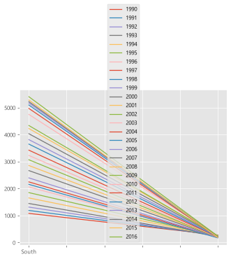

x축이 South, North 두 칸뿐이고 선이 연도마다 하나씩(27개) 그려졌다. 원하던 그림이 아니다.
**pandas plot 은 행 인덱스를 x축에 놓기 때문**이다. 연도를 x축에 놓으려면 행과 열을 뒤집는다.

<!-- run -->
```python
tdf_ns = df_ns.T   # 전치 : 행 = 연도, 열 = South, North
tdf_ns.plot()
```
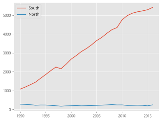

이제 x축 = 연도, 선 2개(South, North)로 연도별 변화가 보인다.

### 3-3. 막대 그래프

<!-- run -->
```python
tdf_ns.plot(kind='bar')   # 가로 막대는 kind='barh'
```
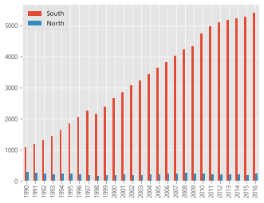

### 3-4. 히스토그램 — `pd.to_numeric()` 이 필요한 이유

<!-- run -->
```python
# 글자 취급(object)인 열을 숫자로 변환. 원본을 바꾸지 않으므로 = 로 다시 넣는다
tdf_ns['North'] = pd.to_numeric(tdf_ns['North'])
tdf_ns['South'] = pd.to_numeric(tdf_ns['South'])

tdf_ns.plot(kind='hist')
```
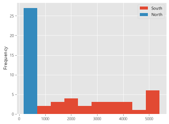

- **히스토그램** = 값을 구간으로 나눠, 구간마다 몇 개가 들어 있는지 센 그래프
  (x축 = 발전량 구간, y축 Frequency = 그 구간에 속한 연도 수)
- 막대 그래프는 값을 그대로 막대 높이로 쓰지만, 히스토그램은 **구간을 계산**해야 해서 값이 반드시 숫자여야 한다.

> 💡 **왜 숫자가 글자 취급이 됐을까?** 원본 엑셀의 다른 칸에 `-` 같은 글자가 섞여 있으면
> 그 열 전체가 `object` 가 된다. `df.dtypes` 로 확인하고, 계산·그래프 전에 `pd.to_numeric()` 으로 바꾼다.
> 바꿀 수 없는 값이 섞여 있으면 `pd.to_numeric(..., errors='coerce')` 로 NaN 처리한다.
> 표 전체를 한 번에 바꾸려면 `df = df.apply(pd.to_numeric)`.

### 3-5. `kind` 종류 한눈에

| kind | 그래프 | 주로 보는 것 |
|---|---|---|
| `'line'` (기본) | 선 그래프 | 시간에 따른 변화 |
| `'bar'` / `'barh'` | 세로 / 가로 막대 | 항목끼리 크기 비교 |
| `'hist'` | 히스토그램 | 값이 어디에 몰려 있나(분포) |
| `'scatter'` | 산점도 | 두 값 사이의 관계 (x, y 필수) |
| `'box'` | 박스 플롯 | 분포 요약, 이상치 |
| `'area'` | 면적 그래프 | 누적된 양의 변화 |
| `'pie'` | 파이 차트 | 전체에서 차지하는 비율 |

자주 쓰는 공통 옵션 : `figsize=(가로, 세로)`, `color`, `alpha`(투명도 0~1), `title`

---

## 4. 그래프용 데이터 만들기 (인구 이동 데이터)

그래프보다 **그래프에 넣을 데이터를 다듬는 과정**이 더 길다. 여기서 쓰는 문법은 계속 반복된다.

<!-- run -->
```python
df = pd.read_excel('./Data-Pandas/시도별 전출입 인구수.xlsx', engine='openpyxl', header=0)

# ① 병합 셀 때문에 생긴 NaN 을 바로 위 칸의 값으로 채우기
df = df.ffill()

# ② 서울에서 다른 지역으로 이동한 행만 고르기 (불린 인덱싱)
mask = (df['전출지별'] == '서울특별시') & (df['전입지별'] != '서울특별시')
df_seoul = df[mask]

# ③ 필요 없는 열 삭제 → 열 이름 변경 → 지역 이름을 행 인덱스로
df_seoul = df_seoul.drop(['전출지별'], axis=1)
df_seoul = df_seoul.rename(columns={'전입지별': '전입지'})
df_seoul.set_index('전입지', inplace=True)

# ④ 서울 → 경기도 한 줄만 꺼내기 (시리즈 : 인덱스 = 연도, 값 = 이동 인구수)
sr_one = df_seoul.loc['경기도']
```

### 단계별 문법

| 단계 | 코드 | 뜻 |
|---|---|---|
| ① | `df.ffill()` | **f**orward **fill**. 빈칸을 바로 위 값으로 채운다 (전국, NaN, NaN → 전국, 전국, 전국) |
| ② | `(조건1) & (조건2)` | 두 조건을 모두 만족. `&` = 그리고, `\|` = 또는. **조건마다 괄호 필수** |
| ② | `df[mask]` | mask 가 True 인 행만 남긴다 |
| ③ | `drop([...], axis=1)` | 열 삭제 (`axis=1` 을 빼면 행에서 찾다가 에러) |
| ③ | `rename(columns={옛:새})` | 열 이름 변경 |
| ③ | `set_index('열')` | 그 열을 행 이름표로 → `loc['경기도']` 로 찾을 수 있다 |
| ④ | `df.loc['이름']` | 행 1개 → **시리즈** |
| ④ | `df.loc[['이름1', '이름2']]` | 행 여러 개 → **데이터프레임** (대괄호 2겹) |

### 연도 열 이름 목록 만들기

<!-- run -->
```python
col_years = list(map(str, range(1970, 2018)))   # ['1970', '1971', ..., '2017']

# 행(지역 3개)과 열(연도)을 한 번에 고르기
df_3 = df_seoul.loc[['충청남도', '경상북도', '강원도'], col_years]
```

`list(map(str, range(1970, 2018)))` 를 안쪽부터 읽으면 :

1. `range(1970, 2018)` → 1970 ~ 2017 의 숫자 (끝 숫자 2018 은 미포함)
2. `map(str, ...)` → 숫자마다 `str()` 을 적용해 글자로 바꾼다
3. `list(...)` → 리스트로 만든다

이 데이터의 열 이름이 숫자 `1970` 이 아니라 **글자 `'1970'`** 이라서 글자 목록이 필요하다.

---

## 5. matplotlib 기본 : plt 로 그리고 꾸미기

### 5-1. 가장 간단한 선 그래프

```python
plt.plot(sr_one.index, sr_one.values)   # plt.plot(x, y)
plt.plot(sr_one)                        # 시리즈를 바로 넣어도 된다 (인덱스 = x, 값 = y)
```

### 5-2. 꾸민 선 그래프

<!-- run -->
```python
plt.figure(figsize=(14, 5))                  # ① 그림 크기 (가로 14인치, 세로 5인치)
plt.xticks(size=10, rotation='vertical')     # ② x축 눈금 글자 : 크기 10, 세로로 회전

plt.plot(sr_one.index, sr_one.values, marker='o', markersize=10)   # ③ 점이 찍힌 선

plt.title('서울 -> 경기 인구 이동', size=30)  # ④ 제목
plt.xlabel('기간', size=20)                  # ⑤ x축 이름
plt.ylabel('이동 인구수', size=20)            # ⑥ y축 이름

plt.legend(labels=['서울 -> 경기'], loc='best', fontsize=15)   # ⑦ 범례
plt.show()                                   # ⑧ 화면에 출력
```
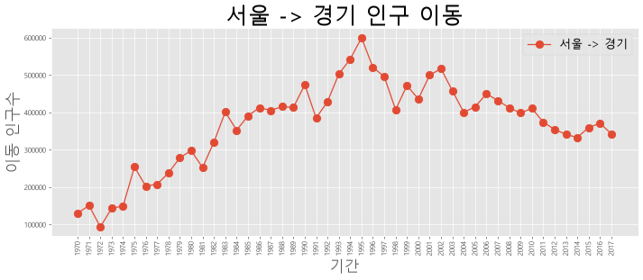

### 5-3. 명령 정리

| 명령 | 하는 일 | 주의 |
|---|---|---|
| `plt.figure(figsize=(가로, 세로))` | 도화지 크기 | **plot 보다 먼저** 쓴다 |
| `plt.plot(x, y)` | 선 그래프 | |
| `plt.title('제목', size=30)` | 제목 | |
| `plt.xlabel()` / `plt.ylabel()` | 축 이름 | |
| `plt.xticks(rotation=...)` | x축 눈금 글자 회전 | `'vertical'`, `'horizontal'`, 숫자(각도). **소문자** |
| `plt.ylim(최소, 최대)` | y축 범위 | `plt.xlim()` 도 같다 |
| `plt.legend(labels=[...], loc=...)` | 범례 | `labels` (복수형 s) |
| `plt.show()` | 화면에 출력 | 셀의 마지막에 |

### 5-4. `plot()` 의 선 · 점 옵션

| 옵션 | 뜻 | 예 |
|---|---|---|
| `marker` | 점 모양 | `'o'` 동그라미, `'s'` 네모, `'^'` 세모, `'*'` 별 |
| `markersize` | 점 크기 | `10` |
| `markerfacecolor` | 점 안쪽 색 | `'green'` |
| `color` | 선 색 | `'olive'`, `'#FF7F50'` |
| `linewidth` (`lw`) | 선 굵기 | `2` |
| `linestyle` (`ls`) | 선 모양 | `'-'` 실선, `'--'` 파선, `':'` 점선 |
| `label` | 범례에 표시할 이름 | `'서울 -> 충남'` |

### 5-5. 범례 위치 `loc`

| 숫자 | 글자 | 위치 |
|---|---|---|
| 0 | `'best'` | 선을 가리지 않는 자리 자동 선택 |
| 1 | `'upper right'` | 오른쪽 위 |
| 2 | `'upper left'` | 왼쪽 위 |
| 3 | `'lower left'` | 왼쪽 아래 |
| 4 | `'lower right'` | 오른쪽 아래 |
| 5 | `'right'` | 오른쪽 |
| 6 | `'center left'` | 왼쪽 가운데 |
| 7 | `'center right'` | 오른쪽 가운데 |
| 8 | `'lower center'` | 아래 가운데 |
| 9 | `'upper center'` | 위 가운데 |
| 10 | `'center'` | 정가운데 |

숫자보다 글자로 쓰는 편이 나중에 읽기 쉽다.

### 5-6. 범례 이름을 붙이는 두 가지 방법

```python
# 방법 1 : legend 에서 한꺼번에 (그린 순서대로 이름이 붙는다)
plt.plot(x, y)
plt.legend(labels=['서울 -> 경기'])

# 방법 2 : plot 마다 label 로 붙이고, legend 는 호출만
plt.plot(x, y, label='서울 -> 경기')
plt.legend()
```

선이 여러 개면 **방법 2**가 순서를 헷갈릴 일이 없어 안전하다.

---

## 6. 그래프에 주석 달기 : annotate

`plt.annotate()` 는 그래프 위에 **화살표나 글자**를 그려 넣는다.

<!-- run -->
```python
plt.figure(figsize=(14, 5))
plt.xticks(size=10, rotation='vertical')
plt.plot(sr_one.index, sr_one.values, marker='o', markersize=10)

plt.title('서울 -> 경기 인구 이동', size=30)
plt.xlabel('기간', size=20)
plt.ylabel('이동 인구수', size=20)
plt.legend(labels=['서울 -> 경기'], loc='best', fontsize=15)

# y축 범위 지정 : 주석을 넣을 공간 확보
plt.ylim(50000, 800000)

# 주석 - 화살표 : 글자 없이('') 화살표만. xytext(시작점) → xy(끝점, 화살촉)
plt.annotate('',
             xy=(20, 620000),       # 화살표 끝점
             xytext=(2, 290000),    # 화살표 시작점
             xycoords='data',       # 좌표를 데이터 값 기준으로 해석
             arrowprops=dict(arrowstyle='->', color='skyblue', lw=5))   # 화살표 서식

# 주석 - 글자 : xy = 글자가 놓일 위치
plt.annotate('인구이동 증가(1970-1995)',
             xy=(10, 550000),
             rotation=25,           # 글자를 25도 기울임
             va='baseline',         # 세로 정렬
             ha='center',           # 가로 정렬
             fontsize=15)

plt.show()
```
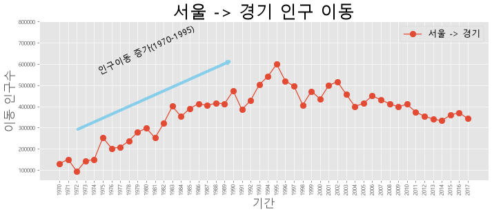

### 꼭 알아야 할 점 : x 좌표는 "몇 번째 눈금인지"

x축이 `'1970'`, `'1971'` 같은 **글자**일 때, matplotlib 은 내부에서 왼쪽부터 0, 1, 2 ... 번호를 붙인다.
그래서 `xy=(20, 620000)` 의 20 은 "20년" 이 아니라 **21번째 눈금(= 1990)** 이다.

| 옵션 | 뜻 |
|---|---|
| `xy` | 화살표 끝점. 화살표가 없으면 글자 위치 |
| `xytext` | 화살표 시작점 (글자가 있으면 글자 위치) |
| `arrowprops=dict(...)` | 화살표 서식. `arrowstyle` 모양, `color` 색, `lw` 굵기 |
| `rotation` | 글자 기울기(각도) |
| `va` | vertical alignment. 세로 정렬 (`'baseline'`, `'top'`, `'center'`, `'bottom'`) |
| `ha` | horizontal alignment. 가로 정렬 (`'left'`, `'center'`, `'right'`) |

---

## 7. Figure 와 Axes : 객체로 그리기

지금까지는 `plt.` 로 "지금 그리고 있는 그래프"에 명령했다.
그래프가 여러 개가 되면 **어느 그래프에 명령하는지** 분명히 해야 한다. 그래서 그래프에 이름을 붙여 다룬다.

- **Figure (fig)** = 도화지 전체
- **Axes (ax)** = 도화지 위의 그래프 한 칸

```python
fig = plt.figure(figsize=(20, 5))   # 도화지 만들기
ax = fig.add_subplot(1, 1, 1)       # (행 수, 열 수, 몇 번째 칸) → 1행 1열의 1번째 칸
```

### 7-1. 한 그래프에 선 여러 개 그리기

<!-- run -->
```python
fig = plt.figure(figsize=(20, 5))
ax = fig.add_subplot(1, 1, 1)

# 같은 ax 에 plot 을 여러 번 → 선이 겹쳐 그려진다
ax.plot(col_years, df_3.loc['충청남도', :], marker='o', markerfacecolor='green',
        markersize=10, color='olive', linewidth=2, label='서울 -> 충남')
ax.plot(col_years, df_3.loc['경상북도', :], marker='o', markerfacecolor='blue',
        markersize=10, color='blue', linewidth=2, label='서울 -> 경북')
ax.plot(col_years, df_3.loc['강원도', :], marker='o', markerfacecolor='magenta',
        markersize=10, color='magenta', linewidth=2, label='서울 -> 강원')

ax.legend(loc='best')                                        # 범례 (plot 의 label 을 모아 표시)
ax.set_title('서울 -> 충남, 경북, 강원 인구 이동', size=20)   # 제목
ax.set_xlabel('기간', size=12)                               # x축 이름
ax.set_ylabel('이동 인구수', size=12)                         # y축 이름

ax.tick_params(axis='x', labelsize=10, labelrotation=70)     # x축 눈금 글자 : 크기 10, 70도 회전
ax.tick_params(axis='y', labelsize=10)

plt.show()
```
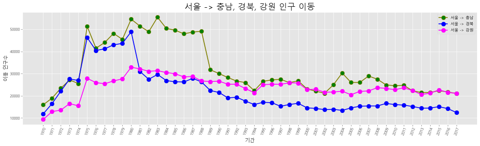

### 7-2. plt 방식 ↔ ax 방식 대응표

ax 방식은 이름 앞에 **`set_`** 이 붙는 것이 많다.

| 하는 일 | plt 방식 | ax 방식 |
|---|---|---|
| 선 그리기 | `plt.plot()` | `ax.plot()` |
| 제목 | `plt.title()` | `ax.set_title()` |
| x축 이름 | `plt.xlabel()` | `ax.set_xlabel()` |
| y축 이름 | `plt.ylabel()` | `ax.set_ylabel()` |
| y축 범위 | `plt.ylim()` | `ax.set_ylim()` |
| 범례 | `plt.legend()` | `ax.legend()` |
| 눈금 글자 회전 | `plt.xticks(rotation=70)` | `ax.tick_params(axis='x', labelrotation=70)` |
| 주석 | `plt.annotate()` | `ax.annotate()` |

### 7-3. 눈금 글자를 회전할 때 `set_xticklabels` 를 피하는 이유

교재에 자주 나오는 아래 코드는 요즘 matplotlib 에서 **경고**가 난다.

```python
ax.set_xticklabels(col_years, rotation=70)
# UserWarning: set_ticklabels() should only be used with a fixed number of ticks ...
```

"눈금 **위치**를 정하지 않고 **이름표**만 바꾸면 엉뚱한 자리에 붙을 수 있다" 는 뜻이다.
회전만 하려는 것이라면 이름표를 새로 붙일 필요가 없으니 `tick_params` 를 쓴다.

```python
ax.tick_params(axis='x', labelrotation=70)   # 경고 없음
```

이름표 자체를 바꿔야 한다면 **위치를 먼저** 정한다.

```python
ax.set_xticks([1, 2, 3])                     # 위치 먼저
ax.set_xticklabels(['USA', 'EU', 'JAPAN'])   # 그다음 이름표
```

---

## 8. 화면을 나눠 그래프 여러 개 그리기

`fig.add_subplot(행 수, 열 수, 몇 번째)` 로 도화지를 나눈다. 번호는 **왼쪽 위부터 오른쪽으로, 그다음 아래 줄** 순서다.

```
add_subplot(2, 2, n)

┌───────┬───────┐
│   1   │   2   │
├───────┼───────┤
│   3   │   4   │
└───────┴───────┘
```

<!-- run -->
```python
df_4 = df_seoul.loc[['충청남도', '경상북도', '강원도', '전라남도'], col_years]

# 그래프 객체 생성 : 2행 2열 → 그래프 4개
fig = plt.figure(figsize=(20, 10))
ax1 = fig.add_subplot(2, 2, 1)
ax2 = fig.add_subplot(2, 2, 2)
ax3 = fig.add_subplot(2, 2, 3)
ax4 = fig.add_subplot(2, 2, 4)

# 칸마다 선 하나씩
ax1.plot(col_years, df_4.loc['충청남도', :], marker='o', markerfacecolor='green',
         markersize=10, color='olive', linewidth=2, label='서울 -> 충남')
ax2.plot(col_years, df_4.loc['경상북도', :], marker='o', markerfacecolor='blue',
         markersize=10, color='skyblue', linewidth=2, label='서울 -> 경북')
ax3.plot(col_years, df_4.loc['강원도', :], marker='o', markerfacecolor='red',
         markersize=10, color='magenta', linewidth=2, label='서울 -> 강원')
ax4.plot(col_years, df_4.loc['전라남도', :], marker='o', markerfacecolor='orange',
         markersize=10, color='yellow', linewidth=2, label='서울 -> 전남')

# 범례 표시
ax1.legend(loc='best')
ax2.legend(loc='best')
ax3.legend(loc='best')
ax4.legend(loc='best')

# 차트 제목 추가
ax1.set_title('서울 -> 충남 인구 이동', size=15)
ax2.set_title('서울 -> 경북 인구 이동', size=15)
ax3.set_title('서울 -> 강원 인구 이동', size=15)
ax4.set_title('서울 -> 전남 인구 이동', size=15)

# x축 눈금 글자 90도 회전
ax1.tick_params(axis='x', labelrotation=90)
ax2.tick_params(axis='x', labelrotation=90)
ax3.tick_params(axis='x', labelrotation=90)
ax4.tick_params(axis='x', labelrotation=90)

plt.show()
```
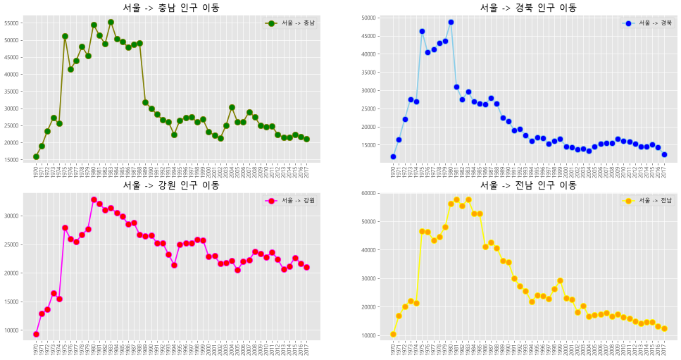

> 💡 그래프끼리 글자가 겹치면 `plt.show()` 앞에 `plt.tight_layout()` 을 넣는다. 간격을 자동으로 맞춰 준다.
>
> 💡 같은 코드가 4번 반복되면 `for` 문으로 줄일 수 있다.
> ```python
> for ax in [ax1, ax2, ax3, ax4]:
>     ax.tick_params(axis='x', labelrotation=90)
> ```

### 색 이름 찾기

```python
import matplotlib

print(matplotlib.colors.cnames)   # {'aliceblue': '#F0F8FF', 'antiquewhite': '#FAEBD7', ...}
```

- `cnames` = 색 이름과 색 코드가 들어 있는 딕셔너리 (148가지)
- 색은 이름(`'coral'`, `'skyblue'`, `'olive'`)이나 코드(`'#FF7F50'`)로 쓴다

---

## 9. 그래프 종류별 정리

### 9-1. 면적 그래프 (area)

<!-- run -->
```python
df_4 = df_seoul.loc[['충청남도', '경상북도', '강원도', '전라남도'], col_years]
df_4 = df_4.transpose()              # 행 = 연도, 열 = 지역 (연도를 x축에 놓기 위해)
df_4.index = df_4.index.map(int)     # 인덱스 '1970'(글자) → 1970(숫자)

# stacked=True : 지역별 값을 위로 쌓는다(기본값) / stacked=False : 쌓지 않고 겹쳐 그린다
df_4.plot(kind='area', stacked=True, alpha=0.2, figsize=(20, 10))

plt.title('서울 -> 타시도 인구 이동', size=30)
plt.ylabel('이동 인구 수', size=20)
plt.xlabel('기간', size=20)
plt.legend(loc='best', fontsize=15)
plt.show()
```
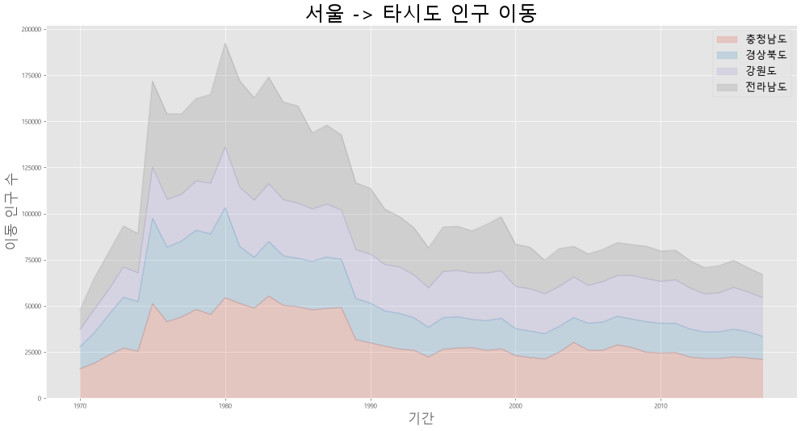

- `df_4.index.map(int)` : 인덱스의 값마다 `int()` 를 적용한다. x축이 숫자가 되어 눈금이 깔끔하게 나온다.
- `alpha=0.2` : 투명도. 0 = 완전 투명, 1 = 불투명
- 누적 그래프의 **맨 위 선은 네 지역의 합계**다. 각 지역의 값은 그 색 띠의 두께다.

### 9-2. 세로 막대 그래프 (bar)

<!-- run -->
```python
# 위에서 만든 df_4 (행 = 연도, 열 = 지역) 를 그대로 사용
df_4.plot(kind='bar', figsize=(20, 10), width=0.7,
          color=['orange', 'green', 'skyblue', 'blue'])   # 열 순서대로 막대 색

plt.title('서울 -> 타시도 인구 이동', size=30)
plt.xlabel('기간', size=20)
plt.ylabel('이동 인구수', size=20)
plt.legend(loc='best', fontsize=15)   # labels 를 안 쓰면 열 이름(지역)이 자동으로 들어간다
plt.show()
```
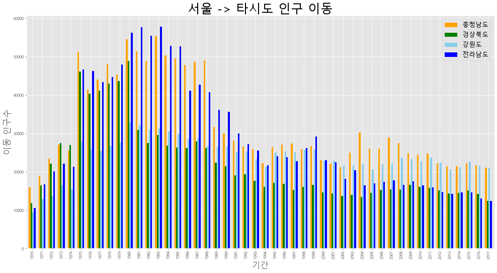

- `width` : 막대 너비. 기본 0.8
- `color` 에 리스트를 주면 **열 순서대로** 색이 정해진다

### 9-3. 가로 막대 그래프 (barh) — 합계 구해서 정렬하기

<!-- run -->
```python
df_4 = df_seoul.loc[['충청남도', '경상북도', '강원도', '전라남도'], col_years]

# 지역마다 48년치 합계 구하기 : axis=1 = 가로 방향(행마다)으로 더한다
df_4['합계'] = df_4.sum(axis=1)

# 합계 열만 골라 작은 순서로 정렬 (barh 는 아래에서 위로 그리므로 큰 값이 맨 위에 온다)
df_total = df_4[['합계']].sort_values(by='합계', ascending=True)

df_total.plot(kind='barh', color='cornflowerblue', width=0.5, figsize=(10, 5))

plt.title('서울 -> 타시도 인구 이동')
plt.ylabel('전입지')
plt.xlabel('이동 인구 수')
plt.show()
```
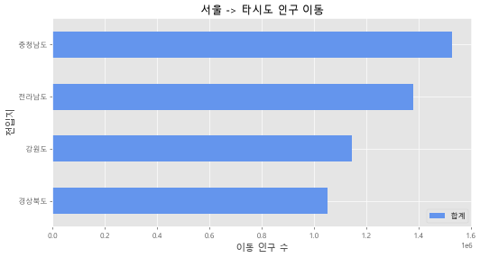

| 코드 | 뜻 |
|---|---|
| `df.sum(axis=1)` | **행마다** 가로로 더한다 → 지역별 합계 |
| `df.sum(axis=0)` | **열마다** 세로로 더한다 → 연도별 합계 (기본값) |
| `df[['합계']]` | 대괄호 2겹 → 열이 1개여도 데이터프레임 |
| `sort_values(by='합계')` | 그 열의 값 기준 정렬 |

항목 이름이 길거나 **순위를 보여 줄 때**는 세로 막대보다 가로 막대가 읽기 편하다.

### 9-4. 히스토그램 (hist)

<!-- run -->
```python
df = pd.read_csv('./Data-Pandas/auto-mpg.csv', header=None)   # 열 이름 줄이 없는 파일
df.columns = ['mpg', 'cylinders', 'displacement', 'horsepower', 'weight',
              'acceleration', 'model year', 'origin', 'name']

df['mpg'].plot(kind='hist', bins=10, color='coral', figsize=(10, 5))

plt.title('Histogram')
plt.xlabel('mpg')
plt.show()
```
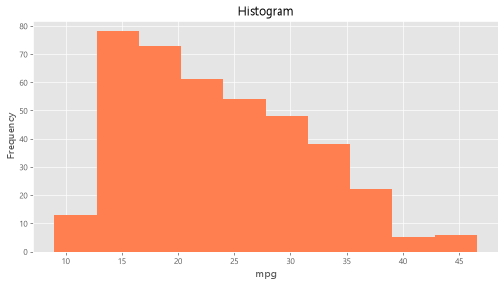

- `bins=10` : 값의 범위를 **10개 구간**으로 나눈다. 숫자가 클수록 막대가 촘촘해진다.
- 읽는 법 : 연비가 13 ~ 20 사이인 차가 가장 많고(398대 중 151대), 39 가 넘는 차는 11대뿐이다.

> ⚠️ 여기서 `df` 에 **자동차 데이터를 새로 담았다.** 앞의 인구 이동 데이터는 `df` 에서 사라졌다.
> 같은 이름을 다시 쓰면 앞의 내용이 덮어써진다는 점에 주의한다. ([13장](#13-내가-만난-에러와-함정-모음))

### 9-5. 산점도 (scatter)

<!-- run -->
```python
# 연비(mpg)와 차의 무게(weight)의 관계
df.plot(kind='scatter', x='weight', y='mpg', c='coral', s=10, figsize=(10, 5))

plt.title('Scatter Plot - mpg vs. weight')
plt.show()
```
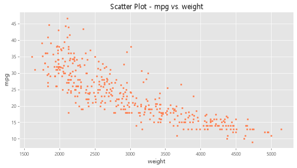

- 산점도는 **`x`, `y` 를 꼭 지정**한다. 점 하나 = 자동차 1대
- `c` = 점 색, `s` = 점 크기
- 읽는 법 : 점들이 오른쪽 아래로 내려간다 → **무거운 차일수록 연비가 나쁘다**

### 9-6. 버블 차트 — 점 크기로 세 번째 정보 보여 주기

<!-- run -->
```python
# 실린더 개수를 0 ~ 1 사이 비율로 바꾼 뒤 300 을 곱해 점 크기로 사용
cylinders_size = df['cylinders'] / df['cylinders'].max() * 300

df.plot(kind='scatter', x='weight', y='mpg', c='coral', figsize=(10, 5),
        s=cylinders_size, alpha=0.3)

plt.title('Scatter Plot: mpg-weight-cylinders')
plt.show()
```
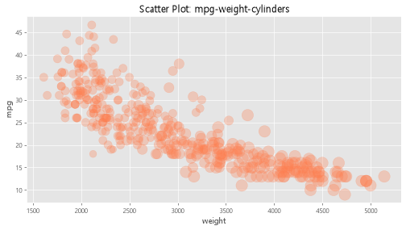

```python
cylinders_size = df['cylinders'] / df['cylinders'].max() * 300
```

| 부분 | 뜻 |
|---|---|
| `df['cylinders']` | 차마다 실린더 개수 (3 ~ 8) |
| `/ df['cylinders'].max()` | 가장 큰 값(8)으로 나눈다 → 0 ~ 1 사이 비율 |
| `* 300` | 점이 눈에 보이게 크기를 키운다 |

- `s` 에 **숫자 하나**를 주면 모든 점이 같은 크기, **시리즈**를 주면 점마다 크기가 달라진다
- `alpha=0.3` : 점이 겹치는 곳이 진하게 보여 몰려 있는 곳을 알 수 있다
- x(무게), y(연비), 점 크기(실린더 수)로 **정보 3개**를 한 그래프에 담는다

### 9-7. 파이 차트 (pie) — `groupby` 로 묶어서 세기

<!-- run -->
```python
df['count'] = 1                            # 차 1대 = 1 로 표시할 열 추가
df_origin = df.groupby('origin').sum()     # origin(생산지)이 같은 행끼리 묶어서 더한다
df_origin.index = ['USA', 'EU', 'JAPAN']   # 1, 2, 3 → 나라 이름

df_origin['count'].plot(kind='pie',
                        figsize=(7, 5),
                        autopct='%1.1f%%',   # 퍼센트 표시
                        startangle=10,       # 첫 조각이 시작하는 각도
                        colors=['chocolate', 'bisque', 'cadetblue'])   # 조각 색

plt.title('Model Origin', size=20)
plt.legend(labels=df_origin.index, loc='upper right')
plt.show()
```
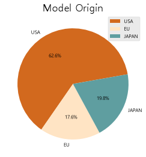

**`groupby` 란?** 같은 값을 가진 행끼리 묶는 것이다. "반별로 모여!" 와 같다.

```
df.groupby('origin')         # 묶기만 한 상태 (아직 계산 전)
df.groupby('origin').sum()   # 묶음마다 합계 → origin 이 행 인덱스가 된다
```

- `df.groupby('origin')` 만 출력하면 `<DataFrameGroupBy object ...>` 라고만 나온다. 묶기만 하고 계산을 안 했기 때문이다. 뒤에 `.sum()`, `.mean()`, `.count()` 같은 계산을 붙여야 표가 나온다.
- `count` 열에 1 을 넣고 더하면 **묶음마다 몇 대인지**가 된다 (USA 249, EU 70, JAPAN 79).

**`autopct='%1.1f%%'` 읽는 법**

| 부분 | 뜻 |
|---|---|
| `%1.1f` | 소수점 아래 **1자리**까지 표시 (`%1.2f` 면 2자리) |
| `%%` | 퍼센트 기호 `%` 그 자체 (% 를 글자로 쓰려면 두 번 쓴다) |

> 💡 개수만 세려면 더 짧은 방법이 있다. `df['origin'].value_counts()` 가 같은 숫자를 준다.
> `groupby().sum()` 은 글자 열(`name` 등)까지 이어 붙이기 때문에 표가 지저분해진다.
> 필요한 열만 계산하려면 `df.groupby('origin')['count'].sum()`.

### 9-8. 박스 플롯 (box)

<!-- run -->
```python
# 그래프 객체 생성 : 1행 2열 → 그래프 2개
fig = plt.figure(figsize=(15, 5))
ax1 = fig.add_subplot(1, 2, 1)   # 왼쪽
ax2 = fig.add_subplot(1, 2, 2)   # 오른쪽

# 왼쪽 : 수직 박스 플롯. x = 생산지별 연비 시리즈 3개 → 상자 3개
ax1.boxplot(x=[df[df['origin'] == 1]['mpg'],
               df[df['origin'] == 2]['mpg'],
               df[df['origin'] == 3]['mpg']],
            tick_labels=['USA', 'EU', 'JAPAN'])

# 오른쪽 : 수평 박스 플롯
ax2.boxplot(x=[df[df['origin'] == 1]['mpg'],
               df[df['origin'] == 2]['mpg'],
               df[df['origin'] == 3]['mpg']],
            tick_labels=['USA', 'EU', 'JAPAN'],
            orientation='horizontal')

ax1.set_title('제조국가별 연비 분포(수직 박스 플롯)')
ax2.set_title('제조국가별 연비 분포(수평 박스 플롯)')

plt.show()
```
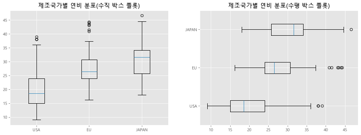

**`df[df['origin'] == 1]['mpg']` 읽는 법** : 안쪽부터 읽는다.

1. `df['origin'] == 1` → 행마다 True / False
2. `df[...]` → True 인 행만 남긴다 (미국 차만)
3. `['mpg']` → 그중 연비 열만 꺼낸다

**박스 플롯 읽는 법**

```
        ○        ← 이상치 : 유난히 튀는 값
        ┬        ← 최댓값 (이상치 제외)
        │
    ┌───┴───┐    ← 75% 지점 (3사분위)
    │       │
    ├───────┤    ← 중앙값 (50%)
    │       │
    └───┬───┘    ← 25% 지점 (1사분위)
        │
        ┴        ← 최솟값 (이상치 제외)
```

- **상자** = 가운데 50% 의 값이 모여 있는 범위. 상자가 짧으면 값이 비슷비슷하다는 뜻
- 이 그래프에서 : 중앙값이 USA 18.5, EU 26.5, JAPAN 31.6 → **일본 차의 연비가 가장 좋다**

> ⚠️ **버전에 따라 옵션 이름이 다르다.** 예전 교재의 코드는 새 matplotlib 에서 에러가 난다.
>
> | 예전 (교재) | 지금 (matplotlib 3.9 이후) | 그대로 쓰면 |
> |---|---|---|
> | `labels=[...]` | `tick_labels=[...]` | 3.11 에서 `TypeError` |
> | `vert=False` | `orientation='horizontal'` | 3.11 에서 경고 |
>
> 내 버전 확인 : `import matplotlib; print(matplotlib.__version__)`

### 9-9. 박스 플롯을 더 짧게 — pandas 의 `df.boxplot(by=...)`

9-8 에서는 생산지별 시리즈 3개를 직접 만들어 넣었다. pandas 의 `boxplot()` 에 `by` 를 주면 **묶는 일까지 알아서** 해 준다.

<!-- run -->
```python
# origin 코드(1, 2, 3)를 나라 이름으로 바꾼 열 추가
df['제조국가'] = df['origin'].map({1: '미국', 2: '유럽', 3: '일본'})

fig = plt.figure(figsize=(15, 5))
ax1 = fig.add_subplot(1, 2, 1)
ax2 = fig.add_subplot(1, 2, 2)

# column = 값을 볼 열, by = 묶는 기준 열, ax = 그릴 칸
df.boxplot(column='mpg', by='제조국가', grid=False, ax=ax1)
df.boxplot(column='mpg', by='제조국가', grid=False, vert=False, ax=ax2)   # vert=False : 수평

plt.suptitle('')   # pandas 가 자동으로 붙이는 큰 제목('Boxplot grouped by 제조국가') 지우기
ax1.set_title('제조국가별 연비 분포(수직)')
ax2.set_title('제조국가별 연비 분포(수평)')
ax1.set_xlabel('제조국가'); ax1.set_ylabel('연비 (mpg)')
ax2.set_xlabel('연비 (mpg)'); ax2.set_ylabel('제조국가')

plt.show()
```
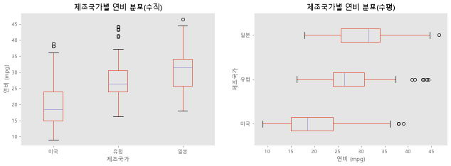

| 코드 | 뜻 |
|---|---|
| `시리즈.map({옛값: 새값})` | 값마다 딕셔너리에서 찾아 바꾼다 (1 → '미국') |
| `df.boxplot(column='mpg', by='제조국가')` | 제조국가가 같은 행끼리 묶어, 묶음마다 mpg 상자를 그린다 |
| `plt.suptitle('')` | 도화지 전체의 큰 제목을 빈 글자로 바꿔 지운다 |

> ⚠️ **칸이 2개일 때 `plt.title()`, `plt.xlabel()` 은 마지막 칸(ax2)에만 적용된다.**
> `plt.` 명령은 "지금 그리고 있는 칸" 하나에만 명령하기 때문이다. 칸마다 꾸미려면 `ax1.set_title()`,
> `ax2.set_title()` 처럼 **ax 를 직접 지정**한다. ([7-2](#7-2-plt-방식--ax-방식-대응표))
>
> ⚠️ 여기서도 `vert=False` 는 matplotlib 3.11 에서 경고가 난다(3.13 에서 삭제 예정). 실행은 된다.

---

## 10. 그래프를 파일로 저장하기

```python
df.plot(kind='scatter', x='weight', y='mpg', c='coral', s=10, figsize=(10, 5))
plt.title('Scatter Plot - mpg vs. weight')

plt.savefig('./output/scatter.png')                                  # 그림 파일로 저장
plt.savefig('./output/scatter_transparent.png', transparent=True)    # 배경을 투명하게
plt.show()
```

- **`savefig()` 는 `show()` 보다 먼저** 쓴다. `show()` 뒤에는 그림이 닫혀서 빈 파일이 저장된다.
- 저장할 폴더(`output`)가 미리 있어야 한다.
- 선명하게 저장 : `plt.savefig('a.png', dpi=300)`
- 가장자리가 잘리면 : `plt.savefig('a.png', bbox_inches='tight')`
- 확장자로 형식이 정해진다 : `.png`, `.jpg`, `.pdf`, `.svg`

---

## 11. seaborn : 통계 그래프를 짧은 코드로

**seaborn** 은 matplotlib 위에 만들어진 그래프 도구다. 회귀선, 밀도 곡선, 묶음별 평균 같은 **통계 계산을 알아서** 해 주기 때문에 코드가 짧다.
matplotlib 위에서 돌아가므로 지금까지 배운 `fig`, `ax`, `ax.set_title()`, `plt.show()` 를 그대로 쓴다.

### 11-1. 준비 : import 와 예제 데이터

<!-- run -->
```python
import seaborn as sns   # 보통 sns 로 줄여 쓴다

titanic = sns.load_dataset('titanic')   # seaborn 이 준비해 둔 예제 데이터를 데이터프레임으로 불러온다
print(titanic.head())
print(titanic.info())
```

- `sns.load_dataset()` 은 예제 데이터를 **인터넷에서 내려받는다.** 인터넷이 안 되면 에러가 난다.
- 타이타닉 데이터 : 승객 891명, 열 15개. 이 글에서 쓰는 열은 아래와 같다.

| 열 | 뜻 | 값 |
|---|---|---|
| `survived` | 생존 여부 | 0 = 사망, 1 = 생존 |
| `alive` | 생존 여부(글자) | `'no'`, `'yes'` |
| `sex` | 성별 | `'male'`, `'female'` |
| `age` | 나이 | 숫자 (177명은 빈칸) |
| `fare` | 요금 | 숫자 |
| `class` | 객실 등급 | `'First'`, `'Second'`, `'Third'` |

### 11-2. seaborn 함수의 공통 모양

```python
sns.그래프함수(data=데이터프레임, x='x축 열', y='y축 열', hue='색으로 나눌 열', ax=그릴 칸)
```

| 옵션 | 뜻 |
|---|---|
| `data` | 데이터프레임. 이것을 주면 `x`, `y` 에는 **열 이름(글자)** 만 쓰면 된다 |
| `x`, `y` | x축, y축에 놓을 열 |
| `hue` | 이 열의 값마다 **색을 나눠** 그린다 (범례도 자동) |
| `ax` | 화면을 나눴을 때 **어느 칸에 그릴지**. 안 쓰면 지금 그리고 있는 칸 |

pandas plot 은 표의 모양(행 인덱스 = x축)에 맞춰 그리지만, seaborn 은 **열 이름으로 x, y 를 직접 고른다.** 그래서 `.T` 로 뒤집을 일이 없다.

### 11-3. 회귀선이 있는 산점도 (regplot)

<!-- run -->
```python
fig = plt.figure(figsize=(15, 5))   # 도화지
ax1 = fig.add_subplot(1, 2, 1)      # 1행 2열 중 첫 번째 칸
ax2 = fig.add_subplot(1, 2, 2)

# 왼쪽 : 산점도 + 선형 회귀선 (fit_reg=True 가 기본값)
sns.regplot(x='age', y='fare', data=titanic, ax=ax1)

# 오른쪽 : 회귀선 없이 산점도만
sns.regplot(x='age', y='fare', data=titanic, ax=ax2, fit_reg=False)

plt.show()
```
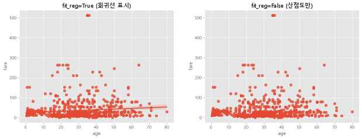

- **회귀선** = 점들의 흐름을 가장 잘 나타내는 직선. 선 주변의 옅은 띠는 그 선이 있을 법한 범위(신뢰구간)다.
- 읽는 법 : 선이 거의 평평하다 → **나이와 요금은 거의 관계가 없다** (상관계수 0.096).
- 9-5 의 `df.plot(kind='scatter')` 와 같은 산점도인데, 회귀선을 자동으로 그려 준다는 점이 다르다.

### 11-4. 히스토그램과 밀도 곡선 (histplot, kdeplot)

<!-- run -->
```python
fig = plt.figure(figsize=(15, 5))
ax1 = fig.add_subplot(1, 3, 1)   # 1행 3열
ax2 = fig.add_subplot(1, 3, 2)
ax3 = fig.add_subplot(1, 3, 3)

sns.histplot(data=titanic, x='fare', kde=True, ax=ax1)    # 히스토그램 + 밀도 곡선
sns.kdeplot(data=titanic, x='fare', fill=True, ax=ax2)    # 밀도 곡선만 (fill=True : 곡선 아래를 색칠)
sns.histplot(data=titanic, x='fare', ax=ax3)              # 히스토그램만

ax1.set_title('titanic fare - histplot(kde=True)')
ax2.set_title('titanic fare - kdeplot')
ax3.set_title('titanic fare - histplot')

plt.show()
```
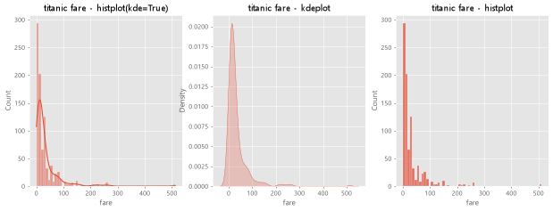

- **KDE(커널 밀도 곡선)** = 히스토그램의 막대를 **부드러운 곡선**으로 바꾼 것. 값이 어디에 몰려 있는지 본다.
- 열 하나(`x` 만)의 분포를 볼 때 쓴다.
- 읽는 법 : 요금이 왼쪽(싼 쪽)에 몰려 있고 오른쪽으로 꼬리가 길다. 승객의 82% 가 요금 50 미만이고, 가장 비싼 요금은 512 다.

> 💡 교재에 나오는 `sns.distplot()` 은 곧 없어질 옛 함수라서 쓰면 경고가 난다. 지금은 `sns.histplot(kde=True)` 를 쓴다.

### 11-5. 피벗 테이블과 히트맵 (heatmap)

히트맵은 **표의 숫자를 색의 진하기로** 보여 준다. 먼저 표를 만들어야 한다.

<!-- run -->
```python
# 피벗 테이블 : 행 = 성별, 열 = 객실 등급, 값 = 그 칸에 해당하는 승객 수
table = titanic.pivot_table(index=['sex'], columns=['class'], aggfunc='size')
```

```
class   First  Second  Third
sex
female     94      76    144
male      122     108    347
```

| 옵션 | 뜻 |
|---|---|
| `index` | 행에 놓을 기준 |
| `columns` | 열에 놓을 기준 |
| `aggfunc='size'` | 칸마다 **몇 행인지** 센다. 평균은 `'mean'`, 합계는 `'sum'` (이때는 `values='열'` 도 지정) |

<!-- run -->
```python
sns.heatmap(table,                 # 색으로 나타낼 표
            annot=True, fmt='d',   # annot : 칸에 숫자 표시 / fmt='d' : 정수로 표시
            cmap='YlGnBu',         # 색 지도 : Yl 노랑 → Gn 초록 → Bu 파랑 (값이 클수록 진한 파랑)
            linewidths=.5,         # 칸 사이 구분선 굵기
            cbar=True)             # 오른쪽 색 막대(색이 어떤 값인지 알려 준다) 표시

plt.show()
```
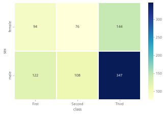

- 읽는 법 : 가장 진한 칸은 **3등석 남성(347명)** 이다.
- 색 지도 이름 끝에 **`_r`** 을 붙이면 색 순서가 뒤집힌다. `'YlGnBu_r'` 은 값이 **작을수록** 진한 파랑이다.
- `fmt='d'` 는 값이 정수일 때만 쓴다. 소수면 `fmt='.1f'` (소수점 아래 1자리).

### 11-6. 범주별 점 그래프 (stripplot, swarmplot)

x축이 `First`, `Second`, `Third` 같은 **범주(종류)** 일 때, 값을 점으로 하나하나 찍는 그래프다.

<!-- run -->
```python
fig = plt.figure(figsize=(15, 5))
ax1 = fig.add_subplot(1, 2, 1)
ax2 = fig.add_subplot(1, 2, 2)

# 왼쪽 : 점이 겹쳐도 그대로 찍는다
sns.stripplot(x='class', y='age', data=titanic, ax=ax1)

# 오른쪽 : 점이 겹치지 않게 옆으로 펼쳐 찍는다
sns.swarmplot(x='class', y='age', data=titanic, ax=ax2)

ax1.set_title('Strip Plot')
ax2.set_title('Swarm Plot')

plt.show()
```
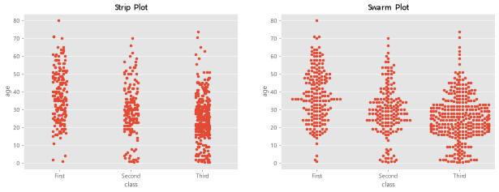

| 함수 | 점을 찍는 방법 | 특징 |
|---|---|---|
| `stripplot` | 겹쳐도 그대로 | 빠르다. 점이 많으면 뭉쳐 보인다 |
| `swarmplot` | 겹치지 않게 옆으로 펼친다 | **옆으로 넓게 퍼진 곳 = 그 나이대에 사람이 많다** |

- 읽는 법 : 1등석은 40 ~ 50대와 고령 승객이 눈에 띄고, 3등석은 20 ~ 30대와 어린이가 많다.

> ⚠️ swarmplot 을 실행하면 이런 경고가 나온다. 에러가 아니다.
> ```
> UserWarning: 12.7% of the points cannot be placed; you may want to decrease the size of the markers or use stripplot.
> ```
> 점이 너무 많아 다 펼쳐 놓을 자리가 없다는 뜻이다. 점을 작게 하면(`size=3`) 줄어든다.

### 11-7. 막대 그래프 (barplot) — 막대 높이는 "평균"

<!-- run -->
```python
fig = plt.figure(figsize=(15, 5))
ax1 = fig.add_subplot(1, 3, 1)
ax2 = fig.add_subplot(1, 3, 2)
ax3 = fig.add_subplot(1, 3, 3)

sns.barplot(x='sex', y='survived', data=titanic, ax=ax1)                              # 성별 생존율
sns.barplot(x='sex', y='survived', hue='class', data=titanic, ax=ax2)                 # 등급별로 막대를 나란히
sns.barplot(x='sex', y='survived', hue='class', dodge=False, data=titanic, ax=ax3)    # 같은 자리에 겹쳐서

ax1.set_title('titanic survived - sex')
ax2.set_title('titanic survived - sex/class')
ax3.set_title('titanic survived - sex/class(dodge=False)')

plt.show()
```
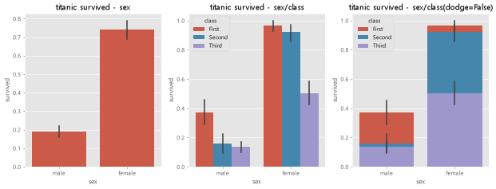

**가장 중요한 점 : seaborn 의 막대 높이는 값 그대로가 아니라 묶음의 "평균"이다.**
`survived` 는 0 과 1 뿐이므로, 평균이 곧 **생존율**이 된다. (pandas 의 `kind='bar'` 는 표의 값을 그대로 그린다.)

- 막대 위의 검은 선 = 그 평균이 있을 법한 범위(신뢰구간). 선이 길수록 불확실하다.
- 읽는 법 : 생존율이 여성 74.2%, 남성 18.9%. 1등석 여성은 96.8%, 3등석 남성은 13.5% 다.

| 옵션 | 뜻 |
|---|---|
| `hue='class'` | 등급마다 색을 나눠 막대를 그린다 |
| `dodge=True` (기본) | 막대를 **옆으로 나란히** 놓는다 |
| `dodge=False` | 막대를 **같은 자리에 겹쳐** 놓는다 |

> ⚠️ `dodge=False` 는 **누적(쌓기)이 아니다.** 막대를 위로 쌓아 더하는 것이 아니라 같은 자리에 겹쳐 그리는 것이라서,
> 낮은 막대가 높은 막대에 가려질 수 있다. 세 번째 그래프의 높이도 합계가 아니라 각 등급의 생존율 그대로다.

### 11-8. 박스 플롯과 바이올린 그래프 (boxplot, violinplot)

<!-- run -->
```python
fig = plt.figure(figsize=(15, 10))
ax1 = fig.add_subplot(2, 2, 1)   # 2행 2열
ax2 = fig.add_subplot(2, 2, 2)
ax3 = fig.add_subplot(2, 2, 3)
ax4 = fig.add_subplot(2, 2, 4)

sns.boxplot(x='alive', y='age', data=titanic, ax=ax1)                   # 박스 플롯
sns.boxplot(x='alive', y='age', hue='sex', data=titanic, ax=ax2)        # 성별로 색을 나눈 박스 플롯
sns.violinplot(x='alive', y='age', data=titanic, ax=ax3)                # 바이올린 그래프
sns.violinplot(x='alive', y='age', hue='sex', data=titanic, ax=ax4)     # 성별로 색을 나눈 바이올린 그래프

plt.show()
```
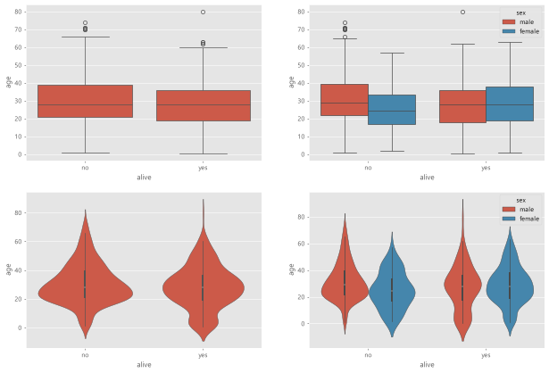

- **바이올린 그래프** = 박스 플롯 + 밀도 곡선. **폭이 넓은 곳에 값이 많다.** 가운데 굵은 막대가 박스 플롯의 상자, 흰 점이 중앙값이다.
- 박스 플롯은 요약(중앙값, 사분위)만 보여 주고, 바이올린은 **어느 나이대에 몰려 있는지**까지 보여 준다.
- 읽는 법 : 생존자(yes) 쪽 바이올린은 0 ~ 10살 부근이 더 불룩하다 → 어린이의 생존 비율이 높았다.
- 9-8 에서는 시리즈 3개를 직접 만들어 넣었지만, seaborn 은 `x='alive'` 한 줄로 묶어 준다.

> ⚠️ 이 셀의 마지막 줄이 `sns.violinplot(...)` 이면 그래프 위에 `<Axes: xlabel='alive', ylabel='age'>` 라는 글자가 같이 나온다.
> Jupyter 가 셀 마지막 줄의 결과값을 출력하기 때문이다. 마지막에 `plt.show()` 를 쓰면 사라진다.

### 11-9. seaborn 함수 한눈에

| 함수 | 그래프 | 주로 보는 것 |
|---|---|---|
| `sns.regplot()` | 산점도 + 회귀선 | 두 숫자 열의 관계 |
| `sns.histplot()` | 히스토그램 (`kde=True` 면 곡선 추가) | 열 하나의 분포 |
| `sns.kdeplot()` | 밀도 곡선 | 열 하나의 분포 |
| `sns.heatmap()` | 히트맵 | 표의 값 크기 비교 |
| `sns.stripplot()` / `sns.swarmplot()` | 범주별 점 그래프 | 범주별 값의 퍼짐 |
| `sns.barplot()` | 막대 (높이 = 평균) | 범주별 평균 비교 |
| `sns.boxplot()` / `sns.violinplot()` | 박스 / 바이올린 | 범주별 분포 요약 |

---

## 12. folium : 지도 위에 데이터 올리기

**folium** 은 지도를 만들어 그 위에 마커, 원, 선, 색칠한 구역을 올리는 도구다.
matplotlib 과 달리 결과가 그림 파일이 아니라 **HTML(웹 페이지)** 이다. 마우스로 움직이고 확대할 수 있다.

설치가 필요하다 : `conda install -c conda-forge folium` 또는 `pip install folium`

### 12-1. 지도 만들기 · 보기 · 저장하기

```python
import folium

# location = 지도 가운데의 [위도, 경도], zoom_start = 처음 확대 정도 (클수록 확대)
seoul_map = folium.Map(location=[37.55, 126.98], zoom_start=12)

seoul_map.save('./output/seoul.html')   # HTML 파일로 저장 → 웹 브라우저로 연다
seoul_map                               # 셀의 마지막 줄에 변수 이름만 쓰면 노트북에 지도가 나온다
```

- 좌표는 **[위도, 경도]** 순서다. 서울은 위도 37.55, 경도 126.98.
- `zoom_start` 기준 : 3 = 대륙, 7 = 나라 전체, 9 = 도 하나, 12 = 도시
- 지도 바탕은 인터넷에서 받아 온다. 인터넷이 안 되면 회색 화면만 나온다.
- 저장할 폴더(`output`)가 미리 있어야 한다.

### 12-2. 마커 찍기 (Marker) — `zip` 으로 여러 열을 한꺼번에

```python
df = pd.read_excel('./Data-Pandas/서울지역 대학교 위치.xlsx')   # 열 : 이름, 위도, 경도 (대학교 47곳)

seoul_map = folium.Map(location=[37.55, 126.98], zoom_start=12)

# zip : 세 열에서 같은 줄의 값을 하나씩 묶어 꺼낸다 → (이름, 위도, 경도)
for name, lat, lng in zip(df.이름, df.위도, df.경도):
    folium.Marker([lat, lng],          # 마커 위치
                  popup=name,          # 마커를 클릭하면 나오는 글
                  tooltip=name,        # 마우스를 올리면 나오는 글
                  icon=folium.Icon(color='red', icon='info-sign')   # 마커 색과 그림
                  ).add_to(seoul_map)  # 만든 마커를 지도에 올린다

seoul_map.save('./output/seoul_colleges.html')
```

**`zip` 읽는 법** : 여러 목록에서 같은 순서의 값끼리 묶는다.

```python
list(zip(['A', 'B'], [1, 2], [10, 20]))   # [('A', 1, 10), ('B', 2, 20)]
```

`for name, lat, lng in zip(...)` 은 한 번 돌 때마다 묶음 하나를 풀어서 세 변수에 나눠 담는다.

| 코드 | 뜻 |
|---|---|
| `df.이름` | `df['이름']` 과 같다. 열 이름에 띄어쓰기가 없을 때만 쓸 수 있다 |
| `folium.Marker([위도, 경도])` | 마커 1개를 만든다 |
| `popup` / `tooltip` | 클릭하면 / 마우스를 올리면 나오는 글 |
| `.add_to(지도)` | 만든 것을 지도에 올린다. **이것을 빼면 지도에 안 나온다** |

### 12-3. 팝업 크기 정하기 (IFrame, Popup)

`popup=name` 으로 글자만 주면 팝업 크기가 자동으로 정해져서 긴 이름은 여러 줄로 꺾인다. 크기를 직접 정할 수 있다.

```python
for name, lat, lng in zip(df.이름, df.위도, df.경도):
    iframe = folium.IFrame(name, width=150, height=50)   # 팝업 안에 넣을 내용과 크기(픽셀)
    popup = folium.Popup(iframe, max_width=600)          # 그 내용을 담은 팝업
    folium.Marker([lat, lng], popup=popup).add_to(seoul_map)

seoul_map.save('./output/seoul_colleges.html')   # 저장은 for 문이 끝난 뒤 한 번만
```

> ⚠️ **변수 이름을 `Popup` (대문자)으로 쓰지 않는다.** `from folium.map import Popup` 으로 불러온 `Popup` 과
> 이름이 같아서, `Popup = folium.Popup(...)` 이라고 쓰면 불러온 것이 덮어써진다. 변수는 소문자 `popup` 으로 쓴다.
>
> ⚠️ **`save()` 를 for 문 안에 넣지 않는다.** 들여쓰기가 한 칸 들어가면 마커를 하나 찍을 때마다 파일을 저장해서
> (47번) 느려진다. 결과는 같지만 for 문 밖에서 한 번만 저장하면 된다.

### 12-4. 원으로 표시하기 (CircleMarker)

```python
seoul_map = folium.Map(location=[37.55, 126.98], zoom_start=12)   # 지도를 새로 만든다

for name, lat, lng in zip(df.이름, df.위도, df.경도):
    iframe = folium.IFrame(name, width=150, height=50)
    popup = folium.Popup(iframe, max_width=600)
    folium.CircleMarker([lat, lng],
                        radius=10,            # 원의 반지름(픽셀)
                        color='brown',        # 원의 둘레 색
                        fill=True,            # 원 안을 칠할지
                        fill_color='coral',   # 원 안을 칠하는 색
                        fill_opacity=0.7,     # 칠의 투명도 (0 = 투명, 1 = 불투명)
                        tooltip=name,
                        popup=popup
                        ).add_to(seoul_map)

seoul_map
```

> ⚠️ **지도를 새로 만들지 않으면 앞에서 찍은 마커가 그대로 남는다.** `seoul_map` 에 계속 `add_to` 를 하면
> 같은 자리에 마커가 겹겹이 쌓인다. 다른 모양으로 다시 그릴 때는 `folium.Map(...)` 부터 다시 실행한다.

### 12-5. 실습 : 공공데이터로 경의중앙선 역 표시하기

공공데이터 포털(<https://data.seoul.go.kr/>)에서 `위도 경도 csv` 로 검색해 받은 파일을 쓴다.

```python
# 공공데이터 CSV 는 대부분 한글 윈도우 인코딩(cp949)으로 저장되어 있다
df = pd.read_csv('./Data-Pandas/경의중앙선_역위치.csv', encoding='cp949')   # 열 : 선명, 역명, 경도, 위도 (78개 역)

seoul_map = folium.Map(location=[37.55, 126.98], zoom_start=12)

# 열 4개를 묶어서 꺼낸다. 팝업 글 : '경의중앙-도라산'
for name1, name2, lat, lng in zip(df.선명, df.역명, df.위도, df.경도):
    iframe = folium.IFrame(name1 + '-' + name2, width=150, height=50)
    popup = folium.Popup(iframe, max_width=600)
    folium.CircleMarker([lat, lng],
                        radius=10, color='brown',
                        fill=True, fill_color='coral', fill_opacity=0.7,
                        popup=popup
                        ).add_to(seoul_map)

seoul_map.save('./output/seoul_stations.html')
seoul_map
```

- `encoding='cp949'` 를 빼면 `UnicodeDecodeError: 'utf-8' codec can't decode byte ...` 가 난다.
- 이 파일은 열 순서가 **경도, 위도** 다. `zip(df.위도, df.경도)` 처럼 **열 이름으로** 꺼내면 순서를 헷갈리지 않는다.
- 글자를 이을 때 숫자가 섞여 있으면 `str()` 로 바꾼다 : `'경의중앙-' + str(name)`

### 12-6. 구역을 색칠하기 (Choropleth) — 경기도 인구

**단계구분도(Choropleth)** = 행정구역처럼 경계로 둘러싸인 영역을 **값의 크기에 따라 다른 색으로** 칠한 지도.
재료가 두 가지 필요하다. ① 값이 든 표 ② 구역의 경계선 정보(GeoJSON 파일).

```python
import json

# ① 값 : 경기도 시군구별 인구 (행 = 44개 시군구, 열 = 2007 ~ 2017)
df = pd.read_excel('./Data-Pandas/경기도인구데이터.xlsx', index_col='구분', engine='openpyxl')
df.columns = df.columns.map(str)   # 열 이름 2007(숫자) → '2007'(글자)

# ② 경계 : GeoJSON 파일을 딕셔너리로 읽기
geo_data = json.load(open('./Data-Pandas/경기도행정구역경계.json', encoding='utf-8'))
```

```python
g_map = folium.Map(location=[37.5502, 126.982], zoom_start=9)

year = '2017'   # 2007 ~ 2017 중에서 고른다

folium.Choropleth(geo_data=geo_data,                   # 경계
                  data=df[year],                       # 값 (시리즈 : 인덱스 = 시군구 이름, 값 = 인구)
                  key_on='feature.properties.name',    # 경계 파일에서 구역 이름이 들어 있는 곳
                  fill_color='YlOrRd',                 # 색 지도 : 노랑 → 주황 → 빨강
                  fill_opacity=0.7,                    # 칠의 투명도
                  line_opacity=0.3,                    # 경계선의 투명도
                  bins=[10000, 100000, 300000, 500000, 700000],   # 색을 나누는 구간의 경계값
                  ).add_to(g_map)

g_map.save('./output/gyonggi_population_' + year + '.html')
g_map
```

**표와 경계는 "이름"으로 짝을 맞춘다.**

```
표(df)의 행 인덱스          경계 파일(geo_data)
수원시장안구  293828   ↔   feature.properties.name = '수원시장안구'
```

- `key_on='feature.properties.name'` 은 "경계 파일에서 구역마다 `properties` 안의 `name` 값을 이름으로 쓴다" 는 뜻이다.
- **이름이 한 글자라도 다르면 그 구역은 색이 안 칠해진다(검은색).** 짝이 맞는지 미리 확인한다. ([12-7](#12-7-인터넷에서-경계-파일-받기--이름이-맞는지-점검하기))
- `bins=[1만, 10만, 30만, 50만, 70만]` 이면 구간이 4개다 : 1만 ~ 10만(연한 노랑), 10만 ~ 30만, 30만 ~ 50만, 50만 ~ 70만(진한 빨강)
- `data` 에 **시리즈**를 주면 인덱스로 짝을 맞춘다. **데이터프레임**을 주면 `columns=['이름 열', '값 열']` 을 같이 써야 한다.
- 읽는 법 : 2017년 인구는 화성시(69만), 남양주시(67만), 성남시분당구(50만) 순으로 많다. 2007년에 비해 화성시 +32만, 김포시 +19만, 남양주시 +17만 명이 늘어, 신도시 지역에 인구가 몰렸다.

> ⚠️ **`threshold_scale` 은 옛 이름이다.** 교재의 `threshold_scale=[...]` 을 그대로 쓰면 실행은 되지만
> `choropleth 'threshold_scale' parameter is now depreciated in favor of the 'bins' parameter` 경고가 난다. `bins` 로 쓴다.
>
> ⚠️ **`bins` 는 모든 값을 덮어야 한다.** 가장 큰 값(69만)보다 마지막 경계값이 작으면
> `ValueError: All values are expected to fall into one of the provided bins` 에러가 난다.
> `bins=6` 처럼 숫자 하나만 주면 구간 6개를 자동으로 나눈다(기본값).
>
> 💡 `json.load(open(..., encoding='utf-8'))` 에서 에러가 나면 파일 앞에 BOM 이라는 표시가 붙은 경우다. `encoding='utf-8-sig'` 로 읽는다.

### 12-7. 인터넷에서 경계 파일 받기 · 이름이 맞는지 점검하기

경계 파일을 내려받지 않고 인터넷 주소에서 바로 읽을 수 있다. 값은 연습용으로 무작위 숫자를 만든다.

```python
import requests
import numpy as np

geo_url = ('https://raw.githubusercontent.com/southkorea/southkorea-maps/master/'
           'kostat/2018/json/skorea-provinces-2018-geo.json')

res = requests.get(geo_url, timeout=10)   # 주소에 요청을 보낸다. 10초 안에 답이 없으면 포기
print(res.status_code)                    # 200 이면 정상
res.raise_for_status()                    # 정상이 아니면 여기서 에러를 내고 멈춘다
geo = res.json()                          # 받은 JSON 글자를 딕셔너리로 바꾼다

names = ['서울특별시', '부산광역시', '대구광역시', '인천광역시', '광주광역시', '대전광역시',
         '울산광역시', '세종특별자치시', '경기도', '강원도', '충청북도', '충청남도',
         '전라북도', '전라남도', '경상북도', '경상남도', '제주특별자치도']

rng = np.random.default_rng(1)   # 난수 생성기. 씨앗(seed) 1 → 실행할 때마다 같은 숫자가 나온다
df = pd.DataFrame({'region': names,
                   'loan': rng.integers(10, 300, len(names))})   # 10 이상 300 미만의 정수 17개

# 이름 점검 : 경계 파일의 이름을 모두 꺼내 집합으로 만든다
geo_names = {f['properties']['name'] for f in geo['features']}
print('불일치:', set(df['region']) ^ geo_names)   # set() 이 나오면 모두 일치

m = folium.Map(location=[36.3, 127.8], zoom_start=7, tiles='OpenStreetMap')

folium.Choropleth(geo_data=geo,
                  data=df,                       # 데이터프레임을 주면
                  columns=['region', 'loan'],    # [이름 열, 값 열] 을 지정한다
                  key_on='feature.properties.name',
                  fill_color='YlOrRd', fill_opacity=0.8, line_opacity=0.4,
                  legend_name='시도별 가계대출 (샘플, 조 원)',   # 색 막대 위에 표시할 이름
                  ).add_to(m)
m
```

**이름 점검 코드 읽는 법**

```python
geo_names = {f['properties']['name'] for f in geo['features']}
```

1. `geo['features']` → 구역 정보가 하나씩 들어 있는 리스트 (시도 17개)
2. `for f in ...` → 구역을 하나씩 꺼내 `f` 에 담는다
3. `f['properties']['name']` → 그 구역의 이름
4. `{ ... }` → 꺼낸 이름을 **집합(set)** 으로 모은다. 집합은 중복이 없다

```python
set(df['region']) ^ geo_names
```

`^` 는 **한쪽에만 있는 것**을 골라낸다. 양쪽에 모두 있는 이름은 빠진다.

```python
{'서울특별시', '부산광역시', '경기도'} ^ {'서울특별시', '부산광역시', '경기'}   # {'경기도', '경기'}
```

결과가 빈 집합 `set()` 이면 표와 경계 파일의 이름이 **모두 일치**한다. 이름이 나오면 그 구역은 색이 안 칠해지니 표의 이름을 고친다.

### 12-8. 선 긋기 (PolyLine) — 국가 간 자금 흐름

```python
m = folium.Map(location=[30, 100], zoom_start=3, tiles='OpenStreetMap')   # 세계 지도

seoul = [37.57, 126.98]

# (목적지 좌표, 이름, 금액(억 원))
flows = [([40.71, -74.00], '서울->뉴욕 투자', 500),
         ([35.68, 139.69], '서울->도쿄 송금', 200),
         ([1.35, 103.82], '서울->싱가포르 투자', 800)]

# 묶음 하나를 풀어 dest, label, amount 에 나눠 담는다
for dest, label, amount in flows:
    folium.PolyLine([seoul, dest],                      # 선이 지나는 좌표 목록 (시작점, 끝점)
                    weight=amount / 100,                # 선 굵기 : 금액이 클수록 굵게
                    color='crimson',
                    opacity=0.7,
                    tooltip=f'{label}: {amount}억원'     # 마우스를 올리면 나오는 글
                    ).add_to(m)
m
```

- `PolyLine` 에는 좌표를 **2개 이상** 줄 수 있다. 준 순서대로 이어서 긋는다.
- 선 굵기에 값을 넣으면 9-6 의 버블 차트처럼 **정보를 하나 더** 담을 수 있다.
- `f'{label}: {amount}억원'` : f-문자열. `{ }` 안의 변수 값이 글자 속에 들어간다.
- 서울 → 뉴욕 선은 태평양이 아니라 **유럽 쪽으로** 그어진다. 지도 위에서 두 좌표를 직선으로 잇기 때문이다(경도 126.98 → -74.00).

### 12-9. folium 한눈에

| 코드 | 하는 일 |
|---|---|
| `folium.Map(location=[위도, 경도], zoom_start=12)` | 지도 만들기 |
| `folium.Marker([위도, 경도], popup=, tooltip=, icon=)` | 마커 |
| `folium.Icon(color='red', icon='info-sign')` | 마커의 색과 그림 |
| `folium.CircleMarker([위도, 경도], radius=, color=, fill=True, fill_color=)` | 원 |
| `folium.Popup(folium.IFrame(글, width=, height=), max_width=)` | 크기를 정한 팝업 |
| `folium.PolyLine([좌표1, 좌표2], weight=, color=)` | 선 |
| `folium.Choropleth(geo_data=, data=, key_on=, fill_color=, bins=)` | 구역 색칠 |
| `.add_to(지도)` | 지도에 올리기 (모든 요소에 필요) |
| `지도.save('a.html')` | HTML 로 저장 |

---

## 13. 내가 만난 에러와 함정 모음

### 13-1. 오타 한 글자로 난 에러

| 내가 친 것 | 맞는 것 | 에러 |
|---|---|---|
| `FontProperties(frame=...)` | `FontProperties(fname=...)` | `TypeError` : 그런 옵션 없음 |
| `rotation='Vertical'` | `rotation='vertical'` | `ValueError` : 대소문자 구분 |
| `plt.legend(lables=[...])` | `plt.legend(labels=[...])` | `TypeError` : l 과 e 순서 |
| `'강원도]` | `'강원도']` | `SyntaxError: unterminated string literal` : 따옴표 안 닫음 |
| `sr_one = ` | `sr_one = df_seoul.loc['경기도']` | `SyntaxError` : `=` 오른쪽이 비어 있음 |

> 💡 에러가 나면 **맨 아래 줄**(에러 종류와 이유)과 **화살표 `---->` 가 가리키는 줄 번호**를 먼저 본다.
> 편집기의 빨간 밑줄이 항상 범인은 아니다. 자료형 검사 경고나 맞춤법 검사 표시일 때도 있다.

### 13-2. `NameError` : 이름을 모른다

```
NameError: name 'pd' is not defined
NameError: name 'cylinders_size' is not defined
```

원인은 둘 중 하나다.

1. **그 변수를 만드는 셀을 실행하지 않았다.** 커널을 재시작하거나 노트북을 새로 열면 변수가 모두 사라진다. 실행 번호가 `In[1]` 이면 방금 새로 시작했다는 신호 → 위 셀부터 다시 실행한다.
2. **그 변수를 만드는 줄이 아예 없다.** 만드는 줄을 추가한다.

### 13-3. 그래프가 안 나오고 경고만 나온다 — 셀을 나눴을 때

**증상** : 강사님 화면과 똑같이 쳤는데 내 화면에는 그래프가 안 나온다.

```python
# ── 셀 1 ──
fig = plt.figure(figsize=(20, 5))
ax = fig.add_subplot(1, 1, 1)
ax.plot(...)

# ── 셀 2 ──
ax.legend(loc='best')
ax.set_title('제목')
plt.show()            # 아무것도 안 나온다
```

**원인** : Jupyter 는 **셀이 끝날 때 그 셀의 그림을 출력하고 닫아 버린다.**
셀 1 이 끝나면서 선만 있는 그림이 나오고 닫힌다. 셀 2 는 이미 닫힌 그림을 꾸미는 것이라 보여 줄 그림이 없다.

같은 코드를 두 가지로 실행해 보면 차이가 분명하다.

| 실행 방식 | 결과 |
|---|---|
| 두 셀로 나눠 실행 | 셀 1 : 제목 없는 그래프 / 셀 2 : **출력 없음** |
| 한 셀에 합쳐 실행 | 제목 · 범례가 있는 **완성된 그래프** |

**해결** : 그래프 하나는 **한 셀 안에서** 만들고, 그리고, 꾸미고, `plt.show()` 까지 한다.
VS Code 에서는 두 셀을 선택하고 `Shift+M` 을 누르면 합쳐진다.

### 13-4. 경고(Warning)와 에러(Error)는 다르다

| | 실행 | 뜻 |
|---|---|---|
| `...Error` | **멈춘다** | 고쳐야 다음으로 넘어간다 |
| `...Warning` | 끝까지 된다 | "이렇게 쓰면 위험할 수 있어" 라고 알려 주기만 한다 |

이 글에서 만난 경고

| 경고 | 뜻 | 참고 |
|---|---|---|
| `set_ticklabels() should only be used with a fixed number of ticks` | 눈금 위치 없이 이름표만 바꿨다 | [7-3](#7-3-눈금-글자를-회전할-때-set_xticklabels-를-피하는-이유) |
| `vert: bool was deprecated in Matplotlib 3.11` | `vert=False` 는 옛 옵션이다 | [9-8](#9-8-박스-플롯-box) |
| `12.7% of the points cannot be placed` | swarmplot 의 점을 다 펼칠 자리가 없다 | [11-6](#11-6-범주별-점-그래프-stripplot-swarmplot) |
| `threshold_scale parameter is now depreciated` | `bins` 로 이름이 바뀌었다 | [12-6](#12-6-구역을-색칠하기-choropleth--경기도-인구) |

### 13-5. 같은 이름 `df` 를 계속 쓰다가 생기는 문제

```python
df = pd.read_excel('시도별 전출입 인구수.xlsx')   # df = 인구 데이터
...
df = pd.read_csv('auto-mpg.csv')                # df = 자동차 데이터 (인구 데이터는 사라짐)
```

Jupyter 는 **화면 순서가 아니라 실행한 순서**대로 기억한다.
위쪽 셀로 돌아가 `df['전출지별']` 을 실행하면 `KeyError` 가 난다. 지금 `df` 는 자동차 데이터이기 때문이다.

- 해결 : 그 데이터를 읽는 셀부터 다시 실행한다.
- 예방 : 데이터마다 다른 이름을 쓴다 (`df_pop`, `df_car`).

### 13-6. 한글이 □□□ 로 깨진다

1. 글꼴 설정(`rc('font', family=...)`)을 실행했는지 확인한다.
2. `plt.style.use()` 를 **글꼴 설정 뒤에** 썼다면 글꼴이 초기화됐을 수 있다 (`'classic'`, `'seaborn-v0_8'`, `'default'` 등). 글꼴 설정을 다시 실행한다.
3. 마이너스 부호가 깨지면 `plt.rcParams['axes.unicode_minus'] = False`.

### 13-7. 그 밖에 기억할 것

| 상황 | 원인 | 해결 |
|---|---|---|
| 선 그래프의 x축이 이상하다 | 행 인덱스가 x축이 된다 | `.T` 로 전치 |
| `TypeError: no numeric data to plot` | 값이 글자 취급(object) | `pd.to_numeric()` |
| 열 이름 `1970` 으로 못 찾는다 | 열 이름이 글자 `'1970'` | `list(map(str, range(...)))` |
| `annotate` 화살표가 엉뚱한 곳에 | x 좌표는 연도가 아니라 눈금 번호 | 왼쪽부터 0, 1, 2 ... 로 센다 |
| 저장한 그림이 비어 있다 | `show()` 뒤에 `savefig()` | `savefig()` 를 먼저 |
| `drop` 에서 `KeyError` | 열을 지우는데 `axis=1` 이 없음 | `drop([...], axis=1)` |
| 조건 2개에서 에러 | 조건에 괄호가 없음 | `(조건1) & (조건2)` |
| 칸이 2개인데 제목이 한쪽에만 붙는다 | `plt.title()` 은 마지막 칸에만 적용 | `ax1.set_title()`, `ax2.set_title()` |
| seaborn 막대 높이가 표의 값과 다르다 | `sns.barplot` 은 **평균**을 그린다 | 값 그대로는 pandas `kind='bar'` |
| 그래프 위에 `<Axes: ...>` 글자가 나온다 | 셀 마지막 줄의 결과값이 출력됨 | 마지막에 `plt.show()` |

### 13-8. 모듈이나 파일을 못 찾는다

| 에러 | 원인 | 해결 |
|---|---|---|
| `ModuleNotFoundError: No module named 'folium'` | 그 라이브러리가 설치되어 있지 않다 | `conda install -c conda-forge folium` 또는 `pip install folium` 로 설치 → **커널 재시작** → 위 셀부터 다시 실행 |
| `FileNotFoundError: ... './data/auto-mpg.csv'` | 그 경로에 파일이 없다 | 폴더 이름을 확인한다. 강의 코드는 `./data/`, 내 폴더는 `./Data-Pandas/` |
| `UnicodeDecodeError: 'utf-8' codec can't decode byte ...` | 파일이 다른 인코딩으로 저장되어 있다 | `pd.read_csv(..., encoding='cp949')` |
| `KeyError: '2007'` | 열 이름이 글자 `'2007'` 이 아니라 숫자 `2007` 이다 | `df.columns = df.columns.map(str)` 을 먼저 실행 |

- `./` 는 **지금 노트북 파일이 있는 폴더**다. `./Data-Pandas/a.csv` 는 "노트북과 같은 폴더 안의 Data-Pandas 폴더 안의 a.csv".
- 설치한 뒤에도 `ModuleNotFoundError` 가 나면, 설치한 파이썬과 노트북 오른쪽 위에 표시된 커널(파이썬)이 서로 다른 것이다.

### 13-9. 지도(folium)에서 만난 함정

| 상황 | 원인 | 해결 |
|---|---|---|
| 지도가 노트북에 안 나온다 | 셀 마지막 줄에 지도 변수가 없다 | 마지막 줄에 `seoul_map` 을 쓴다. 또는 `save()` 한 HTML 을 브라우저로 연다 |
| 마커가 지도에 안 나온다 | `.add_to(지도)` 를 빼먹었다 | 요소마다 `.add_to()` |
| 마커가 엉뚱한 나라에 찍힌다 | 위도와 경도를 바꿔 썼다 | `[위도, 경도]` 순서 (서울 = `[37.55, 126.98]`) |
| 마커가 겹겹이 쌓인다 | 같은 지도에 계속 `add_to` 했다 | `folium.Map(...)` 부터 다시 실행 |
| 구역이 검은색으로 나온다 | 표와 경계 파일의 이름이 다르다 | `set(이름들) ^ geo_names` 로 점검 ([12-7](#12-7-인터넷에서-경계-파일-받기--이름이-맞는지-점검하기)) |
| `ValueError: All values are expected to fall into one of the provided bins` | `bins` 가 값을 다 덮지 못한다 | 마지막 경계값을 최댓값 이상으로 |
| 불러온 `Popup` 이 이상해졌다 | 변수 이름을 `Popup` 으로 써서 덮어썼다 | 변수는 소문자 `popup` |

---

## 14. 한눈에 요약 (치트시트)

### 준비

```python
import pandas as pd
import matplotlib.pyplot as plt
from matplotlib import font_manager, rc

plt.style.use('ggplot')                                    # 스타일 먼저
font_name = font_manager.FontProperties(fname='./Data-Pandas/malgun.ttf').get_name()
rc('font', family=font_name)                               # 그다음 한글 글꼴
plt.rcParams['axes.unicode_minus'] = False                 # 마이너스 부호
```

### pandas plot

```python
df.plot()                                  # 선
df.plot(kind='bar')                        # 세로 막대   (barh = 가로)
df['열'].plot(kind='hist', bins=10)        # 히스토그램
df.plot(kind='scatter', x='a', y='b')      # 산점도      (s = 점 크기, c = 색)
df.plot(kind='area', stacked=True)         # 면적
df['열'].plot(kind='pie', autopct='%1.1f%%')   # 파이
df[['a', 'b']].plot(kind='box')            # 박스
```

### 꾸미기 (plt 방식)

```python
plt.figure(figsize=(14, 5))
plt.plot(x, y, marker='o', markersize=10, color='olive', linewidth=2, label='이름')
plt.title('제목', size=30)
plt.xlabel('x축', size=20)
plt.ylabel('y축', size=20)
plt.xticks(rotation='vertical')
plt.ylim(최소, 최대)
plt.legend(loc='best', fontsize=15)
plt.annotate('글자', xy=(x, y), xytext=(x2, y2), arrowprops=dict(arrowstyle='->'))
plt.savefig('./output/a.png')   # show 보다 먼저
plt.show()
```

### 객체(ax) 방식 · 화면 분할

```python
fig = plt.figure(figsize=(20, 10))
ax1 = fig.add_subplot(2, 2, 1)             # (행 수, 열 수, 몇 번째)
ax1.plot(x, y, label='이름')
ax1.set_title('제목')
ax1.set_xlabel('x축')
ax1.set_ylabel('y축')
ax1.legend(loc='best')
ax1.tick_params(axis='x', labelrotation=90)
plt.tight_layout()
plt.show()
```

### 데이터 다듬기

```python
df = df.ffill()                                     # 빈칸을 위 값으로 채우기
mask = (df['a'] == '값') & (df['b'] != '값')         # 조건 (괄호 필수)
df2 = df[mask]                                      # 조건에 맞는 행만
df2 = df2.drop(['열'], axis=1)                      # 열 삭제
df2 = df2.rename(columns={'옛이름': '새이름'})       # 열 이름 변경
df2.set_index('열', inplace=True)                   # 열 → 행 인덱스
df2.loc[['행1', '행2'], ['열1', '열2']]             # 행, 열 고르기
df2.T                                               # 행 ↔ 열 뒤집기
pd.to_numeric(df2['열'])                            # 글자 → 숫자
df2.sum(axis=1)                                     # 행마다 합계
df2.sort_values(by='열', ascending=True)            # 값 기준 정렬
df.groupby('열').sum()                              # 같은 값끼리 묶어서 합계
list(map(str, range(1970, 2018)))                   # ['1970', ..., '2017']
```

### seaborn

```python
import seaborn as sns

titanic = sns.load_dataset('titanic')                        # 예제 데이터 (인터넷 필요)

sns.regplot(x='age', y='fare', data=titanic, ax=ax1)         # 산점도 + 회귀선 (fit_reg=False : 선 없이)
sns.histplot(data=titanic, x='fare', kde=True)               # 히스토그램 + 밀도 곡선
sns.kdeplot(data=titanic, x='fare', fill=True)               # 밀도 곡선
sns.stripplot(x='class', y='age', data=titanic)              # 범주별 점 (겹침)
sns.swarmplot(x='class', y='age', data=titanic)              # 범주별 점 (안 겹침)
sns.barplot(x='sex', y='survived', hue='class', data=titanic)    # 막대 (높이 = 평균)
sns.boxplot(x='alive', y='age', hue='sex', data=titanic)     # 박스 플롯
sns.violinplot(x='alive', y='age', data=titanic)             # 바이올린 그래프

table = titanic.pivot_table(index=['sex'], columns=['class'], aggfunc='size')   # 피벗 테이블
sns.heatmap(table, annot=True, fmt='d', cmap='YlGnBu', linewidths=.5)           # 히트맵
```

### folium

```python
import folium, json

m = folium.Map(location=[37.55, 126.98], zoom_start=12)      # [위도, 경도]

for name, lat, lng in zip(df.이름, df.위도, df.경도):          # 열 3개를 묶어서 하나씩
    folium.Marker([lat, lng], popup=name, tooltip=name,
                  icon=folium.Icon(color='red', icon='info-sign')).add_to(m)
    folium.CircleMarker([lat, lng], radius=10, color='brown',
                        fill=True, fill_color='coral', fill_opacity=0.7).add_to(m)

folium.PolyLine([[37.57, 126.98], [35.68, 139.69]], weight=5, color='crimson').add_to(m)   # 선

geo_data = json.load(open('./Data-Pandas/경기도행정구역경계.json', encoding='utf-8'))
folium.Choropleth(geo_data=geo_data, data=df['2017'],        # 구역 색칠 (시리즈 : 인덱스 = 구역 이름)
                  key_on='feature.properties.name',
                  fill_color='YlOrRd', bins=[10000, 100000, 300000, 500000, 700000]).add_to(m)

m.save('./output/a.html')                                    # HTML 로 저장
m                                                            # 셀 마지막 줄 → 노트북에 표시
```

### 꼭 기억할 10가지

1. pandas plot 은 **행 인덱스 = x축, 열 = 선**. 안 맞으면 `.T`
2. 그래프에 넣을 값은 **숫자**여야 한다 → `pd.to_numeric()`
3. Jupyter 에서 **그래프 하나는 한 셀**에서 끝낸다
4. `plt.figure(figsize=...)` 는 **plot 보다 먼저**, `plt.savefig()` 는 **show 보다 먼저**
5. `plt.style.use()` 는 스타일에 따라 글꼴을 초기화한다 → **스타일 → 글꼴** 순서
6. 그래프 여러 개 = `fig.add_subplot(행, 열, 번호)` 로 만든 **ax 마다** 명령
7. ax 방식은 `set_` 이 붙는다 : `plt.title()` ↔ `ax.set_title()`
8. 범례는 `plot(label=...)` + `legend()` 가 안전하다
9. 글자로 된 x축에서 `annotate` 의 x 좌표는 **눈금 번호**(0부터)
10. **경고는 실행을 막지 않는다.** 에러와 구분해서 읽는다

### seaborn · folium 에서 더 기억할 5가지

1. seaborn 은 `data=표` 를 주고 `x`, `y`, `hue` 에 **열 이름**을 쓴다. 화면을 나눴으면 `ax=` 로 칸을 고른다
2. `sns.barplot` 의 막대 높이는 **평균**이다
3. folium 좌표는 **[위도, 경도]**, 만든 요소는 반드시 **`.add_to(지도)`**
4. Choropleth 는 표와 경계 파일을 **이름으로** 짝짓는다 → `key_on`, 이름 점검은 `set ^ set`
5. 지도는 그림이 아니라 **HTML** 이다 → `save('a.html')` 또는 셀 마지막 줄에 지도 변수
