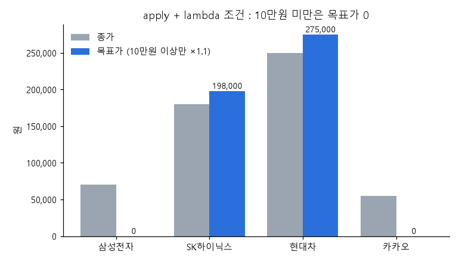
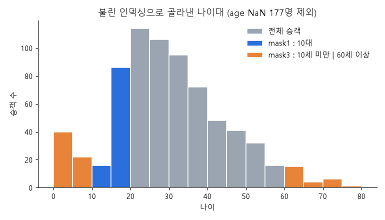
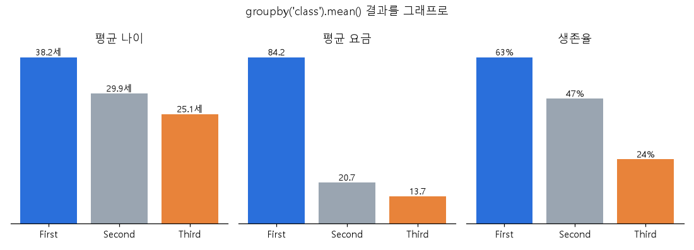
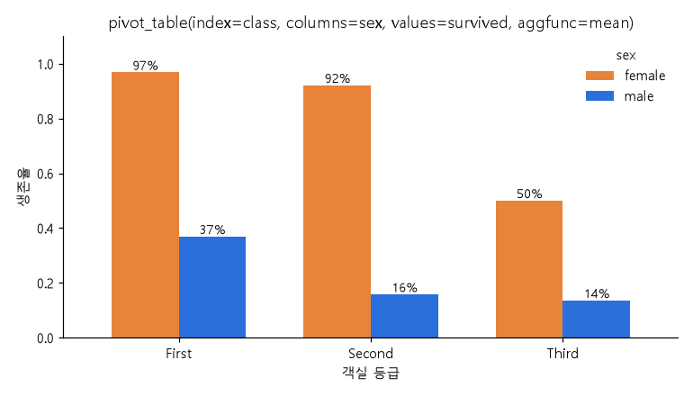
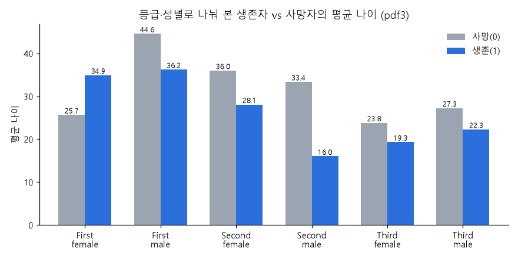

# 데이터프레임 응용 (07.데이터프레임응용.ipynb)

> 이번 파일에서 한 것
> 1. 내가 만든 함수를 데이터에 한 번에 적용하기 (`apply`, `map`, `pipe`)
> 2. 열 순서 바꾸기, 열 하나를 여러 개로 쪼개기
> 3. 조건으로 행 골라내기 (불린 인덱싱, `isin`)
> 4. 표 두 개 합치기 (`concat`, `merge`, `join`)
> 5. 그룹으로 나눠서 계산하기 (`groupby`, `agg`, `filter`)
> 6. 멀티 인덱스 다루기, 피벗 테이블 (`xs`, `pivot_table`)

- 데이터 : seaborn 의 `titanic` (891명), 주가데이터.xlsx, stock price.xlsx, stock valuation.xlsx
- 노트북에는 엑셀 경로가 `./data/` 로 되어 있는데 내 폴더에는 `Data-Pandas/` 에 들어 있다. 실행할 때 경로를 바꿔야 함.
- pandas 버전 3.0 기준. (그래서 출력에 `dtype: str` 이 나온다. 예전 버전은 `object`)
- 노트북에 그래프는 없었는데, 결과표만 봐서는 감이 잘 안 와서 직접 그래프로 그려 봤다. → `img/07_df/`

---

## 목차

1. [함수 매핑](#1-함수-매핑)
   - [1-1. 원소 하나하나에 함수 적용](#1-1-원소-하나하나에-함수-적용)
   - [1-2. 열/행 단위로 함수 적용](#1-2-열행-단위로-함수-적용--dataframeapply)
   - [1-3. 데이터프레임 통째로 함수 적용](#1-3-데이터프레임-통째로-함수-적용--pipe)
   - [map / apply / pipe 정리](#map--apply--pipe-정리)
2. [열 재구성](#2-열-재구성)
3. [필터링](#3-필터링)
4. [데이터프레임 합치기](#4-데이터프레임-합치기)
5. [그룹 연산](#5-그룹-연산)
6. [멀티 인덱스](#6-멀티-인덱스)
7. [피벗 테이블](#7-피벗-테이블)
8. [헷갈렸던 것 / 주의할 점](#8-헷갈렸던-것--주의할-점)
9. [한눈에 요약](#9-한눈에-요약)

---

## 1. 함수 매핑

매핑 = 짝지어 주기. 데이터를 하나씩 꺼내서 함수에 넣고, 나온 값을 원래 자리에 다시 채워 넣는 것.
for 문을 직접 안 돌려도 pandas가 알아서 해 준다.

```
age :  22.0   38.0   26.0  ...
         ↓      ↓      ↓
      add_10 add_10 add_10
         ↓      ↓      ↓
결과 :  32.0   48.0   36.0  ...
```

결국 차이는 **함수 안에 뭐가 들어가느냐** 이다.

| | 함수에 들어가는 것 | 쓰는 메소드 |
|---|---|---|
| 1-1 | 값 하나 (칸 하나) | `Series.apply()`, `Series.map()`, `DataFrame.map()` |
| 1-2 | 시리즈 하나 (열 한 줄 or 행 한 줄) | `DataFrame.apply(axis=0 / 1)` |
| 1-3 | 데이터프레임 전체 | `DataFrame.pipe()` |

### 1-1. 원소 하나하나에 함수 적용

#### 준비

```python
import seaborn as sns

titanic = sns.load_dataset('titanic')    # seaborn 에 들어있는 타이타닉 데이터 (891행)
df = titanic.loc[:, ['age', 'fare']]     # 나이, 요금 열만 가져옴
df['ten'] = 10                           # 모든 행에 10 이 들어간 열 추가 (나중에 행 연산할 때 씀)
print(df.head())
```

```
    age     fare  ten
0  22.0   7.2500   10
1  38.0  71.2833   10
2  26.0   7.9250   10
```

```python
# 사용자 함수 정의
def add_10(n):            # 값 하나 받아서 10 더해서 돌려줌
    return n + 10

def add_two_obj(a, b):    # 값 두 개 받아서 더해서 돌려줌
    return a + b

print(add_10(10))           # 20
print(add_two_obj(10, 10))  # 20
```

함수부터 따로 테스트해 보고 데이터에 적용하는 습관. 함수가 틀리면 apply 결과도 다 틀리니까.

#### 시리즈 원소에 적용 : `Series.apply()`

```python
# age 열(시리즈)의 값 하나하나를 add_10 에 넣는다
sr1 = df['age'].apply(add_10)     # 함수 이름만 쓴다. add_10() 처럼 괄호 붙이면 안 됨!
print(sr1.head())                 # 22.0 → 32.0, 38.0 → 48.0 ...
```

괄호를 안 붙이는 이유 : `add_10()` 은 "지금 당장 실행해라" 이고, `add_10` 은 "이 함수를 넘겨줄게, 네가 알아서 실행해" 라는 뜻.

노트북에 주석 처리해 둔 테스트 코드 :

```python
# def add_10(n):
#     print("처리중:", n)    # 값이 하나씩 들어오는지 눈으로 확인
#     return n + 10
# df['age'].apply(add_10)
```

이거 돌려 보면 `처리중: 22.0`, `처리중: 38.0` ... 이렇게 891번 찍힌다. apply 가 진짜로 값을 하나씩 넣는다는 걸 확인할 수 있음.

```python
# 인자가 2개인 함수 : 첫 번째(a)는 시리즈 값이 자동으로 들어가고, 나머지(b)는 키워드로 따로 넘겨준다
sr2 = df['age'].apply(add_two_obj, b=10)
print(sr2.head())      # sr1 이랑 결과 같음
```

```python
# lambda 로 조건 달기 : 나이가 짝수면 10 더하고, 홀수면 그대로
# sr3 = df['age'].apply(lambda x: add_10(x))       # 이건 그냥 sr1 이랑 똑같음
sr3 = df['age'].apply(lambda x: add_10(x) if x % 2 == 0 else x)
print(sr3.head())
```

```
0    32.0     ← 22 짝수 → +10
1    48.0     ← 38 짝수 → +10
2    36.0     ← 26 짝수 → +10
3    35.0     ← 35 홀수 → 그대로
4    35.0
```

- `lambda x: 식` = 이름 없는 한 줄짜리 함수. `def` 로 따로 만들기 귀찮을 때 씀.
- `A if 조건 else B` = 조건이 참이면 A, 아니면 B. lambda 안에서는 이 형태로만 조건을 쓸 수 있다.
- age 가 NaN 인 경우 : `NaN % 2 == 0` 은 False → else 로 가서 NaN 그대로 남는다. 에러는 안 남.

#### 데이터프레임 원소에 적용 : `DataFrame.map()`

```python
df = titanic.loc[:, ['age', 'fare']]

def add_10(n):
    return n + 10

df_map = df.map(add_10)      # 모든 칸(age, fare 전부)에 +10
print(df_map.head())
```

```
    age     fare
0  32.0  17.2500
1  48.0  81.2833
```

- 데이터프레임은 칸이 가로세로로 있으니까, 칸 전체에 같은 함수를 적용하려면 `map`.
- 예전 버전에서는 `applymap()` 이었는데 이름이 `map()` 으로 바뀌었다. 옛날 블로그 코드에 applymap 나오면 이거라고 생각하면 됨.

#### 금융 예제

```python
import pandas as pd

df = pd.DataFrame({
    '종목': ['삼성전자', 'SK하이닉스', '현대차', '카카오'],
    '종가': [70000, 180000, 250000, 55000],
    '수익률(%)': [2.5, -1.2, 3.8, -0.5],
    '거래량': [1000000, 800000, 450000, 1200000]
})
```

**예제 1. 목표가 = 종가 × 1.1**

```python
def target_price(price):        # 종가 하나 받아서
    return price * 1.10         # 10% 올린 값 반환

df['목표가'] = df['종가'].apply(target_price)    # 결과를 새 열로 추가
# df['목표가'] = df['종가'].map(target_price)    # 시리즈에서는 map 써도 결과 같음
```

사실 이건 `df['종가'] * 1.1` 한 줄이면 된다. 단순 계산은 apply 안 쓰는 게 훨씬 빠름. 여기선 연습용.

**예제 2. 수익률로 신호 붙이기** ← apply 가 진짜 쓸모 있는 경우

```python
def trading_signal(rate):
    if rate >= 3:          # 3% 이상
        return '강한 상승'
    elif rate > 0:         # 0 ~ 3%
        return '상승'
    elif rate <= -1:       # -1% 이하
        return '하락'
    else:                  # -1 ~ 0%
        return '약보합'

df['시장신호'] = df['수익률(%)'].apply(trading_signal)
```

```
       종목  수익률(%)   시장신호
0    삼성전자     2.5     상승
1  SK하이닉스    -1.2     하락
2     현대차     3.8  강한 상승
3     카카오    -0.5    약보합
```

if/elif 가 여러 개 있는 건 그냥 `*` 같은 연산으로는 못 하니까, 이럴 때 함수 만들고 apply 하는 게 제일 읽기 편하다.
(구간 나누기만 하는 거면 `pd.cut()` 도 있음)

**예제 3. 종가 10만원 이상만 목표가 계산, 나머지는 0**

```python
df['목표가'] = df['종가'].apply(
    lambda x: target_price(x) if x >= 100000 else 0    # 함수 + 조건을 lambda 로 묶음
)
```



**그래프 보는 법** : 회색이 원래 종가, 파란색이 apply 로 만든 목표가.
삼성전자(7만)랑 카카오(5.5만)는 10만원이 안 돼서 목표가가 0 으로 바닥에 붙어 있고, SK하이닉스랑 현대차만 종가보다 10% 높은 막대가 생겼다.
lambda 안의 `if ~ else` 가 행마다 다르게 적용됐다는 걸 눈으로 확인하는 용도.

**예제 4. 표 전체를 천 원 단위로** (데이터프레임 → `map`)

```python
prices = pd.DataFrame({
    '삼성전자': [70000, 71000, 72000],
    'SK하이닉스': [180000, 182000, 185000]
}, index=['월요일', '화요일', '수요일'])

def to_thousand(x):
    return x / 1000

result = prices.map(to_thousand)    # 모든 칸을 1000 으로 나눔 → 70.0, 180.0 ...
```

이것도 사실 `prices / 1000` 이면 끝.

**예제 5. 점수 → 등급** (데이터프레임 → `map`)

```python
scores = pd.DataFrame({
    '삼성전자': [90, 65, 30],
    'SK하이닉스': [75, 95, 45]
}, index=['상승점수', '안정점수', '위험점수'])

def grade(score):
    if score >= 80:
        return 'A'
    elif score >= 60:
        return 'B'
    else:
        return 'C'

result = scores.map(grade)     # 칸마다 등급으로 바뀜
```

```
     삼성전자 SK하이닉스
상승점수    A      B
안정점수    B      A
위험점수    C      C
```

**언제 쓰나** : 표 전체 숫자를 글자(등급, 라벨)로 바꾸거나, 모든 칸에 같은 포맷을 적용할 때 (예: `lambda x: f'{x:,}원'`).

---

### 1-2. 열/행 단위로 함수 적용 : `DataFrame.apply()`

여기서부턴 함수에 **값 하나가 아니라 시리즈(한 줄)** 가 통째로 들어간다.

```
axis=0 (기본값) : 열을 하나씩 넣음   → 함수가 열 개수만큼 실행 (age 1번, fare 1번)
axis=1          : 행을 하나씩 넣음   → 함수가 행 개수만큼 실행 (891번)
```

> axis 는 맨날 헷갈림. 그냥 **axis=1 이면 "행마다"** 라고 외웠다. 행끼리 뭔가 계산할 때 axis=1.

#### 리턴값이 시리즈인 경우 → 결과는 데이터프레임

```python
df = titanic.loc[:, ['age', 'fare']]

def missing_value(series):     # 열 하나(시리즈)가 통째로 들어옴
    return series.isnull()     # 같은 길이의 True/False 시리즈를 돌려줌

result = df.apply(missing_value, axis=0)   # 열마다 실행
print(type(result))                        # DataFrame
```

열마다 True/False 시리즈가 나오고, 그걸 다시 붙이니까 원래랑 같은 모양의 데이터프레임이 된다.

#### 리턴값이 값 하나인 경우 → 결과는 시리즈

```python
def min_max(x):                  # 열 하나가 들어옴
    return x.max() - x.min()     # 최대 - 최소 = 범위(숫자 하나)

result = df.apply(min_max)       # axis=0 기본값 → 열마다
print(result)
```

```
age      79.5800      ← 나이 범위 : 80 - 0.42
fare    512.3292      ← 요금 범위 : 512.33 - 0
dtype: float64
```

열마다 숫자 하나씩 나오니까 그걸 모으면 시리즈. **열별 요약값을 내 마음대로 정의해서 뽑고 싶을 때** 쓴다. (`mean`, `max` 같은 건 이미 있으니까 없는 계산만)

#### 행마다 적용 (axis=1)

```python
df = titanic.loc[:, ['age', 'fare']]
df['ten'] = 10

def add_two_obj(a, b):
    return a + b

# x 에는 행 하나(시리즈)가 들어온다 → x['age'], x['ten'] 으로 그 행의 값을 꺼냄
df['add'] = df.apply(lambda x: add_two_obj(x['age'], x['ten']), axis=1)
```

```
    age     fare  ten   add
0  22.0   7.2500   10  32.0
1  38.0  71.2833   10  48.0
```

**언제 쓰나** : 한 행 안에서 **여러 열을 같이 봐야** 할 때.
예) "성별이 여자고 나이가 10살 미만이면 '여아'" 처럼 열 두 개 이상을 조건에 써야 하는 경우.
단, 891행이면 함수가 891번 도는 거라 느리다. 이 예제처럼 그냥 더하기면 `df['age'] + df['ten']` 이 훨씬 빠르다.

---

### 1-3. 데이터프레임 통째로 함수 적용 : `pipe()`

```python
df = titanic.loc[:, ['age', 'fare']]

# ① 각 칸이 NaN 인지 → 데이터프레임 반환
def missing_value(x):
    return x.isnull()

# ② 열마다 NaN 개수 → 시리즈 반환  (①의 결과를 sum : True=1 로 세짐)
def missing_count(x):
    return missing_value(x).sum()

# ③ 전체 NaN 개수 → 숫자 하나 반환  (②의 결과를 또 sum)
def total_number_missing(x):
    return missing_count(x).sum()
```

```python
result_df = df.pipe(missing_value)            # DataFrame
result_series = df.pipe(missing_count)        # Series  : age 177, fare 0
result_value = df.pipe(total_number_missing)  # 숫자    : 177
```

`df.pipe(함수)` 는 `함수(df)` 랑 똑같다. 그럼 왜 쓰냐?

```python
# pipe 없이 → 안쪽부터 읽어야 해서 헷갈림
result = 함수3(함수2(함수1(df)))

# pipe 쓰면 → 위에서 아래로 순서대로 읽힘
result = (df.pipe(함수1)
            .pipe(함수2)
            .pipe(함수3))
```

**언제 쓰나** : 전처리 단계를 함수로 쪼개 놓고 차례로 이어 붙일 때. (결측치 처리 → 이상치 제거 → 파생변수 추가 ...)
지금 예제처럼 함수 하나만 쓸 땐 별 차이 없음.

리턴 타입은 pipe 가 정하는 게 아니라 **내 함수가 뭘 리턴하느냐** 에 따라 달라진다. (DataFrame / Series / 숫자)

---

### map / apply / pipe 정리

| 어디에 | 메소드 | 함수에 들어가는 것 | 실행 횟수 | 예시 |
|---|---|---|---|---|
| Series | `.apply(f)` / `.map(f)` | 값 하나 | 행 수 | 수익률 → 신호 |
| DataFrame | `.map(f)` | 값 하나 | 칸 수 | 점수표 → 등급표 |
| DataFrame | `.apply(f)` | 열 하나 | 열 수 | 열별 범위 |
| DataFrame | `.apply(f, axis=1)` | 행 하나 | 행 수 | 여러 열 같이 보는 조건 |
| DataFrame | `.pipe(f)` | 표 전체 | 1번 | 전처리 함수 이어 붙이기 |

`Series.map()` 은 함수 말고 **딕셔너리**도 넣을 수 있다. `df['sex'].map({'male': 0, 'female': 1})` 이런 식으로 값 바꾸기 할 때 자주 씀.

---

## 2. 열 재구성

### 2-1. 열 순서 바꾸기

```python
titanic = sns.load_dataset('titanic')
df = titanic.loc[0:4, 'survived':'age']    # 0~4행, survived 부터 age 까지 (loc 은 끝 포함)
```

```
   survived  pclass     sex   age
0         0       3    male  22.0
```

열 이름 꺼내는 방법 3가지 :

```python
df.columns                   # Index 객체
df.columns.values            # 배열 (pandas 3 에선 StringArray 로 나옴)
list(df.columns)             # 파이썬 리스트 ← 이게 제일 다루기 편함
```

```python
columns = list(df.columns.values)          # ['survived', 'pclass', 'sex', 'age']

# 알파벳 순 정렬
columns_sorted = sorted(columns)           # ['age', 'pclass', 'sex', 'survived']
df_sorted = df[columns_sorted]             # 리스트 순서대로 열을 다시 뽑으면 그 순서로 나옴

# 역순
columns_reversed = list(reversed(columns_sorted))   # reversed 는 리스트가 아니라서 list() 로 감싸야 함
df_reversed = df[columns_reversed]
```

핵심은 **`df[열이름 리스트]` 하면 그 순서대로 나온다** 는 것. 정렬은 그냥 리스트 순서를 바꾸는 것뿐.
원하는 순서가 있으면 직접 `df[['sex', 'age', 'survived', 'pclass']]` 처럼 써도 됨.

**언제 쓰나** : 보고서용으로 중요한 열을 앞으로 빼거나, 새로 만든 열(예: '목표가')을 원하는 위치로 옮길 때.

### 2-2. 열 분리하기

```python
df = pd.read_excel('./Data-Pandas/주가데이터.xlsx', engine='openpyxl')
print(df.dtypes)       # 연월일 : datetime64
```

```python
df['연월일'] = df['연월일'].astype('str')      # 날짜 → 글자 '2018-07-02'
dates = df['연월일'].str.split('-')            # '-' 기준으로 쪼갬 → ['2018', '07', '02'] 리스트

df['연'] = dates.str.get(0)    # 리스트의 0번 → '2018'
df['월'] = dates.str.get(1)    # 1번 → '07'
df['일'] = dates.str.get(2)    # 2번 → '02'
```

```
          연월일   당일종가 ...     연   월   일
0  2018-07-02  10100 ...  2018  07  02
```

- `.str` 을 붙여야 시리즈 안의 글자 하나하나에 문자열 함수를 쓸 수 있다.
- 쪼갠 결과는 **글자** 라서 '07' 처럼 앞에 0 이 남아 있음. 숫자로 계산하려면 `.astype(int)` 필요.
- 사실 날짜 타입이면 `df['연월일'].dt.year`, `.dt.month` 로 바로 꺼낼 수 있다. 이 예제는 split 연습용.
- `str.split('-', expand=True)` 하면 리스트가 아니라 바로 열 여러 개짜리 데이터프레임으로 나옴.

**언제 쓰나** : '서울특별시 강남구' → 시 / 구, '홍길동(30)' → 이름 / 나이 처럼 한 칸에 정보가 섞여 있을 때.

---

## 3. 필터링

### 3-1. 불린 인덱싱

```python
titanic = sns.load_dataset('titanic')

# 10대(10 ~ 19세)만
mask1 = (titanic.age >= 10) & (titanic.age < 20)   # 행마다 True/False
df_teenage = titanic.loc[mask1, :]                  # True 인 행만 남김
```

```python
# 10세 미만 이면서(AND) 여자
mask2 = (titanic.age < 10) & (titanic.sex == 'female')
df_female_under10 = titanic.loc[mask2, :]
```

```python
# 10세 미만 이거나(OR) 60세 이상, 열은 age/sex/alone 만
mask3 = (titanic.age < 10) | (titanic.age >= 60)
df_under10_morethan60 = titanic.loc[mask3, ['age', 'sex', 'alone']]
```

규칙 정리 :
- 그리고 = `&`, 또는 = `|`, 아니다 = `~`. 파이썬의 `and` / `or` 쓰면 에러 남.
- **조건마다 괄호 필수.** `titanic.age >= 10 & titanic.age < 20` 이렇게 쓰면 `&` 가 먼저 계산돼서 이상해짐.
- `loc[행조건, 열]` 로 쓰면 행 거르기 + 열 고르기를 한 번에 할 수 있다.



**그래프 보는 법** : 회색 막대가 전체 승객의 나이 분포(5살 단위), 색칠된 부분이 마스크로 골라낸 사람들.
- 파란색(10대) : 10~19세 구간만 칠해짐. 그 사이 사람들만 True 가 된 것.
- 주황색(10세 미만 | 60세 이상) : 양쪽 끝 두 군데가 칠해짐. OR 조건이라 떨어져 있는 두 구간이 같이 뽑힌다.
- 전체적으로 20~30대가 제일 많고 아이와 노인은 적다.
- 나이가 NaN 인 177명은 `NaN >= 10` 이 False 라서 어떤 마스크에도 안 들어간다. 그래프에도 없음.

### 3-2. `isin()`

```python
# sibsp(같이 탄 형제/배우자 수)가 3, 4, 5 인 사람

# 불린 인덱싱으로 하면 조건이 3개
mask3 = titanic['sibsp'] == 3
mask4 = titanic['sibsp'] == 4
mask5 = titanic['sibsp'] == 5
df_boolean = titanic[mask3 | mask4 | mask5]

# isin 쓰면 한 줄
isin_filter = titanic['sibsp'].isin([3, 4, 5])
df_isin = titanic[isin_filter]      # 결과 똑같음
```

**언제 쓰나** : "이 값들 중 하나면" 조건. 특정 종목코드 목록, 특정 지역 목록만 뽑을 때 진짜 많이 씀.
반대(목록에 없는 것)는 `~titanic['sibsp'].isin([3, 4, 5])`.

---

## 4. 데이터프레임 합치기

세 가지 차이 :

| | 기준 | 느낌 |
|---|---|---|
| `concat` | 그냥 위아래 / 옆으로 이어 붙임 (인덱스 기준으로 줄 맞춤) | 종이 이어 붙이기 |
| `merge` | **공통 열(key)** 값이 같은 것끼리 | 엑셀 VLOOKUP |
| `join` | **행 인덱스** 가 같은 것끼리 | 인덱스로 하는 merge |

### 4-1. concat (연결)

```python
df1 = pd.DataFrame({'a': ['a0', 'a1', 'a2', 'a3'],
                    'b': ['b0', 'b1', 'b2', 'b3'],
                    'c': ['c0', 'c1', 'c2', 'c3']},
                   index=[0, 1, 2, 3])

df2 = pd.DataFrame({'a': ['a2', 'a3', 'a4', 'a5'],
                    'b': ['b2', 'b3', 'b4', 'b5'],
                    'c': ['c2', 'c3', 'c4', 'c5'],
                    'd': ['d2', 'd3', 'd4', 'd5']},
                   index=[2, 3, 4, 5])
```

**위아래로 붙이기 (axis=0, 기본값)**

```python
result1 = pd.concat([df1, df2])     # 리스트로 묶어서 넣는다
```

```
    a   b   c    d
0  a0  b0  c0  NaN     ← df1 에는 d 열이 없어서 NaN
1  a1  b1  c1  NaN
2  a2  b2  c2  NaN
3  a3  b3  c3  NaN
2  a2  b2  c2   d2     ← 인덱스 2, 3 이 두 번 나옴!
3  a3  b3  c3   d3
4  a4  b4  c4   d4
5  a5  b5  c5   d5
```

인덱스가 중복되면 나중에 `loc[2]` 했을 때 두 줄이 나와서 꼬인다. 그래서 :

```python
result2 = pd.concat([df1, df2], ignore_index=True)   # 인덱스를 0 ~ 7 로 새로 매김
```

**옆으로 붙이기 (axis=1)**

```python
result3 = pd.concat([df1, df2], axis=1)                  # join='outer' 기본 → 합집합
result3_in = pd.concat([df1, df2], axis=1, join='inner') # 교집합 → 인덱스 2, 3 만 남음
```

```
     a    b    c    a    b    c    d        ← 열 이름 a, b, c 가 두 번씩 생김
0   a0   b0   c0  NaN  NaN  NaN  NaN
...
```

옆으로 붙일 땐 **행 인덱스 기준으로 줄을 맞춘다.** 인덱스가 안 겹치는 줄은 NaN.
열 이름이 같아도 합쳐 주지 않고 그냥 둘 다 둔다. → 이러면 `df['a']` 했을 때 열 2개가 나와서 불편함.

**시리즈 붙이기**

```python
sr1 = pd.Series(['e0', 'e1', 'e2', 'e3'], name='e')               # 인덱스 0~3
sr2 = pd.Series(['f0', 'f1', 'f2'], name='f', index=[3, 4, 5])
sr3 = pd.Series(['g0', 'g1', 'g2', 'g3'], name='g')

result4 = pd.concat([df1, sr1], axis=1)              # 시리즈 name 이 열 이름이 됨 → e 열 추가
result5 = pd.concat([df2, sr1], axis=1, sort=True)   # 인덱스 0~5 합집합, 안 맞는 곳 NaN
result6 = pd.concat([sr1, sr3], axis=1)              # 시리즈 2개 옆으로 → 데이터프레임
result7 = pd.concat([sr1, sr3], axis=0)              # 시리즈 2개 위아래로 → 긴 시리즈 (인덱스 0~3 이 두 번)
```

**언제 쓰나** : 1월.xlsx, 2월.xlsx, 3월.xlsx 처럼 **열 구성이 같은 파일 여러 개** 를 하나로 합칠 때. (axis=0 + ignore_index=True 조합이 제일 흔함)

### 4-2. merge (병합)

```python
df1 = pd.read_excel('./Data-Pandas/stock price.xlsx', engine='openpyxl')       # 종목별 주가
df2 = pd.read_excel('./Data-Pandas/stock valuation.xlsx', engine='openpyxl')   # 종목별 재무지표
```

df1 : `id, stock_name, value(시가총액), price` — 10종목
df2 : `id, name, eps, bps, per, pbr` — 10종목

재무 용어 메모
- eps (주당순이익) : 주식 1주가 1년에 번 돈
- bps (주당순자산) : 회사 망해서 다 팔면 1주당 남는 돈
- per = 주가 / eps : 낮을수록 버는 돈에 비해 싸다
- pbr = 주가 / bps : 1 보다 작으면 자산가치보다 싸게 거래되는 중

두 표에 둘 다 있는 종목은 5개뿐 (CJ E&M, 이마트, 삼양사, 종근당, 모두투어리츠).

```
df1 id : 128940 130960 138250 139480 142280 145990 185750 192400 199800 204210
df2 id :        130960        139480        145990 185750               204210  (+ 136480 138040 161390 181710 207940)
                  ↑ 겹치는 건 이 5개
```

```python
# 교집합 (inner, 기본값) : 양쪽에 다 있는 id 만
merge_inner = pd.merge(df1, df2)     # on 안 쓰면 이름이 같은 열(id)을 자동으로 key 로 씀
```
→ 5행

```python
# 합집합 (outer) : 한쪽에만 있어도 다 남김, 없는 쪽은 NaN
merge_outer = pd.merge(df1, df2, how='outer', on='id')
```
→ 15행 (10 + 10 - 겹치는 5)

```python
# 왼쪽 기준 (left) : df1 은 전부 남기고, df2 는 짝이 있는 것만 붙임
# key 열 이름이 서로 다르면 left_on / right_on 으로 각각 지정
merge_left = pd.merge(df1, df2, how='left', left_on='stock_name', right_on='name')
```
→ 10행. id 열이 양쪽에 다 있어서 `id_x`(df1), `id_y`(df2) 로 이름이 바뀐다.

```python
# 오른쪽 기준 (right) : df2 전부 + df1 짝 있는 것
merge_right = pd.merge(df1, df2, how='right', left_on='stock_name', right_on='name')
```

how 정리 :

| how | 남는 행 | 이번 결과 |
|---|---|---|
| `inner` (기본) | 양쪽 다 있는 것 | 5행 |
| `outer` | 한쪽이라도 있는 것 | 15행 |
| `left` | 왼쪽 전부 | 10행 |
| `right` | 오른쪽 전부 | 10행 |

**필터링 + merge 응용**

```python
# 1. df1 에서 주가 5만원 미만만 골라서
mask = df1['price'] < 50000
price = df1[mask]                 # 엔에스쇼핑(13,200), 녹십자엠에스(10,200), 모두투어리츠(3,475)

# 2. 재무 정보랑 합치기 (교집합)
value = pd.merge(price, df2)      # 모두투어리츠 1개만 남음 → 나머지 두 개는 df2 에 없어서
```

```python
# 1만 초과 & 5만 미만
mask = (df1['price'] > 10000) & (df1['price'] < 50000)
price = df1[mask]                 # 엔에스쇼핑, 녹십자엠에스
value = pd.merge(price, df2)      # Empty DataFrame !
```

처음에 왜 비었지? 했는데, 걸러진 두 종목이 df2(재무표)에 아예 없어서 교집합이 0개인 거였다.
**merge 결과가 비거나 너무 적으면 key 값이 양쪽에 실제로 있는지부터 확인하자.**

**언제 쓰나** : 주문표 + 고객표, 주가 + 재무제표 처럼 **공통 키(ID, 코드, 이름)로 다른 정보를 옆에 붙일 때.** 실무에서 제일 많이 쓰는 합치기.

### 4-3. join (결합)

```python
df1 = pd.read_excel('./Data-Pandas/stock price.xlsx', engine='openpyxl')
df2 = pd.read_excel('./Data-Pandas/stock valuation.xlsx', engine='openpyxl')

# 인덱스 설정 없이 바로 join → 둘 다 인덱스가 0~9 라서 "줄 번호" 끼리 붙어버림
# 열 이름이 겹치면(id) 에러 나니까 lsuffix/rsuffix 로 꼬리표를 붙여야 함
df3 = df1.join(df2, lsuffix='_price', rsuffix='_val')
```

```
   id_price stock_name   ...  id_val       name
0    128940       한미약품   ...  130960     CJ E&M     ← 한미약품 옆에 CJ E&M 이 붙음 (틀린 매칭!)
1    130960     CJ E&M   ...  136480         하림
```

이건 **잘못 합쳐진 결과** 다. 종목이 아니라 그냥 0번 줄끼리, 1번 줄끼리 붙었다. 에러가 안 나서 더 위험함.

제대로 하려면 key 를 인덱스로 먼저 만들어야 한다 :

```python
df1.set_index('id', inplace=True)    # id 를 행 인덱스로 (inplace=True : df1 자체를 바꿈)
df2.set_index('id', inplace=True)

df = df1.join(df2)     # 인덱스(id) 같은 것끼리 붙음. 기본은 how='left' → df1 10행 전부 유지
```

```
       stock_name   price    name           eps
id
128940       한미약품  421000     NaN           NaN     ← df2 에 없는 종목은 NaN
130960     CJ E&M   98900  CJ E&M   6301.333333     ← 같은 종목끼리 제대로 붙음
```

**언제 쓰나** : 이미 인덱스가 키(날짜, 코드 등)로 잡혀 있는 표끼리. 주가 시계열(인덱스=날짜) 여러 개 붙일 때 편함.
key 가 열에 있으면 그냥 merge 쓰는 게 덜 헷갈림.

---

## 5. 그룹 연산

groupby 는 3단계로 생각하면 된다.

```
분할(split)          →   적용(apply)      →   결합(combine)
class 별로 나누기         각 그룹 평균 계산       결과를 표 하나로
First  216명              38.2세
Second 184명              29.9세                class | age
Third  491명              25.1세                ...
```

### 5-1. 1개 열 기준

```python
titanic = sns.load_dataset('titanic')
df = titanic.loc[:, ['age', 'sex', 'class', 'fare', 'survived']]   # 891명

grouped = df.groupby(['class'])     # 아직 계산 안 됨. 나눠만 놓은 상태 (그룹 객체)

for key, group in grouped:          # 그룹 객체는 for 로 돌릴 수 있다
    print('* key :', key)           # ('First',)  ← 리스트로 넣어서 튜플로 나옴
    print('* number :', len(group)) # 216
    print(group.head())             # 그 그룹에 속한 행들 (데이터프레임)
```

- First 216명 / Second 184명 / Third 491명
- `groupby(['class'])` 처럼 **리스트** 로 넣으면 key 가 `('First',)` 튜플로 나온다. `groupby('class')` 로 넣으면 `'First'` 글자로 나옴.

```python
# 그룹별 평균
average = grouped.mean(numeric_only=True)    # 숫자 열만 평균
```

```
              age       fare  survived
class
First   38.233441  84.154687  0.629630
Second  29.877630  20.662183  0.472826
Third   25.140620  13.675550  0.242363
```

`numeric_only=True` 를 빼면 sex 열(글자)도 평균 내려다가 `TypeError` 가 난다. pandas 2 부터 이렇게 바뀜.



**그래프 보는 법** : 위의 평균표를 그대로 막대로 옮긴 것. 세 칸 모두 First → Third 로 갈수록 줄어든다.
- 평균 나이 : 1등석이 38세로 제일 많다. 돈 있는 나이 든 사람이 1등석을 탔다는 얘기.
- 평균 요금 : 1등석 84 vs 3등석 13.7, 6배 정도 차이. 등급 차이가 요금에 그대로 보인다.
- 생존율 : **63% → 47% → 24%.** survived 가 0/1 이라서 평균을 내면 그대로 생존 비율이 된다. 등급이 낮을수록 생존율이 확 떨어짐.
- 0/1 열의 평균 = 비율. 이거 알고 나니까 groupby 로 비율 구하는 게 엄청 쉬워졌다.

```python
# 특정 그룹 하나만 꺼내기
group3 = grouped.get_group(('Third',))     # 리스트로 groupby 했으니 key 도 튜플로 줘야 함
```

### 5-2. 여러 열 기준

```python
grouped_two = df.groupby(['class', 'sex'])    # 등급 × 성별 = 6개 그룹

for key, group in grouped_two:
    print('* key :', key)            # ('First', 'female') ...
    print('* number :', len(group))
```

| class | female | male |
|---|---|---|
| First | 94 | 122 |
| Second | 76 | 108 |
| Third | 144 | 347 |

3등석 남자가 347명으로 압도적으로 많다.

```python
group3f = grouped_two.get_group(('Third', 'female'))    # 3등석 여자만

average_two = grouped_two.mean(numeric_only=True)       # 결과 인덱스가 2단 (멀티 인덱스)
```

```
                     age        fare  survived
class  sex
First  female  34.611765  106.125798  0.968085
       male    41.281386   67.226127  0.368852
Second female  28.722973   21.970121  0.921053
       male    30.740707   19.741782  0.157407
Third  female  21.750000   16.118810  0.500000
       male    26.507589   12.661633  0.135447
```

여기서 생존율을 보면 등급보다 **성별 차이가 더 크다.** 이건 아래 피벗 그래프에서 다시.

### 5-3. 집계 agg

```python
def min_max(x):              # 그룹의 열 하나(시리즈)가 들어옴
    return x.max() - x.min()

# 열마다 어떤 함수 쓸지 딕셔너리로 지정
agg_minmax = grouped.agg({
    'age': min_max,
    'fare': min_max,
    'survived': min_max
})
```

```
           age      fare  survived
First    79.08  512.3292         1
Second   69.33   73.5000         1
Third    73.58   69.5500         1
```

1등석 요금 범위가 512 로 엄청 크다. 1등석 안에서도 가격 차이가 컸다는 뜻 (0원 ~ 512).

```python
# 모든 열에 같은 함수 여러 개
agg_all = grouped.agg(['min', 'max'])

# 열마다 다른 함수
agg_sep = grouped.agg({'fare': ['min', 'max'], 'age': 'mean'})

# 열 하나만 골라서 계산
age_mean = grouped.age.mean()       # grouped['age'].mean() 이랑 같음
```

- `agg(['min', 'max'])` 하면 sex 열도 min/max 가 나오는데 글자라서 알파벳 순 (female < male). 의미 없는 값이니 무시.
- 요금 min 이 전부 0.0 인 것 → 공짜로 탄 사람(직원 등)이 있었다는 것. 이상치 의심 포인트.

**언제 쓰나** : 부서별 매출 합계/평균, 지역별 최대·최소, 월별 건수 같은 **"~별 요약"** 은 거의 다 groupby + agg.

### 5-4. 그룹 필터링

```python
# 그룹 크기가 200 이상인 그룹의 행만 남김
grouped_filter = grouped.filter(lambda x: len(x) >= 200)    # x = 그룹 하나(데이터프레임)
```
→ First(216), Third(491) 만 통과. Second(184) 탈락. 결과는 **원래 행들** 그대로 707행.

```python
# 그룹의 평균 나이가 30 미만인 그룹만
age_filter = grouped.filter(lambda x: x.age.mean() < 30)
```
→ Second(29.9), Third(25.1) 통과. First(38.2) 탈락.

filter 는 **그룹 단위로 통과/탈락** 을 정하고, 결과는 요약표가 아니라 **원래 데이터프레임 형태** 로 돌려준다. agg 랑 헷갈리지 말기.

**언제 쓰나** : "주문이 10건 이상인 고객의 주문만", "표본이 너무 적은 그룹은 빼고 분석" 같은 경우.

---

## 6. 멀티 인덱스

```python
grouped = df.groupby(['class', 'sex'])
gdf = grouped.mean()       # 여기선 numeric_only 없어도 됨 (sex 가 인덱스로 빠져서 남은 열이 전부 숫자)
```

인덱스가 (class, sex) 두 단계로 되어 있다. 꺼내는 법 :

```python
gdf.loc['First']                  # 바깥 레벨만 지정 → First 의 female, male 두 줄
gdf.loc[('First', 'female')]      # 두 레벨 다 지정 → 한 줄 (시리즈)
gdf.xs('male', level='sex')       # 안쪽 레벨로 고르기 → 각 등급의 male 만
```

`loc` 은 바깥 레벨부터 순서대로만 지정할 수 있다. 안쪽 레벨(sex)만 가지고 고르고 싶으면 `xs(값, level=레벨이름)`.

---

## 7. 피벗 테이블

엑셀 피벗이랑 똑같다. 정해 줄 것 4가지 : **행(index), 열(columns), 값(values), 계산 방법(aggfunc)**

```python
pdf1 = pd.pivot_table(df,             # 원본 데이터
                      index='class',    # 행에 올 것
                      columns='sex',    # 열에 올 것
                      values='age',     # 계산할 값
                      aggfunc='mean')   # 평균
```

```
sex        female       male
class
First   34.611765  41.281386
Second  28.722973  30.740707
Third   21.750000  26.507589
```

5-2 의 groupby 결과랑 숫자가 같다. 모양만 다름 → groupby 는 세로로 길고, 피벗은 가로세로 표라서 비교하기 편하다.
(groupby 결과에 `.unstack()` 하면 피벗이랑 같은 모양이 됨)

### 생존율 / 생존자 수

```python
pdf2 = pd.pivot_table(df,
                      index='class',
                      columns='sex',
                      values='survived',
                      aggfunc=['mean', 'sum'])    # 함수 2개 → 열이 2단으로 생김
```

```
            mean              sum
sex       female      male female male
class
First   0.968085  0.368852     91   45
Second  0.921053  0.157407     70   17
Third   0.500000  0.135447     72   47
```

- mean = 생존율, sum = 생존자 수 (0/1 이니까 더하면 산 사람 수)



**그래프 보는 법** : pdf2 의 mean 부분을 막대로 그린 것. 주황 = 여자, 파랑 = 남자.
- 여자는 1등석 97%, 2등석 92% 로 거의 다 살았다. 3등석도 50%.
- 남자는 1등석도 37% 이고 2·3등석은 15% 안팎.
- **같은 등급 안에서 남녀 차이가 등급 간 차이보다 훨씬 크다.** "여자와 아이 먼저" 구조를 숫자로 확인한 셈.
- 앞의 groupby 그래프(등급만)에서는 "등급이 낮으면 덜 산다" 까지만 보였는데, 성별을 하나 더 쪼개니까 진짜 큰 요인은 성별이라는 게 보인다. 그룹을 어떻게 나누느냐에 따라 보이는 게 달라진다는 걸 느낌.
- 단, 2등석 여자 92% vs 3등석 여자 50% 처럼 여자끼리는 등급 차이도 크다. 두 요인이 다 영향 있음.

### 행/열 둘 다 여러 개

```python
pdf3 = pd.pivot_table(df,
                      index=['class', 'sex'],     # 행 2단
                      columns='survived',         # 열 : 사망(0) / 생존(1)
                      values=['age', 'fare'],     # 값 2개
                      aggfunc=['mean', 'max'])    # 함수 2개

print(pdf3.index)      # MultiIndex : (class, sex) 6개
print(pdf3.columns)    # MultiIndex : (함수, 값, survived) → 2 × 2 × 2 = 8개
```

열이 3단이다 : `('mean', 'age', 0)` = "평균 / 나이 / 사망자". 처음 보면 복잡한데 바깥부터 읽으면 됨.



**그래프 보는 법** : pdf3 에서 `mean → age` 부분만 꺼낸 것. 그룹마다 회색 = 죽은 사람 평균 나이, 파랑 = 산 사람 평균 나이.
- 대부분 그룹에서 **산 사람이 더 어리다.** 특히 2등석 남자 : 사망 33.4세 vs 생존 16.0세. 2등석 남자 생존자 17명 중 상당수가 아이였다는 뜻.
- 1등석 여자만 반대 (사망 25.7 < 생존 34.9). 근데 1등석 여자 중 죽은 사람은 94명 중 3명뿐이라, 3명 평균이라 크게 의미 두기 어렵다.
- **평균만 보면 안 되고 그 평균이 몇 명짜리인지 같이 봐야 한다.** (pdf2 의 sum, 또는 `aggfunc='count'`)
- 노트북 주석에 적은 "1등급 여성 중 생존자의 평균 나이 : 34.939" 가 이 그래프 맨 왼쪽 파란 막대.

### xs 로 꺼내기

```python
# --- 행 선택 (axis=0 기본) ---
pdf3.xs('First')                               # class = First 인 행들
pdf3.xs(('First', 'female'))                   # First 이고 female 인 한 줄
pdf3.xs('male', level='sex')                   # sex 레벨이 male 인 행들 (각 등급의 남자)
pdf3.xs(('Second', 'male'), level=[0, 'sex'])  # 레벨은 번호(0)나 이름('sex') 둘 다 됨

# --- 열 선택 (axis=1) ---
pdf3.xs('mean', axis=1)                              # mean 열들만
pdf3.xs(('mean', 'age'), axis=1)                     # 평균 나이 열들 (사망/생존) ← 위 그래프 데이터
pdf3.xs(1, level='survived', axis=1)                 # 생존자(1) 열들만
pdf3.xs(('max', 'fare', 0), level=[0, 1, 2], axis=1) # 사망자의 최대 요금
```

`pdf3.xs(('max', 'fare', 0), level=[0, 1, 2], axis=1)` 결과 :

```
               max
              fare
survived         0
class  sex
First  female  151.55
       male    263.00
Second female   26.00
       male     73.50
Third  female   69.55
       male     69.55
```

- `xs` 에서 axis=1 안 쓰면 행에서 찾는다. 열에서 찾고 싶으면 꼭 `axis=1`.
- `level=` 을 쓰면 결과에 그 레벨이 남아 있고(위처럼 max / fare / 0 이 표에 그대로 보임), 안 쓰면 꺼낸 레벨이 사라진다.

**언제 쓰나** : 두 가지 기준으로 교차해서 비교할 때 (등급 × 성별, 지역 × 월, 상품 × 요일).
보고서에 넣을 표는 groupby 보다 pivot_table 이 바로 쓰기 좋다.

---

## 8. 헷갈렸던 것 / 주의할 점

**1) `apply(add_10)` vs `apply(add_10())`**
괄호 붙이면 함수를 실행한 결과를 넘기는 거라 에러 (`TypeError: add_10() missing 1 required positional argument`).

**2) apply 가 항상 좋은 건 아니다**
`df['age'] + 10`, `df['종가'] * 1.1` 처럼 바로 계산되는 건 apply 보다 수십 배 빠르다. apply 는 if 문 같은 복잡한 로직이 필요할 때만.

**3) axis 방향**
`apply(axis=0)` = 열마다 / `apply(axis=1)` = 행마다. `concat(axis=0)` = 위아래 / `concat(axis=1)` = 옆으로.
→ "axis=1 이면 가로 방향으로 뭔가 일어난다" 로 기억.

**4) 불린 인덱싱 괄호, `&` `|`**
`(조건1) & (조건2)`. 괄호 빼거나 `and` 쓰면 에러.

**5) concat 후 인덱스 중복**
위아래로 붙일 땐 거의 항상 `ignore_index=True`.

**6) join 을 인덱스 설정 없이 쓰면 줄 번호끼리 붙는다**
에러 없이 틀린 결과가 나와서 위험. 키를 `set_index` 하고 join 하거나, 그냥 merge 쓰기.

**7) merge 결과가 비었을 때**
코드 문제가 아니라 key 가 양쪽에 없는 경우가 많다. `df1['id'].isin(df2['id'])` 로 미리 확인.

**8) groupby 평균 TypeError**
글자 열이 섞여 있으면 `mean()` 에서 에러 → `mean(numeric_only=True)` 또는 계산할 열만 먼저 골라서.

**9) groupby(['class']) vs groupby('class')**
리스트로 넣으면 key 가 튜플 `('First',)`. 그래서 `get_group(('Third',))` 처럼 튜플로 줘야 했다.

**10) 0/1 열의 평균 = 비율, 합 = 개수**
survived 같은 열에 쓰면 생존율 / 생존자 수가 바로 나온다.

**11) 평균은 표본 수랑 같이 보기**
1등석 여자 사망자 평균 나이 25.7세는 3명짜리 평균. 숫자 하나만 보고 결론 내리면 안 됨.

---

## 9. 한눈에 요약

| 하고 싶은 것 | 코드 |
|---|---|
| 열 값 하나하나에 함수 | `df['열'].apply(함수)` |
| 조건 붙여서 적용 | `df['열'].apply(lambda x: A if 조건 else B)` |
| 표 전체 칸에 함수 | `df.map(함수)` |
| 열마다 요약값 | `df.apply(함수)` |
| 행마다 여러 열 같이 계산 | `df.apply(lambda r: ..., axis=1)` |
| 전처리 함수 이어 붙이기 | `df.pipe(f1).pipe(f2)` |
| 열 순서 바꾸기 | `df[열이름리스트]` |
| 글자 쪼개기 | `df['열'].str.split('-').str.get(0)` |
| 조건으로 행 고르기 | `df.loc[(조건1) & (조건2), 열]` |
| 목록 중 하나인 행 | `df['열'].isin([...])` |
| 위아래로 이어 붙이기 | `pd.concat([df1, df2], ignore_index=True)` |
| 키로 합치기 | `pd.merge(df1, df2, how='left', on='키')` |
| 인덱스로 합치기 | `df1.join(df2)` (인덱스 먼저 set_index) |
| ~별 평균 | `df.groupby('열').mean(numeric_only=True)` |
| 열마다 다른 집계 | `grouped.agg({'열1': 'mean', '열2': ['min', 'max']})` |
| 조건 맞는 그룹만 남기기 | `grouped.filter(lambda g: ...)` |
| 교차표 | `pd.pivot_table(df, index=, columns=, values=, aggfunc=)` |
| 멀티 인덱스 안쪽 레벨로 고르기 | `df.xs(값, level='레벨', axis=0 또는 1)` |
