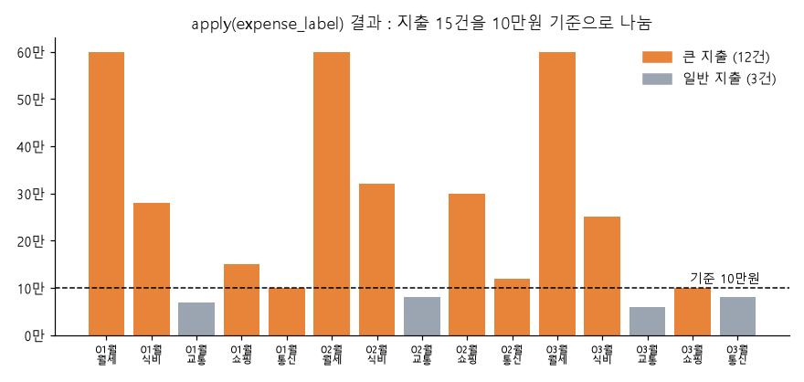
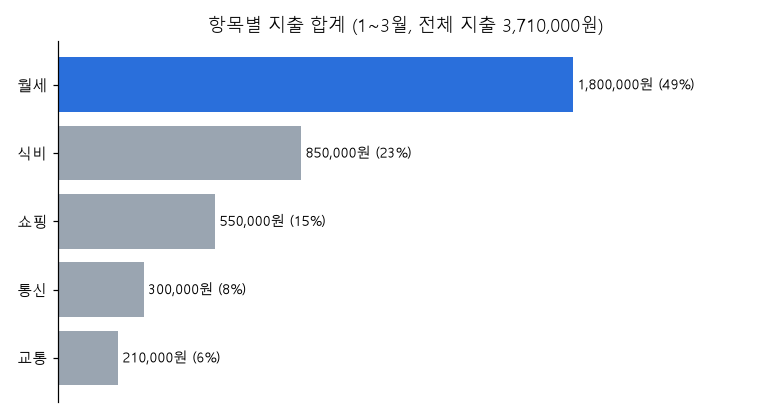
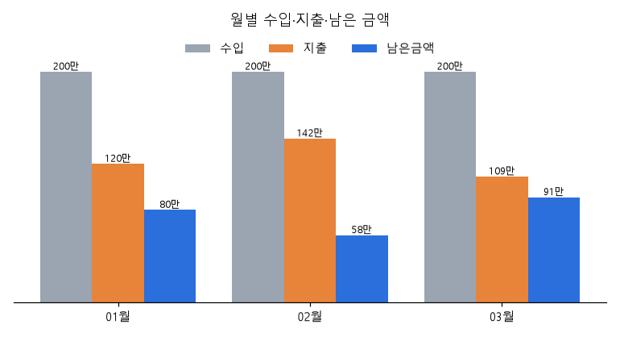
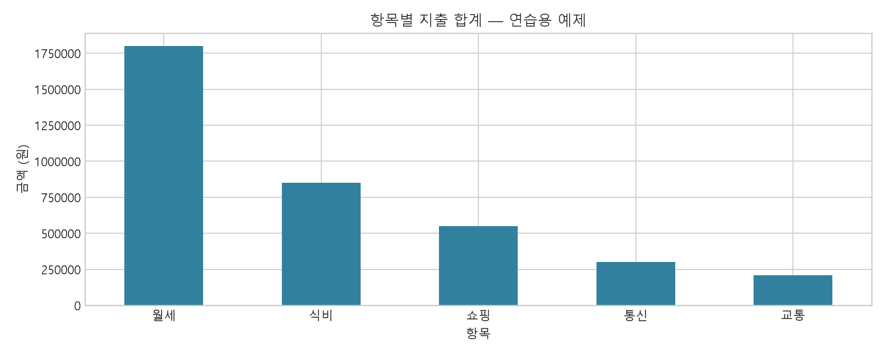
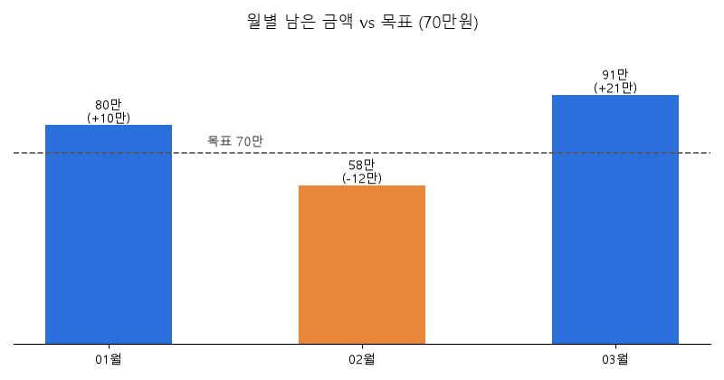

# 나의 입출금 시스템 (나의 입출금 시스템.ipynb)

> 이 프로젝트에서 하는 것
> 통장 거래 내역(1~3월, 18건)을 데이터프레임으로 만들고,
> 수입/지출을 나눠서 **얼마 벌고 얼마 썼는지, 어디에 제일 많이 썼는지** 를 확인한다.
> 07 데이터프레임응용에서 배운 마스크 필터링, `apply`, `isin`, `groupby` 를 실제로 써먹는 연습.

**최종 목표 (노트북 맨 위에 적어 둔 것)**
- 전체 수입 · 지출 · 남은 금액
- 항목별 지출 순위 / 어디에 많이 썼는지
- 월별 수입 · 지출 · 남은 금액 표
- 항목별 지출 그래프 1개 + CSV 2개 (월별요약, 항목별지출)

**지금까지 한 것** : 목표 전부 완료 (0 ~ 7단계) + 미니실습 (8단계). 결과물은 `outputs/` 폴더에 png 1개, csv 2개.

---

## 목차

0. [환경 설정](#0-환경-설정)
1. [데이터 만들기](#1-데이터-만들기)
2. [수입과 지출 나누기 : 마스크](#2-수입과-지출-나누기--마스크)
3. [표시열 만들기 : apply / 필터링 : isin](#3-표시열-만들기--apply)
4. [항목별 지출 순위 : groupby + sort](#4-항목별-지출-순위--groupby--sort)
5. [월별 표 : pivot_table](#5-월별-수입--지출--남은-금액--pivot_table)
6. [지출 합계 그래프](#6-지출-합계-그래프)
7. [CSV 로 저장](#7-csv-로-저장)
8. [미니실습](#8-미니실습)
9. [헷갈렸던 것 / 주의할 점](#9-헷갈렸던-것--주의할-점)
10. [한눈에 요약](#10-한눈에-요약)

---

## 0. 환경 설정

```python
import pandas as pd                    # 표 데이터
import matplotlib.pyplot as plt        # 그래프 (6장 항목별 지출 그래프)
from pathlib import Path               # 폴더/파일 경로 다루기
from IPython.display import display    # 표를 예쁘게 출력 (print 보다 보기 좋음)

# 산출물 저장 폴더 지정
OUTPUT = Path('outputs')               # 노트북 위치 기준 outputs 폴더
OUTPUT.mkdir(exist_ok=True)            # 없으면 만들고, 이미 있으면 그냥 넘어감 (에러 안 남)
```

- `exist_ok=True` 안 쓰면 두 번째 실행할 때 `FileExistsError` 남. 노트북은 셀을 여러 번 돌리니까 꼭 넣기.
- `Path('outputs') / '월별요약.csv'` 처럼 `/` 로 경로를 이어 붙일 수 있다. 문자열 더하기보다 편함.
- `display()` 는 주피터에서 셀 마지막 줄이 아니어도 표 모양으로 보여 준다. 한 셀에서 표 여러 개 보고 싶을 때 씀.

---

## 1. 데이터 만들기

데이터 규칙
- 한 줄 = 거래 한 건
- 금액은 원 단위, **항상 양수**. 수입인지 지출인지는 `구분` 열로 나눈다.
- 수입 : 월급 / 지출 : 월세 · 식비 · 교통 · 쇼핑 · 통신

```python
# 리스트 안에 리스트 : [날짜, 구분, 항목, 금액] 이 한 줄
data = [
    ['2026-01-01', '수입', '월급', 2000000],
    ['2026-01-05', '지출', '월세', 600000],
    ...                                       # 한 달에 6건씩 x 3개월 = 18건
    ['2026-03-25', '지출', '통신', 80000],
]

# 컬럼명 : '날짜', '구분', '항목', '금액'
df = pd.DataFrame(data, columns=['날짜', '구분', '항목', '금액'])
display(df)
print('내역 수:', len(df))     # 18
```

리스트의 리스트로 만들 때는 `columns=` 로 열 이름을 따로 줘야 한다. (딕셔너리로 만들 땐 키가 열 이름)

### 데이터 확인

```python
display(df.head())                  # 처음 5행
print(df['구분'].value_counts())    # 값별 개수 → 지출 15, 수입 3
print('빠진 값:', df.isna().sum().sum())   # 0
```

- `value_counts()` : 어떤 값이 몇 번 나왔는지. 범주형 열 처음 볼 때 제일 먼저 해 보는 것.
- `isna().sum().sum()` : 첫 번째 sum = 열별 NaN 개수, 두 번째 sum = 전체 NaN 개수. (07 의 pipe 예제랑 같은 원리)
- 1월 월급은 0번 행, 1월 월세는 1번 행. 매달 6행씩 반복되는 구조라서 2월 월급은 6번, 3월 월급은 12번.

> 실제 통장 내역이면 환불(-), 계좌 이체(내 통장끼리), 카드대금(카드 사용 내역이랑 중복) 같은 게 섞여 있다.
> 그대로 더하면 지출이 두 번 잡히거나 하니까, 실제 데이터 쓸 땐 이런 것부터 걸러야 한다.

---

## 2. 수입과 지출 나누기 : 마스크

```python
# 구분이 '수입' 인 행만 / '지출' 인 행만
income = df[df['구분'] == '수입'].copy()
expenses = df[df['구분'] == '지출'].copy()

display(income)             # 3행 (매달 월급)
display(expenses.head())    # 15행 중 앞 5개
```

- `df['구분'] == '수입'` → 행마다 True/False (마스크). `df[마스크]` 하면 True 인 행만 남는다.
- 인덱스는 원래 번호 그대로 (income 은 0, 6, 12). 새로 매기고 싶으면 `.reset_index(drop=True)`.

**`.copy()` 를 붙인 이유**
바로 다음 단계에서 `expenses['표시'] = ...` 로 새 열을 추가하는데, copy 없이 하면 `SettingWithCopyWarning` 이 뜬다.
필터링한 결과가 원본의 "일부를 보는 것" 인지 "새로 복사한 것" 인지 pandas 가 확실하지 않아서 경고하는 것.
**거른 다음에 열을 추가하거나 값을 바꿀 거면 `.copy()` 붙이기.**

### 전체 수입 / 지출 / 남은 금액

```python
total_income = income['금액'].sum()       # 6,000,000
total_expense = expenses['금액'].sum()    # 3,710,000
remaining = total_income - total_expense  # 2,290,000

print(f'전체 수입: {total_income:,}원')   # :, → 천 단위 쉼표
print(f'전체 지출: {total_expense:,}원')
print(f'남은 금액: {remaining:,}원')
```

```
전체 수입: 6,000,000원
전체 지출: 3,710,000원
남은 금액: 2,290,000원
```

- f-string 안에서 `{값:,}` 하면 `6000000` → `6,000,000`. 금액 출력할 때 필수.
- 3개월 동안 번 돈의 약 **38%(229만원)** 를 남겼다. 한 달 평균 약 76만원 저축한 셈.

---

## 3. 표시열 만들기 : apply

10만원 이상이면 '큰 지출', 미만이면 '일반 지출' 표시를 붙인다.

```python
def expense_label(amount):       # 금액 1개를 받아서
    if amount >= 100000:         # 10만원 이상이면
        return '큰 지출'
    else:
        return '일반 지출'

# 금액 열의 값을 하나씩 함수에 넣고 결과를 '표시' 열로 추가
expenses['표시'] = expenses['금액'].apply(expense_label)
display(expenses[['항목', '금액', '표시']])     # 보고 싶은 열만 골라서 출력
```

- 07 정리의 "시리즈 원소에 함수 매핑" 그대로. 함수 이름만 넘긴다 (`expense_label()` 아님).
- lambda 한 줄로 쓰면 : `expenses['금액'].apply(lambda x: '큰 지출' if x >= 100000 else '일반 지출')`
- `>=` 라서 **딱 10만원(1월 통신, 3월 쇼핑)도 큰 지출** 로 들어간다. 경계값 포함인지 아닌지 항상 확인하기.



**그래프 보는 법** : 지출 15건을 날짜순으로 하나씩 막대로 세운 것. 점선이 10만원 기준선.
- 주황(큰 지출) 12건, 회색(일반 지출) 3건. 일반 지출은 **전부 교통비** 다 (7만, 8만, 6만).
- 1월 통신, 3월 쇼핑은 막대 끝이 점선에 딱 붙어 있는데 주황색이다. `>=` 라서 큰 지출로 분류된 것.
- 3월 통신(8만)은 점선 아래라 회색. 같은 통신비인데 달마다 분류가 다르다.
- 결론 : 10만원 기준이면 거의 다 큰 지출이 돼서 구분하는 의미가 별로 없다. 기준을 20만원쯤으로 올리면 월세 · 식비 · 2월 쇼핑만 남아서 더 쓸모 있을 것 같다.

### 큰 지출만 / 식비·쇼핑만

```python
# 마스크 : 금액 10만원 이상인 행만
big_expenses = expenses[expenses['금액'] >= 100000]

# isin : 항목이 식비 또는 쇼핑인 행만
food_shopping = expenses[expenses['항목'].isin(['식비', '쇼핑'])]

display(big_expenses.head())
display(food_shopping)          # 6행 (식비 3 + 쇼핑 3)
```

- `isin(['식비', '쇼핑'])` = `(expenses['항목'] == '식비') | (expenses['항목'] == '쇼핑')` 를 짧게 쓴 것.
- 식비 + 쇼핑 = 140만원. 고정비(월세 · 통신)가 아니라 **내가 줄일 수 있는 돈** 이라서 따로 보는 의미가 있다.
- `big_expenses` 는 이미 만든 '표시' 열로도 거를 수 있다 : `expenses[expenses['표시'] == '큰 지출']`.
  지금은 기준(10만원)이 두 군데 적혀 있어서, 기준을 바꾸면 둘 다 고쳐야 한다. 변수 하나로 빼 두는 게 좋음 → [9장](#9-헷갈렸던-것--주의할-점)

---

## 4. 항목별 지출 순위 : groupby + sort

```python
# 항목별로 묶어서 → 금액 열만 → 합계
category_total = expenses.groupby('항목')['금액'].sum()

# 큰 금액부터 정렬 (ascending=False : 내림차순)
category_total = category_total.sort_values(ascending=False)

display(category_total)
print('가장 큰 지출 항목:', category_total.index[0])      # 정렬했으니 0번이 1등
print(f'해당 항목 합계: {category_total.iloc[0]:,}원')     # iloc : 위치로 꺼내기
```

```
항목
월세    1800000
식비     850000
쇼핑     550000
통신     300000
교통     210000
```

- `groupby('항목')['금액'].sum()` : "항목별 금액 합계". 결과는 시리즈 (인덱스 = 항목 이름).
- `['금액']` 을 먼저 골라 주는 게 좋다. 안 고르면 날짜, 구분 같은 글자 열까지 더하려고 해서 이상한 값이 나오거나 에러가 난다.
- `index[0]` 은 항목 이름(월세), `iloc[0]` 은 값(1,800,000).
- 정렬 안 하고 1등만 알고 싶으면 `category_total.idxmax()` (이름), `.max()` (값) 도 됨.



**그래프 보는 법** : 위 표를 가로 막대로 그린 것. 괄호 안은 전체 지출(371만원) 중 비율.
- **월세가 49%** 로 지출의 절반 가까이 된다. 매달 60만원씩 고정.
- 식비 23% → 쇼핑 15% → 통신 8% → 교통 6% 순.
- 월세는 줄이기 어려운 고정비라서, 실제로 아낄 수 있는 건 2 · 3등인 **식비 + 쇼핑 (38%)** 쪽이다.
- 노트북에서 실제로 그린 세로 막대 그래프는 [6장](#6-지출-합계-그래프)에 있다.

---

## 5. 월별 수입 · 지출 · 남은 금액 : pivot_table

### 5-1. 날짜에서 월 꺼내기

```python
# 날짜가 지금은 글자(str) → 날짜 타입으로 바꿔야 월을 꺼낼 수 있음
df['날짜'] = pd.to_datetime(df['날짜'])

# .dt.month : 날짜에서 월만 꺼내기 → 1, 2, 3
df['월'] = df['날짜'].dt.month
# =>  df['월'] = df['날짜'].str[:7] -> 날짜타입으로 안바꾼 경우

display(df.head())
```

```
          날짜  구분  항목       금액  월
0 2026-01-01  수입  월급  2000000  1
1 2026-01-05  지출  월세   600000  1
```

- `pd.to_datetime()` : `'2026-01-01'` 은 그냥 글자라 월을 못 꺼낸다. 날짜 타입(datetime)으로 바꾸면 `.dt.year`, `.dt.month`, `.dt.day` 를 쓸 수 있다.
- `.dt` 는 글자 열에 `.str` 붙이는 거랑 같은 원리. "이 열 안의 날짜 하나하나에" 라는 뜻.
- **연도까지 붙여서 묶고 싶으면** `df['날짜'].dt.strftime('%Y-%m')` → `'2026-01'`.
  `.dt.month` 만 쓰면 2025년 3월이랑 2026년 3월이 둘 다 `3` 으로 합쳐진다. 지금은 2026년 데이터뿐이라 상관없지만, 실제 통장 내역처럼 1년 넘게 쌓이면 연-월로 묶어야 함.
- 주석에 적어 둔 `str[:7]` 은 **날짜 타입으로 바꾸기 전** (글자일 때) 쓰는 방법. 바꾼 뒤에 쓰면 에러 남. 둘 중 하나만.

### 5-2. 피벗으로 월별 표 만들기

```python
# 피벗 : 행 = 월, 열 = 수입/지출, 값 = 금액 합계
monthly = pd.pivot_table(df,
                         index='월',          # 행에 올 것
                         columns='구분',      # 열에 올 것 (수입, 지출)
                         values='금액',       # 계산할 값
                         aggfunc='sum',       # 합계
                         fill_value=0)        # 빈칸은 0 으로 (수입 없는 달 대비)

# 남은 금액 = 수입 - 지출
monthly['남은금액'] = monthly['수입'] - monthly['지출']
display(monthly)
```

피벗이 하는 일을 그림으로 보면 :

```
[피벗 전] 세로로 긴 거래 18줄               [피벗 후] 3행 x 2열 요약표

월  구분   금액                              구분     수입      지출
1   수입  2000000    ─┐                      월
1   지출   600000     │  1월 · 지출 칸으로    1     2000000   1200000   ← 60+28+7+15+10만
1   지출   280000     │  모여서 sum           2     2000000   1420000
1   지출    70000     │                       3     2000000   1090000
1   지출   150000     │
1   지출   100000    ─┘
2   수입  2000000
...
```

- `index` 값들이 행, `columns` 값들이 열이 되고, 같은 칸에 들어오는 `values` 를 `aggfunc` 로 합친다.
- 엑셀 피벗 테이블에서 행 / 열 / 값 칸에 드래그하던 거랑 똑같다.
- `fill_value=0` : 어떤 달에 수입이 없으면 그 칸이 NaN 이 되고, NaN 이 있으면 `수입 - 지출` 도 NaN 이 된다. 0 으로 채워 두면 `0 - 지출` 로 제대로 계산됨.
- 피벗 후에는 '수입', '지출' 이 열 이름이 되니까 `monthly['수입'] - monthly['지출']` 로 바로 뺄 수 있다.
- 같은 결과 다른 방법 : `df.groupby(['월', '구분'])['금액'].sum().unstack()` (07 정리의 "groupby + unstack = 피벗")

```
구분       수입       지출    남은금액
월
1   2000000  1200000  800000
2   2000000  1420000  580000
3   2000000  1090000  910000
```

검산 : 80만 + 58만 + 91만 = **229만** → 2장에서 구한 전체 남은 금액이랑 같다. 피벗이 맞게 됐는지 이렇게 확인하면 좋다.



**그래프 보는 법** : 위 `monthly` 표를 달마다 막대 3개로 그린 것. 회색 = 수입, 주황 = 지출, 파랑 = 남은 금액.
(노트북에는 없는 그래프. 표만 보면 감이 안 와서 따로 그려 봤다.)
- 수입이 매달 200만원으로 똑같으니까 **남은 금액은 지출에 따라서만 오르내린다.** 주황이 높으면 파랑이 낮다.
- 2월에 지출 142만원으로 제일 많이 쓰고 58만원만 남았다. 원인은 2월 쇼핑 30만원 (1월 15만, 3월 10만의 2~3배) + 식비 32만원.
- 3월은 식비 · 쇼핑 · 통신을 다 줄여서 91만원 남김. 석 달 중 제일 잘함.
- 월세 60만원은 매달 똑같아서 달마다 차이는 전부 식비 · 쇼핑 · 통신 · 교통에서 나온다.

**언제 쓰나** : 거래 내역, 주문 내역처럼 한 줄씩 쌓이는 데이터를 **"~별 x ~별" 요약표** 로 만들 때. 월 x 구분, 월 x 항목, 지역 x 상품 등.
지출만 걸러서 `columns='항목'` 으로 바꾸면 "몇 월에 뭐에 얼마 썼는지" 표가 된다.

### 5-3. 남은 금액이 가장 큰 달

```python
# 남은금액이 가장 큰 달을 출력
best_month = monthly['남은금액'].idxmax()            # 3
best_amount = monthly['남은금액'].max()              # 910000

best_date = df[df['월'] == best_month]['날짜'].iloc[0]   # 3월 첫 거래 날짜 → 2026-03-01

print(f'남은 금액이 가장 큰 달: {best_date:%Y-%m}')     # 2026-03
print(f'남은 금액: {best_amount:,}원')
```

```
남은 금액이 가장 큰 달: 2026-03
남은 금액: 910,000원
```

**`max()` vs `idxmax()`**

| | 알려 주는 것 | 결과 |
|---|---|---|
| `max()` | 제일 큰 **값** (얼마?) | 910000 |
| `idxmax()` | 제일 큰 값의 **인덱스** (어디?) | 3 |

- `monthly` 의 인덱스가 월이니까 `idxmax()` 가 바로 "몇 월" 이 된다. 4장의 `category_total` 에 쓰면 인덱스가 항목이라 `'월세'` 가 나옴.
- 가장 적은 달은 `idxmin()`, `min()` → 2월, 58만원.
- 1등이 여러 개면 맨 처음 것 하나만 나온다.
- 데이터프레임 전체에 쓰면 열마다 나온다 : `monthly.idxmax()` → 수입 1, 지출 2, 남은금액 3.

**`3` 을 `2026-03` 으로 출력하기**
처음엔 `3월` 로 나왔는데, 연도까지 보이게 바꾸고 싶었다.
- `df[df['월'] == best_month]['날짜'].iloc[0]` : 3월 거래들 중 첫 번째 날짜(`2026-03-01`)를 통째로 가져옴. 날짜 안에 연도가 들어 있으니까 따로 안 꺼내도 된다.
- `{best_date:%Y-%m}` : f-string 안에서 날짜를 원하는 모양으로. `{금액:,}` 가 쉼표 붙이는 거랑 같은 자리.

| 기호 | 뜻 | 예 |
|---|---|---|
| `%Y` | 연도 4자리 | 2026 |
| `%m` | 월 2자리 | 03 |
| `%d` | 일 2자리 | 01 |

`{best_date:%Y년 %m월}` 로 쓰면 `2026년 03월`.

---

## 6. 지출 합계 그래프

### 방법 1 : 맑은 고딕 직접 지정 (윈도우 전용)

```python
plt.rc('font', family='Malgun Gothic')   # 윈도우 기본 글꼴이라 경로 없이 이름만
plt.rc('axes', unicode_minus=False)      # 마이너스(-) 기호 깨짐 방지

ax = category_total.plot(kind='bar', figsize=(10, 6), color='#31819e', rot=0,
                         title='항목별 지출 합계 — 연습용 예제',
                         ylabel='금액 (원)')

ax.set_axisbelow(True)                         # 격자를 막대 뒤로
ax.grid(True)

ax.ticklabel_format(axis='y', style='plain')   # 1e6 줄임 끄기 → 1750000
plt.show()
```

처음엔 `'../Data-Pandas/malgun.ttf'` 파일 경로로 글꼴을 불러오려다가 `FileNotFoundError` 가 났다.
이 노트북은 `50. Project` 폴더에 있어서 `../` 로 올라가면 `01. 프로그래밍 기초/Data-Pandas` 를 찾는데 그런 폴더가 없음. (실제 파일은 `02. 데이터분석/src/Data-Pandas/` 에 있다)
근데 맑은 고딕은 윈도우에 이미 깔려 있어서 **파일 경로 없이 이름만** 주면 됐다.

`.plot()` 옵션 정리

| 옵션 | 뜻 |
|---|---|
| `kind='bar'` | 세로 막대 (`'barh'` 는 가로 막대) |
| `figsize=(10, 6)` | 그림 크기 (가로, 세로) 인치 |
| `color='#31819e'` | 막대 색 (청록) |
| `rot=0` | x축 글자 회전 각도. bar 는 기본 90도라 세로로 누워 나옴 → 0 으로 똑바로 |
| `title=`, `ylabel=` | 제목, y축 이름. `ax.set_title()` 으로 따로 써도 결과 같음 |

x축 이름 '항목' 은 안 썼는데 자동으로 나온다. `category_total` 의 인덱스 이름이 '항목' 이라서.

**y축이 `1.75` 로 나왔던 이유**
숫자가 크면 matplotlib 이 알아서 줄여 쓰고 축 맨 위에 작게 `1e6` (= 100만) 을 붙인다. `1.75` 는 `1.75 x 1,000,000 = 175만` 이라는 뜻.
`ticklabel_format(axis='y', style='plain')` 으로 줄여 쓰기를 끄면 1750000 그대로 나온다.
쉼표까지 붙이고 싶으면 `ax.yaxis.set_major_formatter('{x:,.0f}')`.

**`ax` 랑 `ax.yaxis`**

```
ax              ← 그래프 칸 전체 (막대, 제목, 격자 ...)
├── ax.xaxis    ← 가로축 : 월세, 식비 ...
└── ax.yaxis    ← 세로축 : 0, 250000, 500000 ...
```

`.plot()` 은 그린 그래프 칸(`ax`)을 돌려준다. 그래서 `ax = ...plot()` 으로 받아 두면 뒤에서 격자, 눈금 같은 걸 더 손볼 수 있다.
제목처럼 자주 쓰는 건 `ax.set_title()` 바로가기가 있고, 눈금 숫자 모양처럼 축 하나에만 해당하는 건 `ax.yaxis.` 를 거쳐서 설정.

**격자가 막대 앞에 그려지는 문제** → `ax.set_axisbelow(True)` 하면 격자가 막대 뒤로 간다.
막대가 5개뿐이라 세로 격자는 굳이 필요 없음. `ax.grid(True, axis='y')` 면 금액 읽는 가로선만 남는다.

### 방법 2 : 교수님 코드 (어느 컴퓨터에서든 한글 나오게)

```python
# 방법 2

from matplotlib import font_manager

plt.style.use('seaborn-v0_8-whitegrid')    # 흰 배경 + 회색 격자 스타일 (격자가 원래 막대 뒤에 그려짐)

# 이 컴퓨터에 설치된 글꼴 이름 전부 → set (중복 제거)
font_names = {font.name for font in font_manager.fontManager.ttflist} # set 구조, system fonts

# 후보 목록 앞에서부터 보면서 설치된 것 중 첫 번째 하나 고르기. 하나도 없으면 None
font = next((name for name in ['Noto Sans CJK KR', 'Noto Sans CJK JP', 'Malgun Gothic', 'AppleGothic', 'NanumGothic']
             if name in font_names), None)
plt.rcParams['font.family'] = font or 'DejaVu Sans'   # None 이면 기본 글꼴 (한글은 깨짐)
plt.rcParams['axes.unicode_minus'] = False   # -부호 깨짐 방지

# 한글 글꼴을 못 찾았을 때만 항목 이름을 영어로 바꾼 복사본
plot_data = category_total.copy()
if font is None:
    plot_data.index = plot_data.index.map({
        '월세': 'Rent', '식비': 'Food', '교통': 'Transport', '쇼핑': 'Shopping', '통신': 'Phone'})

ax = category_total.plot(kind='bar', figsize=(10, 4), color='#31819e', rot=0,
                         title='항목별 지출 합계 — 연습용 예제',
                         ylabel='금액 (원)')

ax.ticklabel_format(axis='y', style='plain')   # 1e6 줄임 끄기 → 1750000 (과학적 표기법)
plt.tight_layout() # 여백과 요소 사이의 간격을 자동으로 조정, 글자/축 레이어가 잘리지 않도록 하는 함수

plt.savefig(OUTPUT / '항목별지출.png', dpi=200)  # dpi : Dots per inch : 인치당 점의 개수
plt.show()
plt.close()
```

방법 1 이랑 다른 점

| | 방법 1 (내 코드) | 방법 2 (교수님) |
|---|---|---|
| 글꼴 | 맑은 고딕 고정 | 설치된 한글 글꼴 중 있는 걸 골라 씀 |
| 윈도우 | 됨 | 됨 (맑은 고딕이 골라짐) |
| 맥 / 코랩 | 한글 □□ 로 깨짐 | AppleGothic / Noto Sans CJK 로 나옴 |
| 격자 | `grid`, `set_axisbelow` 직접 | `style.use` 한 번으로 해결 |
| 파일 저장 | 안 함 | `savefig` 로 png 저장 |

- `next((... for ... if ...), None)` : 조건에 맞는 첫 번째 하나만 꺼내는 문법. for 문 돌다가 찾으면 바로 멈추는 거랑 같다.
- `font or 'DejaVu Sans'` : font 가 None 이면 뒤에 것. "없으면 이거" 할 때 자주 쓰는 패턴.
- 내 컴퓨터에서 돌려 보면 `font` 는 `'Malgun Gothic'` 이 된다 (앞의 Noto 두 개는 윈도우에 보통 없음).
- 과제 제출하거나 다른 컴퓨터에서 돌릴 수 있으면 방법 2 가 안전하다.

> **고칠 점** : `plot_data` 를 만들어 놓고 그래프는 `category_total.plot(...)` 으로 그리고 있다.
> 그래서 한글 글꼴이 없을 때 영어 이름으로 바꾼 게 그래프에 반영이 안 된다. `plot_data.plot(...)` 으로 바꿔야 의도대로 동작함.
> (윈도우에서는 font 가 None 이 아니라서 결과는 똑같이 나온다)

**저장 관련**
- `plt.tight_layout()` : 제목, 축 이름이 그림 밖으로 잘리지 않게 여백 자동 조정. 저장하기 전에 해 줘야 저장 파일에도 반영됨.
- `plt.savefig(경로, dpi=200)` : 그림을 파일로 저장. dpi 는 1인치에 점 몇 개 → 클수록 선명하고 파일도 커진다. 화면용 100, 보고서용 200~300.
- **순서 주의 : `savefig` 를 `show` 보다 먼저.** `show()` 하고 나면 그림이 비워져서, 뒤에서 `savefig` 하면 빈 흰 그림이 저장된다.
- `plt.close()` : 다 쓴 그림 닫기. 그래프를 여러 개 그릴 때 메모리랑 겹쳐 그려지는 걸 막음.



**그래프 보는 법** : `outputs/항목별지출.png` 로 실제 저장된 그림. 1~3월 지출 합계를 항목별로, 큰 것부터 정렬해서 그렸다 (`category_total` 이 이미 내림차순이라 그대로 그 순서).
- 월세(180만)가 혼자 압도적으로 높다. 전체 지출 371만원 중 **49%**.
- 식비 85만(23%) → 쇼핑 55만(15%) → 통신 30만(8%) → 교통 21만(6%).
- 월세는 계약된 고정비라 당장 못 줄인다. 실제로 줄일 수 있는 건 2 · 3등 **식비 + 쇼핑 = 140만 (38%)**.
- 위 월별 그래프에서 2월에 덜 남은 것도 쇼핑 때문이었으니까, 아낄 곳은 쇼핑이 1순위.


같은 데이터를 가로 막대 + 비율(%)로 그려 본 버전. 순위를 보여 줄 때는 이렇게 가로로 눕히고 비율을 적어 주면 한눈에 더 잘 들어온다.

**seaborn 을 써야 하나?** 이미 합계 내서 정렬해 둔 시리즈는 pandas `.plot()` 이 제일 짧다.
seaborn 은 `expenses` 같은 정리 안 된 원본을 넣고 합계 · 색 구분(`hue`)을 한 번에 그릴 때 편하다.

---

## 7. CSV 로 저장

```python
# 지출합계 : 항목별지출.csv, 월별요약.csv - OUTPUT폴더에 저장

# rename('지출합계') : 시리즈 이름(원래 '금액')을 바꿔서 → CSV 열 이름이 '지출합계' 가 됨
category_total.rename('지출합계').to_csv(OUTPUT / '항목별지출.csv', encoding='utf-8-sig')   # utf-8-sig : 엑셀에서 한글 안 깨짐
monthly.to_csv(OUTPUT / '월별요약.csv', encoding='utf-8-sig')

print(list(OUTPUT.glob('*.csv')))    # 저장됐는지 확인
print("저장완료:", OUTPUT.resolve())   # 파일을 저장한 폴더의 절대 경로를 화면에 출력
```

```
[WindowsPath('outputs/월별요약.csv'), WindowsPath('outputs/항목별지출.csv')]
저장완료: C:\Project_U\01. 프로그래밍 기초\50. Project\outputs
```

저장된 파일 내용 :

```
항목별지출.csv               월별요약.csv
항목,지출합계                 월,수입,지출,남은금액
월세,1800000                 1,2000000,1200000,800000
식비,850000                  2,2000000,1420000,580000
쇼핑,550000                  3,2000000,1090000,910000
통신,300000
교통,210000
```

- `OUTPUT / '파일명'` : 0장에서 만든 `outputs` 폴더 경로에 파일 이름을 이어 붙인 것.
- **인덱스(항목, 월)도 첫 번째 열로 같이 저장된다.** 여기선 인덱스가 의미 있는 값이라 일부러 `index=False` 안 씀. 인덱스가 0, 1, 2 같은 그냥 번호일 때만 `index=False`.
- `encoding='utf-8-sig'` : 그냥 utf-8 로 저장하면 엑셀에서 열 때 한글이 깨진다. `-sig` 가 붙으면 파일 맨 앞에 "나 utf-8 이야" 표시(BOM)가 들어가서 엑셀이 제대로 읽음.
- `rename('지출합계')` : 안 하면 열 이름이 '금액' 으로 저장됨. 파일만 봐도 뭔지 알게 이름을 바꿔 준 것.
- `OUTPUT.glob('*.csv')` : 폴더 안에서 `.csv` 로 끝나는 파일 찾기. 저장 잘 됐는지 확인용.
- `OUTPUT.resolve()` : `outputs` 같은 상대 경로를 `C:\...` 전체 경로로. 파일 탐색기에서 찾아갈 때 편함.

**언제 쓰나** : 분석 결과를 엑셀로 열어 보거나 다른 사람한테 넘길 때. 다음 분석에서 `pd.read_csv` 로 다시 불러 쓸 때.

---

## 8. 미니실습

앞에서 배운 걸 문제 하나씩 다시 써 보는 부분. (실습 4 는 노트북에 없음. 번호가 3 → 5 로 건너뜀)

### 실습 1. 쇼핑 내역만 고르기 : 마스크

```python
# expenses 에서 항목이 '쇼핑' 인 행만 골라서 shopping 에 저장
# expenses['항목'] == '쇼핑' → 행마다 True/False → True 인 행만 남음
shopping = expenses[expenses['항목'] == '쇼핑'].copy()   # 뒤에서 열 추가할 수도 있으니 copy
display(shopping)
```

```
            날짜  구분  항목      금액    표시
4   2026-01-20  지출  쇼핑  150000  큰 지출
10  2026-02-20  지출  쇼핑  300000  큰 지출
16  2026-03-20  지출  쇼핑  100000  큰 지출
```

채점 셀 :

```python
if shopping is None:                       # 아직 안 풀었으면 (변수를 None 으로 두는 템플릿)
    print("실습 1: 아직 작성하지 않았습니다.")
else:
    # 내가 만든 표랑 정답 표가 완전히 같은지 비교 → 다르면 AssertionError, 같으면 아무 일 없음
    pd.testing.assert_frame_equal(shopping, expenses[expenses['항목'] == '쇼핑'])
    print("실습 1 통과")
```

- `pd.testing.assert_frame_equal(a, b)` : 값, 열 이름, 인덱스, 자료형까지 다 같은지 확인. `a == b` 는 칸마다 True/False 표가 나와서 "전체가 같은지" 한 번에 알기 어렵다.
- `.copy()` 를 붙여도 내용은 똑같으니까 통과.

**언제 쓰나** : 특정 값 하나로 거를 때. 값이 여러 개면 2장처럼 `isin([...])`.

### 실습 2. 쇼핑 금액 합계

```python
# 쇼핑인 행만 → 금액 열만 → 합계
shopping_total = expenses.loc[expenses['항목'] == '쇼핑']['금액'].sum()
print(f'쇼핑 합계: {shopping_total:,}원')    # 550,000원
```

- 4장 `category_total` 의 쇼핑 값(550,000)이랑 같다. 이렇게 다른 방법으로 구한 값끼리 맞춰 보면 검산이 됨.
- `loc[마스크]['금액']` 은 거르고 → 다시 열 고르기, 두 번에 나눠서 한 것. 읽기만 할 땐 괜찮은데 **값을 바꿀 때 이렇게 쓰면 SettingWithCopyWarning** 이 뜬다.
  한 번에 쓰는 습관 들이기 : `expenses.loc[expenses['항목'] == '쇼핑', '금액'].sum()` (행 조건, 열 이름을 콤마로)
- 이미 1번에서 `shopping` 을 만들어 놨으니 `shopping['금액'].sum()` 도 됨.

### 실습 3. 20만원 이상 '확인' 표시 : apply + lambda

```python
# 금액 하나씩 lambda 에 넣어서 → 20만 이상이면 '확인', 아니면 '통과'
review = expenses['금액'].apply(lambda x: '확인' if x >= 200000 else '통과')
print(review)                  # 인덱스는 expenses 그대로 (1, 2, 3, 4, 5, 7 ...)
print(review.value_counts())   # 통과 8, 확인 7
```

- 3장의 `expense_label` 함수를 lambda 한 줄로 쓴 것. 조건이 하나면 lambda, if/elif 가 여러 개면 def 가 읽기 편하다.
- `'확인' if 조건 else '통과'` : 파이썬 한 줄 if (조건부 표현식). 순서가 `참일 때 값 → if 조건 → else 거짓일 때 값`.
- 확인 7건 = 월세 3 + 식비 3(28만, 32만, 25만) + 2월 쇼핑(30만). 딱 20만원짜리는 없어서 `>=` / `>` 차이는 이번엔 없음.
- 결과는 시리즈라서 표에 붙이려면 `expenses['검토'] = review`. 인덱스가 같아서 줄이 맞게 들어간다.
- 출력에 `dtype: str` 로 나오는 건 pandas 3 부터 글자 열을 `object` 대신 `str` 로 보여 줘서 그렇다.

**언제 쓰나** : 3장에서 10만원 기준은 거의 다 큰 지출이라 의미가 없었는데, 20만원으로 올리니까 15건 중 7건만 걸린다. 기준을 바꿔 보면서 "몇 건 걸리나" 볼 때 `value_counts()` 랑 같이 쓰면 좋음.

### 실습 5. 월별 남은 비율 : 열끼리 계산

```python
# 월별 (남은금액 / 수입) x 100 → 수입 중 몇 % 를 남겼나
# 같은 행(같은 달)끼리 자동으로 짝지어 계산됨 → for 문 필요 없음
remaining_percent = (monthly['남은금액'] / monthly['수입']) * 100
remaining_percent
```

```
월
1    40.0
2    29.0
3    45.5
```

- 시리즈끼리 `/` 하면 **인덱스(월)가 같은 것끼리** 나눈다. 엑셀에서 C열 / B열 하고 아래로 쭉 끄는 거랑 같음.
- 소수점 정리 : `.round(1)`. 글자로 `%` 붙이고 싶으면 `remaining_percent.map('{:.1f}%'.format)` → `40.0%`.
- 2월만 30% 아래. 5장 그래프에서 본 것처럼 2월 쇼핑 30만원 때문.
- 세 달 평균 (40 + 29 + 45.5) / 3 = 38.2% → 2장에서 구한 전체 비율(229만 / 600만 = 38.2%)이랑 같다.
  **수입이 매달 200만원으로 같아서 우연히 같은 것.** 달마다 수입이 다르면 비율 평균 ≠ 전체 비율이니까 전체는 꼭 합계끼리 나누기.

**언제 쓰나** : 금액만 보면 달마다 수입이 다를 때 비교가 안 된다. 저축률, 증가율, 전환율처럼 "비율로 바꿔서 비교" 할 때.

### 실습 6. 월별 데이터 이어 붙이기 : concat

```python
# 실제로는 1월.csv, 2월.csv ... 따로 받는다고 생각하고 일부러 쪼갠 것
jan = df[df['월'] == 1]
feb = df[df['월'] == 2]
mar = df[df['월'] == 3]

# 리스트로 넣으면 위아래로 이어 붙임 (axis=0 이 기본)
# ignore_index=True : 원래 인덱스(0~5, 6~11 ...) 버리고 0부터 새로 번호
all_months = pd.concat([jan, feb, mar], ignore_index=True)
display(all_months)
print('내역 수:', len(all_months))    # 6 + 6 + 6 = 18
```

- `ignore_index=True` 안 쓰면 원래 번호가 그대로 남는다. 지금은 원래 번호도 안 겹쳐서 상관없지만, **진짜 파일 3개를 각각 읽으면 셋 다 0~5 라서 인덱스 0 이 3개** 가 됨. 그러면 `loc[0]` 했을 때 3줄이 나옴.
- 열 이름이 다르면 없는 칸은 NaN 으로 채워진다. 붙이기 전에 열 이름 맞췄는지 확인하기.
- 옆으로 붙이려면 `axis=1`. 근데 옆으로 붙일 땐 보통 실습 7 의 merge 를 씀.
- 다시 붙인 결과가 원본이랑 같은지 : `all_months.equals(df)` → True.

**언제 쓰나** : 월별 · 지점별로 나눠진 **같은 모양의 파일** 여러 개를 하나로 합칠 때. 폴더째 읽을 땐 이렇게 많이 씀 :

```python
files = Path('data').glob('*.csv')                                   # 폴더 안 csv 전부
total = pd.concat([pd.read_csv(f) for f in files], ignore_index=True)  # 하나씩 읽어서 한 번에 붙이기
```

### 실습 7. 월별 목표랑 비교하기 : merge

```python
# 목표 표 : 월마다 70만원 남기기
# '목표금액' 에 값 하나(700000)만 주면 모든 행에 똑같이 들어감
goal = pd.DataFrame({'월': [1, 2, 3], '목표금액': 700000})

# '월' 기준으로 짝 맞춰서 옆으로 합치기
compare = pd.merge(monthly, goal, on='월')
compare['차이'] = compare['남은금액'] - compare['목표금액']    # 음수 = 목표 못 채움
display(compare[['월', '남은금액', '목표금액', '차이']])
```

```
   월    남은금액    목표금액      차이
0  1  800000  700000  100000
1  2  580000  700000 -120000
2  3  910000  700000  210000
```

- `monthly` 는 '월' 이 **열이 아니라 인덱스** 다. 그래도 `on='월'` 이 되는 건 merge 가 인덱스 이름까지 찾아 주기 때문. 합친 뒤엔 '월' 이 일반 열이 되고 인덱스는 0, 1, 2 로 새로 매겨짐.
  헷갈리면 `monthly.reset_index()` 로 월을 열로 꺼낸 다음 merge 해도 결과 같음.
- `how` 기본값은 `'inner'` → **양쪽에 다 있는 월만** 남는다. goal 에 3월이 없으면 3월이 결과에서 사라짐. 실적은 다 남기고 싶으면 `how='left'` (목표 없는 달은 NaN).

**validate** (노트북에 적어 둔 것)

| 값 | 뜻 | 예 |
|---|---|---|
| `one_to_one` | 양쪽 다 기준 값이 한 번씩만 | 월별 실적 + 월별 목표 (지금 이거) |
| `one_to_many` | 왼쪽은 한 번씩, 오른쪽은 중복 가능 | 종목 정보 1줄 + 그 종목 보유 계좌 여러 줄 |
| `many_to_one` | 왼쪽 중복 가능, 오른쪽은 한 번씩 | 거래 내역 여러 줄 + 종목 정보 1줄 |
| `many_to_many` | 둘 다 중복 가능 | 거의 안 씀. 줄이 곱하기로 불어남 |

- 적어만 두고 실제 코드엔 안 넣었다. `pd.merge(monthly, goal, on='월', validate='one_to_one')` 처럼 넣어 두면 goal 에 실수로 1월이 두 줄 들어가 있을 때 **조용히 줄이 늘어나는 대신 에러** 를 내 준다. 안전장치.



**그래프 보는 법** : `compare` 표를 그린 것. (노트북엔 없음. 표 숫자만 보면 감이 덜 와서 따로 그려 봤다)
- 막대 = 달마다 남은 금액, 점선 = 목표 70만원. 괄호 안은 목표와의 차이.
- 파랑 = 목표 달성, 주황 = 못 채움. **2월만 주황**으로 점선 아래, 12만원 모자람.
- 1월은 10만원, 3월은 21만원 초과 달성. 석 달 합치면 +10 −12 +21 = **+19만원** 으로 전체로는 목표 넘김.
- 2월에 덜 남은 이유는 5장, 6장에서 본 것처럼 쇼핑 30만 + 식비 32만. 2월만 쇼핑 · 식비를 1월 수준으로 썼으면 목표 채웠을 것.

**언제 쓰나** : 열 이름 기준으로 **다른 표의 정보를 옆에 붙일 때**. 실적 + 목표, 주문 + 고객 정보, 거래 + 상품 가격 등. 엑셀 VLOOKUP 이랑 같은 역할.
지금처럼 목표가 매달 같으면 `monthly['남은금액'] - 700000` 한 줄이면 되지만, 달마다 목표가 다를 때는 merge 가 필요하다.

---

## 9. 헷갈렸던 것 / 주의할 점

**1) 날짜는 처음에 글자(str)다**
월을 꺼내려면 `pd.to_datetime()` 으로 바꾼 뒤 `.dt.month`. 또는 글자 상태에서 `str[:7]`. 둘을 섞으면 안 됨.

**2) 필터링 후 열 추가 → `.copy()`**
안 붙이면 SettingWithCopyWarning. 이번 노트북은 잘 붙여 놨음.

**3) 기준값(10만원)이 코드 두 군데에 있다**
`expense_label` 함수 안, `big_expenses` 마스크 안. 위에 `BIG = 100000` 처럼 변수로 한 번만 정해 두면 기준 바꿀 때 한 곳만 고치면 된다.

**4) 경계값**
`>=` 냐 `>` 냐에 따라 딱 10만원짜리(2건)의 분류가 바뀐다.

**5) groupby 할 때 열 먼저 고르기**
`expenses.groupby('항목').sum()` 하면 날짜 · 구분 · 표시(글자)도 합치려고 해서 글자가 줄줄이 이어 붙은 이상한 결과가 나온다. `['금액']` 꼭 붙이기.

**6) 셀은 위에서부터 다시 실행**
`월` 만드는 방식을 바꿨으면 → 피벗 셀 → 출력 셀 순서로 다시 돌려야 한다. 출력 셀만 다시 돌리면 예전 `monthly` 가 남아 있어서 결과가 안 바뀜.

**7) 글꼴 파일 경로**
`../` 는 노트북 파일 위치 기준으로 한 칸 위. 폴더가 다르면 `FileNotFoundError`. 윈도우 기본 글꼴은 경로 없이 이름만 쓰면 된다.

**8) `savefig` 는 `show` 보다 먼저**
반대로 하면 빈 그림이 저장된다.

**9) 방법 2 에서 `plot_data` 를 안 쓰고 있다**
만들어 놓고 `category_total` 로 그림. `plot_data.plot(...)` 으로 고쳐야 영어 이름 대체가 의미 있음.

**10) CSV 는 `utf-8-sig`**
엑셀에서 열 거면 필수.

**11) 거르고 열 고를 땐 `loc[행조건, '열']` 한 번에**
`loc[조건]['금액']` 처럼 두 번 나누면 값 바꿀 때 경고. (실습 2)

**12) concat 은 `ignore_index=True`**
파일 여러 개 붙이면 인덱스가 겹친다. (실습 6)

**13) merge 기본은 inner**
한쪽에만 있는 키는 사라진다. 다 남기려면 `how='left'`, 중복 막으려면 `validate=`. (실습 7)

**14) 비율 평균 ≠ 전체 비율**
이번엔 수입이 매달 같아서 우연히 같았던 것. (실습 5)

---

## 10. 한눈에 요약

| 단계 | 한 일 | 핵심 코드 | 결과 |
|---|---|---|---|
| 0 | 저장 폴더 만들기 | `Path('outputs').mkdir(exist_ok=True)` | outputs 폴더 |
| 1 | 데이터프레임 만들기 | `pd.DataFrame(data, columns=[...])` | 18건 |
| 1 | 구분별 개수, 결측치 | `value_counts()`, `isna().sum().sum()` | 지출 15 / 수입 3 / NaN 0 |
| 2 | 수입 · 지출 나누기 | `df[df['구분'] == '수입'].copy()` | 수입 3행, 지출 15행 |
| 2 | 합계 | `['금액'].sum()`, `f'{x:,}원'` | 수입 600만 / 지출 371만 / 남음 229만 |
| 3 | 큰 지출 표시 | `apply(expense_label)` | 큰 지출 12 / 일반 3 |
| 3 | 조건 거르기 | 마스크, `isin(['식비', '쇼핑'])` | 식비 · 쇼핑 6건 |
| 4 | 항목별 순위 | `groupby('항목')['금액'].sum().sort_values(ascending=False)` | 1등 월세 180만 |
| 5 | 월 꺼내기 | `pd.to_datetime()`, `.dt.month` | 1, 2, 3 |
| 5 | 월별 표 | `pivot_table(index='월', columns='구분', aggfunc='sum')` | 3월이 91만으로 제일 많이 남음 |
| 5 | 최고 달 찾기 | `idxmax()`, `{날짜:%Y-%m}` | 2026-03 |
| 6 | 그래프 | `.plot(kind='bar', rot=0)`, `ticklabel_format`, `savefig` | 항목별지출.png |
| 7 | CSV 저장 | `to_csv(OUTPUT / '...', encoding='utf-8-sig')` | 항목별지출.csv, 월별요약.csv |
| 8-1 | 쇼핑만 고르기 | `expenses[expenses['항목'] == '쇼핑']` | 3건 |
| 8-2 | 쇼핑 합계 | `loc[조건, '금액'].sum()` | 55만 |
| 8-3 | 20만 이상 확인 | `apply(lambda x: '확인' if x >= 200000 else '통과')` | 확인 7 / 통과 8 |
| 8-5 | 남은 비율 | `monthly['남은금액'] / monthly['수입'] * 100` | 40 / 29 / 45.5 % |
| 8-6 | 이어 붙이기 | `pd.concat([jan, feb, mar], ignore_index=True)` | 18건 |
| 8-7 | 목표 비교 | `pd.merge(monthly, goal, on='월')` | 2월만 12만 미달 |
